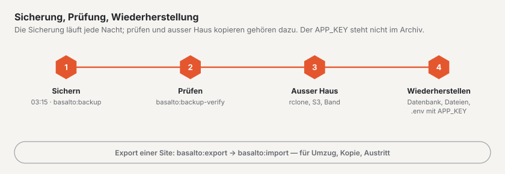

# Backup

Basalto sichert die ganze Installation jede Nacht, prüft die Sicherung auf Wunsch und spielt sie im Notfall zurück.
Für eine einzelne Site gibt es daneben den Export — für Umzug, Kopie oder Austritt.



Zwei Werkzeuge mit verschiedenem Zweck:

| | Sicherung | Export |
| --- | --- | --- |
| Befehl | `basalto:backup` | `basalto:export` |
| Umfang | ganze Installation: Datenbankabzug und Dateien aller Sites | eine Site: Inhalte, Medien, Einstellungen als JSON und Dateien |
| Zweck | Notfall: Server, Datenbank oder Speicher verloren | Umzug, Kopie, Austritt |
| Zurück | Datenbank zurückspielen, Dateien zurückkopieren | `basalto:import` |

## Sicherung

```sh
php artisan basalto:backup                          # nach storage/app/backups
php artisan basalto:backup --path=/srv/sicherung    # anderer Ordner
```

Das Archiv `basalto-backup-JJJJMMTT-HHMMSS.zip` (Zeit in UTC) enthält den Datenbankabzug, die Mediathek jeder Disk,
die Dateien aus Formularen und ein `manifest.json` mit SHA-256 und Grösse jeder Datei.

- **SQLite** wird über `VACUUM INTO` kopiert, **MariaDB/MySQL** mit `mariadb-dump` oder `mysqldump`, **PostgreSQL**
  mit `pg_dump`. Das Werkzeug muss zum Server passen. Liegt es nicht im Suchpfad, setzen Sie in der `.env`
  `BASALTO_BACKUP_MYSQL_DUMP` bzw. `BASALTO_BACKUP_PG_DUMP` auf den Pfad.
- **Nicht im Archiv:** die `.env` und damit der `APP_KEY`. Bewahren Sie ihn getrennt und sicher auf (Passwortmanager),
  nie neben dem Archiv — ohne denselben Schlüssel lassen sich verschlüsselte Spalten nicht lesen.
- Eine Sicherung auf derselben Platte schützt nur gegen Bedienfehler. Kopieren Sie das Archiv zusätzlich **ausser Haus**,
  zum Beispiel nach 03:15 mit `rclone copy storage/app/backups remote:basalto`.

### Zeitplan und Aufbewahrung

| Was | Wann oder wo |
| --- | --- |
| `basalto:backup` | täglich **03:15 UTC** über den Scheduler, nur auf einem Server (nach `basalto:cleanup` um 03:00, vor `basalto:media-purge` um 03:30) |
| «Backup jetzt» | von Hand unter **Verwaltung › Betrieb**; stösst denselben Befehl in der Warteschlange an |
| Aufbewahrung | nach jedem Lauf bleiben die neuesten Sicherungen im Ordner, Vorgabe **7**; einstellbar unter **Verwaltung › Einstellungen › Aufbewahrung › «Sicherungen behalten»** (`backup.keep`, 1 bis 365) |

Der Zeitplan braucht den Cron-Eintrag aus [Hosting](hosting.md). Den Stand der letzten Sicherung und Prüfung zeigt
Verwaltung › Betrieb.

## Prüfung

```sh
php artisan basalto:backup-verify                                   # neueste Sicherung im Standardordner
php artisan basalto:backup-verify --path=/srv/sicherung             # neueste Sicherung in diesem Ordner
php artisan basalto:backup-verify /srv/sicherung/basalto-backup-20261016-031500.zip
```

Geprüft werden Namen, Manifest, Grösse und SHA-256 jeder Datei. Bei SQLite spielt der Befehl die Datenbank in eine
temporäre Datei zurück (`PRAGMA integrity_check`, Zählprobe); bei MariaDB/MySQL und PostgreSQL liest er den Abzug auf
Vollständigkeit. Die echte Rückspielprobe in eine leere Datenbank ist dort ein Handgriff — mindestens vor jedem Update
und vierteljährlich.

## Wiederherstellen

Vorher: Wartungsmodus (`php artisan down`), Scheduler und Worker anhalten, die **aktuelle** Datenbank und den Speicher
zusätzlich sichern — falls die Wiederherstellung selbst schiefgeht.

1. **Archiv prüfen:** `php artisan basalto:backup-verify <archiv>` — nur mit «Wiederherstellung geprüft» weiter.
2. **Entpacken** in einen leeren Arbeitsordner: `mkdir /tmp/wieder && cd /tmp/wieder && unzip <archiv>`.
3. **Datenbank zurückspielen:**
   - SQLite: Anwendung anhalten, `cp database/database.sqlite <pfad aus DB_DATABASE>`.
   - MariaDB/MySQL: leere Datenbank anlegen und einspielen —
     `mariadb -h <host> -u <benutzer> -p -e "CREATE DATABASE basalto_neu CHARACTER SET utf8mb4 COLLATE utf8mb4_unicode_ci"`,
     dann `mariadb -h <host> -u <benutzer> -p basalto_neu < database/database.sql`; `DB_DATABASE` auf `basalto_neu`
     umstellen (oder die alte Datenbank leeren und dorthin einspielen).
   - PostgreSQL: `createdb basalto_neu`, dann `psql -h <host> -U <benutzer> -d basalto_neu -f database/database.sql`.
4. **Dateien zurückkopieren:** `files/<disk>/…` auf die gleichnamige Disk — lokal zum Beispiel
   `rsync -a files/local/ storage/app/private/`; bei S3 oder R2 `aws s3 sync files/s3/ s3://<bucket>/` bzw. `rclone copy`.
5. **`.env` und `APP_KEY`** der gesicherten Installation einsetzen — derselbe Schlüssel wie beim Sichern.
6. **Nacharbeiten:**

```sh
php artisan migrate --force                 # falls Basalto neuer ist als die Sicherung
php artisan optimize:clear
php artisan basalto:search-index
php artisan basalto:page-cache clear        # falls der Seiten-Cache eingeschaltet ist
php artisan basalto:page-cache warm
php artisan up
```

7. **Kontrolle:** `/up` meldet «bereit», die Anmeldung im Backend klappt, eine Seite mit Bildern und die Mediathek
   öffnen. Dann Scheduler und Worker wieder starten.

## Export und Import einer Site

```sh
php artisan basalto:export <handle>                         # nach storage/app/exports
php artisan basalto:export <handle> --path=/tmp/site.zip    # Datei oder Ordner
php artisan basalto:export <handle> --with-submissions      # mit Formulareingängen (Personendaten)
php artisan basalto:import /tmp/site.zip                    # unter dem Handle aus dem Export
php artisan basalto:import /tmp/site.zip --handle=kopie     # unter anderem Handle
```

Im Backend: **Verwaltung › Sites** › Site öffnen › **«Export herunterladen»** — für Betreiber der Site und Besitzer oder
Verwaltung ihres Kontos, ohne Formulareingänge.

### Was im Export steht

Das ZIP enthält `site.json` (Formatversion 1), `manifest.json` mit SHA-256 je Datei, die Mediendateien unter `media/`
und — mit `--with-submissions` — die Dateien der Eingänge unter `submissions/`. In `site.json` stehen die Site
(Handle, Name, Sprachen, Zeitzone, Theme, Einstellungen), Domains, Mitglieder mit Rolle (offene Einladungen als
«ausstehend»), Einstellungen, das Theme aus der Datenbank mit Entwürfen und Fassungen, Ordner und Angaben der Medien,
alle Inhalte mit ihren Fassungen je Sprache, Umleitungen, Menüs und Formulare. Verweise zwischen Inhalten, Medien und
Personen werden beim Import auf die neuen Kennungen umgeschrieben.

**Bewusst nicht dabei:** das Protokoll, die 404-Treffer, der Suchindex (er wird neu aufgebaut), API-Tokens, die
Kommentare, das Geheimnis der Webhooks von Formularen (nach dem Import im Backend neu erzeugen und dem Empfänger
mitteilen) und die Prüfsummen der IP-Adressen von Eingängen.

### Was der Import tut

Basalto prüft das Archiv vollständig (Pfade, Manifest, Prüfsummen, Formatversion) und legt die Site dann in **einem**
Schritt an; geht etwas schief, verschwinden auch die geschriebenen Dateien wieder. Personen mit Konto in der
Installation (gleiche E-Mail) werden Mitglied, für alle anderen entsteht eine Einladung **ohne Mail** — unter
«Benutzer» mit «Erneut senden» abschicken. Belegte Domains werden ausgelassen und gemeldet.

## Laravel Cloud

Auf Laravel Cloud gilt die Sicherung der Plattform: automatische Backups der Datenbank und — wenn Sie es einschalten —
Versionierung des Buckets. `basalto:backup` schreibt dort auf die flüchtige Platte der Instanz; nutzen Sie den Befehl
nur mit `--path` auf einen Speicher, der bleibt. Eine einzelne Site holen Sie nicht aus dem Plattform-Backup, sondern
über den Export.

## Weiter

- [Updates](updates.md)
- [Monitoring](monitoring.md)
- [Sites](../verwaltung/sites.md)
