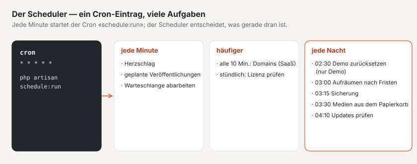

# Hosting

Basalto läuft bei einem **einfachen Hoster** mit PHP, Datenbank und einem Cron-Eintrag — oder auf **Laravel Cloud**
mit verwalteten Diensten. Beides ohne Redis und ohne dauernd laufenden Worker.

## Einfaches Hosting



1. Basalto auf den Server bringen und einrichten wie unter [Installation](installation.md) beschrieben.
2. Treiber in der `.env` auf die Datenbank stellen — das ist bereits die Vorgabe aus `.env.example`:

   ```dotenv
   DB_CONNECTION=mariadb
   CACHE_STORE=database
   SESSION_DRIVER=database
   QUEUE_CONNECTION=database
   ```

3. **Einen** Cron-Eintrag anlegen (Pfad anpassen):

   ```cron
   * * * * * cd /pfad/zu/basalto && php artisan schedule:run >> /dev/null 2>&1
   ```

4. Im Backend unter **Verwaltung › Betrieb** prüfen: `/up` meldet «bereit», der Herzschlag ist jünger als die
   Herzschlag-Schwelle (Vorgabe 5 Minuten, Verwaltung › Einstellungen › Betrieb), die Warteschlange läuft über den Cron.

### Warteschlange ohne Worker

Mails, Webhooks, Bildvarianten und das Vorwärmen des Seiten-Caches laufen über die Warteschlange. Ohne Worker
arbeitet sie der Scheduler ab: Jede Minute startet er

```sh
php artisan queue:work --stop-when-empty --max-time=50 --tries=3
```

ohne Überlappung und nur auf einem Server. Das geschieht, solange beide Bedingungen gelten:

- `QUEUE_CONNECTION=database` und
- `BASALTO_QUEUE_VIA_SCHEDULER` ist nicht gesetzt oder `true`.

Läuft ein eigener Worker (Supervisor, verwaltete Warteschlange), setzen Sie `BASALTO_QUEUE_VIA_SCHEDULER=false`. Mit einer
anderen Warteschlange als `database` plant Basalto `queue:work` ohnehin nicht ein. Welche Aufgaben der Scheduler sonst
ausführt, steht unter [Befehle](befehle.md#zeitplan-des-schedulers).

### Worauf Sie beim Hoster achten

- `schedule:run` startet jede Aufgabe als eigenen PHP-Prozess; der Hoster muss `proc_open` erlauben und einen Cron im
  Minutentakt zulassen.
- Für die tägliche Sicherung braucht der Server das Dump-Werkzeug der Datenbank, siehe [Backup](backup.md).
- Node.js brauchen Sie auf dem Server nicht: Das Release-Archiv bringt das gebaute Frontend mit.

### Webhosting mit LiteSpeed (etwa cyon)

- **Cron mit vollem PHP-Pfad:** Ohne Pfad startet der Cron die Vorgabe-Version des Servers, nicht die Ihrer Site:

  ```cron
  * * * * * cd /home/<login>/basalto && /opt/alt/php85/usr/bin/php artisan schedule:run >> /dev/null 2>&1
  ```

- **PHP-Version je Ordner:** LiteSpeed erbt die `.htaccess` nur eine Ebene tief. Liegt `public/` tiefer
  (`public_html/basalto/public`), braucht `public/.htaccess` die PHP-Version selbst. Der Web-Installer übernimmt sie aus
  der `.htaccess` darüber; Updates lassen `public/.htaccess` stehen.
- **Bestehende `.htaccess`:** Der Web-Installer hängt die Weiterleitung auf `public/` an, statt sie wegzulassen.
- **Updates ohne `proc_open`:** Ist `proc_open` im Browser abgeschaltet, nennt Verwaltung › Updates den Befehl für SSH:
  `/opt/alt/php85/usr/bin/php artisan basalto:update --kern`. Läuft PHP im Browser als `lsphp`, setzen Sie
  `BASALTO_PHP_BINARY=/opt/alt/php85/usr/bin/php`.
- **SQLite:** Basalto stellt SQLite auf WAL mit 5 Sekunden Wartezeit (`DB_JOURNAL_MODE`, `DB_BUSY_TIMEOUT`); die Datei
  liegt in `database/`, ausserhalb von `public/`, gesichert wird mit `VACUUM INTO`.
- **Mails:** Absender ist eine Adresse einer Domain auf demselben Hosting (SMTP über Port 465 oder 587); ein neues
  Hosting sendet in den ersten 30 Tagen höchstens 30 Mails pro Stunde.

## Gesundheit: `/up` und `/up/live`

| Adresse | Prüft | Antwort |
| --- | --- | --- |
| `/up` | Datenbank und Herzschlag des Schedulers (Readiness) | 200 «bereit» oder 503 «gestört», JSON ohne Geheimnisse |
| `/up/live` | nur den PHP-Prozess (Liveness) | 200 |

Eine frische Installation ohne ersten Herzschlag gilt erst nach der Schwelle als gestört. Mehr zur Überwachung steht
unter [Monitoring](monitoring.md).

## Laravel Cloud

Für Laravel Cloud gelten diese Einstellungen:

| Thema | Auf Laravel Cloud |
| --- | --- |
| Dateien | Medien im privaten Bucket (`FILESYSTEM_DISK=s3`); nichts auf der flüchtigen Platte |
| Cache, Sitzungen | Valkey (`CACHE_STORE=redis`, `SESSION_DRIVER=redis`), eigener Cache je Umgebung |
| Warteschlange | verwaltete Warteschlange oder `database`; mit eigenem Worker `BASALTO_QUEUE_VIA_SCHEDULER=false` |
| Build | `composer install --no-dev --no-interaction --prefer-dist --optimize-autoloader` · `php artisan vendor:publish --tag=basalto-assets --force` · `npm ci --audit false` · `npm run build` |
| Deploy-Befehl | `php artisan migrate --force` |
| Scheduler | im App-Cluster einschalten; alle Aufgaben laufen `onOneServer` |
| Eigene Domains der Kunden (nur SaaS) | `basalto:domains-verify` alle zehn Minuten über die Cloud-CLI (`BASALTO_CLOUD_ENVIRONMENT`, `LARAVEL_CLOUD_TOKEN` als Secret) |

Laravel Cloud baut das neue Release und führt die Migrationen aus, bevor es umschaltet — eine Weile bedient der alte
Code das neue Schema. Eigene Migrationen (etwa in Modulen) folgen deshalb der Regel «erst erweitern, später aufräumen»:
eine neue Spalte zuerst hinzufügen und füllen, die alte erst in einem späteren Release entfernen.

Plattform-Backups der Datenbank und die Versionierung des Buckets schalten Sie in Laravel Cloud ein; die Sicherung von
Basalto kommt dazu, siehe [Backup](backup.md).

## Öffentliche Demo

Eine Installation kann als öffentliche Demo laufen: mit `BASALTO_DEMO=true` — nie zusammen mit Daten, die bleiben
sollen.

- **Einrichten:** mit dem Web-Installer, unter «Erweitert» «Als öffentliche Demo einrichten» — der Installer schreibt
  `BASALTO_DEMO=true` und führt direkt auf die Funktionsschau.
- **Schnellzugang:** Die Anmeldeseite zeigt drei Knöpfe «Als Betreiber/Redaktion/Übersetzung ansehen», die ohne
  Passwort und Code anmelden. Ohne den Schalter gibt es weder die Knöpfe noch die Adresse dahinter.
- **Mails abgefangen:** Jede Mail wird vor dem Versand angehalten und nur protokolliert (Mailer `log`, änderbar mit
  `BASALTO_DEMO_MAILER`); das Backend zeigt das Band «Demo — Daten werden jede Nacht zurückgesetzt, Mails werden nicht
  versendet».
- **Nächtlich neu:** Der Scheduler ruft um 02:30 `basalto:demo-reset --force` auf — Datenbank leeren und frisch
  migrieren, Medien leeren, Site `BASALTO_DEMO_SITE` (Vorgabe `demo`) mit den Startinhalten von `BASALTO_DEMO_THEME`
  (Vorgabe `starter`) einspielen und live schalten, drei Konten anlegen.
- **Funktionsschau:** Zur Demo gehört die Seite `/funktionen` mit einer Unterseite je Bereich — was er kann, was man
  probieren kann, und ein Weg ins Backend über den Schnellzugang direkt an die Stelle.
- Die Domain der Demo-Site ist der Host aus `APP_URL`; `BASALTO_DEFAULT_SITE=demo` lässt auch andere Hosts dorthin.

## Weiter

- [Installation](installation.md)
- [Monitoring](monitoring.md)
- [Befehle](befehle.md)
