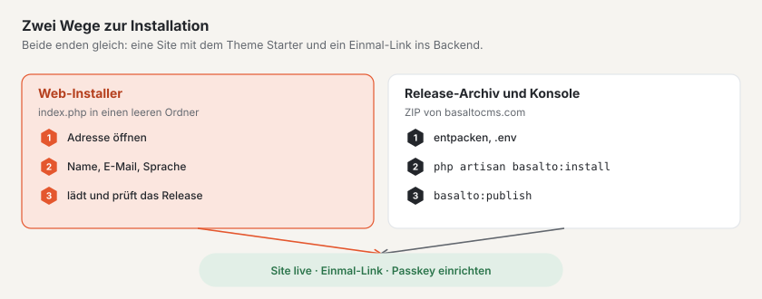

# Installation

Basalto läuft auf jedem Webspace mit PHP 8.4 — ohne Redis, ohne Worker, mit SQLite sogar ohne eigene Datenbank. Diese
Seite beschreibt die Voraussetzungen, die zwei Wege zur Installation und die Schlüssel der `.env`.



## Voraussetzungen

| Was | Wert |
| --- | --- |
| PHP | 8.4 oder neuer |
| PHP-Erweiterungen | `pdo_sqlite`, `pdo_mysql` oder `pdo_pgsql` je nach Datenbank, `mbstring`, `intl`, `gd` (Bildvarianten), `zip` (Export, Sicherung, Theme-Pakete), `sodium` (Lizenz und Signaturen) |
| Datenbank | SQLite, MariaDB 11.4, MySQL 8.4 oder PostgreSQL 18 |
| Webserver | Dokumentwurzel auf `public/`, HTTPS |
| Cron | ein Eintrag für den Scheduler, siehe [Hosting](hosting.md) |
| Nicht nötig | Redis/Valkey, Queue-Worker, Node.js, Mail-Server für die erste Anmeldung |

Für die Sicherung brauchen Sie ausserdem das Dump-Werkzeug der Datenbank (`mariadb-dump`, `mysqldump` oder
`pg_dump`), siehe [Backup](backup.md).

## Weg 1: der Web-Installer

Für alle, die eine Website wollen und kein Terminal brauchen. Schritt für Schritt mit Bildern steht er unter
[Basalto installieren](../einstieg/installieren.md); hier das Wichtigste für den Betrieb:

1. Den Installer von basaltocms.com unter **Download** holen — eine einzige Datei `index.php`.
2. Sie in einen **leeren** Ordner legen und die Adresse im Browser öffnen.
3. **Name der Website**, **E-Mail** und **Sprache** angeben, «Installieren».

Der Installer prüft PHP und die Erweiterungen, lädt das aktuelle Release, prüft dessen **Ed25519-Signatur** und
Prüfsumme, entpackt, schreibt die `.env` (neuer Anwendungsschlüssel, SQLite, Adresse aus dem Browser), migriert, legt
die Site mit dem Starter-Theme und der Domain aus der Adresse an, veröffentlicht die Startinhalte und meldet Sie mit
einem Einmal-Link im Backend an. Danach löscht er sich selbst.

- **Erweitert:** MariaDB/MySQL oder PostgreSQL statt SQLite, Lizenzschlüssel gleich mitgeben.
- **Nur in einen leeren Ordner** (erlaubt sind Dateien, die Hoster selbst anlegen: `.htaccess`, `.user.ini`,
  `.well-known`, `cgi-bin`, `error_log`).
- **Wer zuerst kommt:** Der erste Browser bekommt die Installation; ein zweiter sieht «läuft bereits». Neu beginnen:
  die Datei `.basalto-install.json` im Ordner löschen.
- **Webserver beginnt im Hauptordner statt in `public/`:** Der Installer legt eine `.htaccess` an, die alles über
  `public/` leitet (Apache). Bei nginx die Wurzel auf `public/` setzen.

## Weg 2: Release-Archiv und Konsole

Für Server mit Konsole, für Skripte und für Laravel Cloud. Das Archiv enthält alles, was Basalto braucht — auch
`vendor/` und das gebaute Frontend; Composer und Node sind auf dem Server nicht nötig.

1. Das aktuelle Archiv holen. Welche Datei aktuell ist, steht in `https://basaltocms.com/_download/latest.json`
   (Feld `file`, dazu `sha256` und die Signatur); die Datei liegt unter `https://basaltocms.com/_download/<file>`.
2. Prüfsumme vergleichen und entpacken:

```sh
curl -fsSO https://basaltocms.com/_download/basalto-1.2.0.zip
sha256sum basalto-1.2.0.zip          # mit «sha256» aus latest.json vergleichen
unzip basalto-1.2.0.zip -d meine-site && cd meine-site
cp .env.example .env
php artisan key:generate
# .env bearbeiten: APP_ENV, APP_DEBUG, APP_URL, Datenbank, Mail (siehe unten)
```

3. Installieren:

```sh
php artisan basalto:install
```

Der Installer migriert die Datenbank, fragt nach Handle und Name der Site sowie nach E-Mail und Name des ersten Kontos
und gibt einen **Einmal-Link** zur ersten Anmeldung aus (60 Minuten gültig, nur einmal verwendbar) — ohne Passwort und
ohne Mail-Server. Das erste Konto wird Betreiber der Site. Er läuft mehrfach gefahrlos; Vorhandenes bleibt.

Ohne Rückfragen, etwa in einem Skript:

```sh
php artisan basalto:install --no-interaction --site=meine-site --name="Meine Site" \
  --email=redaktion@example.ch --locale=de --timezone=Europe/Zurich
```

Weitere Optionen: `--user` (Name des Kontos), `--minutes` (Gültigkeit des Links, Vorgabe 60).

Nach der Anmeldung richten Sie im Backend einen Passkey ein (Übersicht › «Passkey einrichten»). Einen neuen
Einmal-Link gibt jederzeit:

```sh
php artisan basalto:login-link redaktion@example.ch              # 15 Minuten gültig
php artisan basalto:login-link redaktion@example.ch --minutes=60
```

### Installer im Browser auf einem vorbereiteten Server

Ohne Konsole führt der Installer im Browser durch dieselben Schritte (Datenbank › Site › Konto › Fertig). Er liegt
unter `/<BASALTO_BACKEND_PATH>/installieren`, in der Vorgabe also `/admin/installieren`, und zeigt am Ende den
Einmal-Link.

- Den Installer gibt es nur, solange nichts eingerichtet ist; danach antwortet die Adresse mit 404.
- Ist der Server schon öffentlich erreichbar, bevor jemand installiert, setzen Sie **`BASALTO_INSTALL_TOKEN`** in der
  `.env` auf einen langen Zufallswert und rufen den Installer mit `/admin/installieren?token=<wert>` auf. Ohne
  passendes Token antwortet er mit 404.

## Die erste Site live schalten

In der `.env`:

```dotenv
BASALTO_DEFAULT_THEME=starter
BASALTO_DEFAULT_SITE=meine-site
```

Dann:

```sh
php artisan basalto:publish meine-site --dry-run   # nur prüfen, nichts schreiben
php artisan basalto:publish meine-site             # Startinhalte einspielen, prüfen, vorwärmen, live schalten
```

`basalto:publish` spielt die Startinhalte des Themes ein (`--ohne-seed` lässt sie weg), prüft Links, Bilder,
Alt-Texte, Pflichtsprachen, Rechtsseiten, Formulare und Umleitungen, wärmt den Seiten-Cache vor und schaltet die Site
live — oder lehnt mit Grund ab. Impressum und Datenschutzerklärung legen Sie aus einer Vorlage als Entwurf an:

```sh
php artisan basalto:legal meine-site impressum
php artisan basalto:legal meine-site datenschutz
```

`BASALTO_DEFAULT_SITE` gilt für jeden Host ohne eigenen Eintrag. Die Domains einer Site tragen Sie im Backend unter
**Verwaltung › Sites** ein.

## Wichtige `.env`-Schlüssel

### Laravel

| Schlüssel | Vorgabe in `.env.example` | Für den Betrieb |
| --- | --- | --- |
| `APP_ENV` | `local` | `production` |
| `APP_DEBUG` | `true` | `false` |
| `APP_KEY` | leer | `php artisan key:generate`; getrennt aufbewahren (siehe [Backup](backup.md)) |
| `APP_URL` | `http://localhost:8000` | öffentliche Adresse mit HTTPS |
| `APP_LOCALE`, `APP_FALLBACK_LOCALE` | `de`, `en` | Sprache der Oberfläche |
| `DB_CONNECTION`, `DB_HOST`, `DB_PORT`, `DB_DATABASE`, `DB_USERNAME`, `DB_PASSWORD` | `sqlite` | `mariadb`, `mysql`, `pgsql` oder `sqlite` |
| `CACHE_STORE`, `SESSION_DRIVER`, `QUEUE_CONNECTION` | `database` | `database` genügt; auf Laravel Cloud Valkey (`redis`) |
| `FILESYSTEM_DISK` | `local` | `local` oder `s3` (Bucket, mit `AWS_*`) |
| `MAIL_MAILER`, `MAIL_HOST`, `MAIL_PORT`, `MAIL_USERNAME`, `MAIL_PASSWORD`, `MAIL_FROM_ADDRESS` | `log` | echter Versand für Anmeldecodes, Einladungen, Formulare und Fehleralarm |

Mails tragen Kopf und Fuss der Site, zu der die Empfängerin gehört (ohne Site: die Site des Herstellers): oben der
Name der Site, unten die Anbieterzeilen aus dem globalen Inhalt «Fuss» des Themes (Felder `brand`, `owner`, `street`,
`city`, `country`, `vat`) und Links auf die Rechtsseiten aus `publish.legal`. Farben und Schrift stehen im Mail-Theme
`basalto` (`packages/core/resources/views/mail/html/themes/basalto.css`).

### Basalto

Die Schlüssel liest `config/basalto.php` des Kerns (`packages/core/config/basalto.php`). Nicht alle stehen in
`.env.example`; die übrigen setzen Sie nur bei Bedarf.

| Schlüssel | Vorgabe | Wozu |
| --- | --- | --- |
| `BASALTO_BACKEND_PATH` | `admin` | Pfad des Backends |
| `BASALTO_DEFAULT_SITE` | leer | Site für Hosts ohne Eintrag in den Domains |
| `BASALTO_DEFAULT_THEME` | siehe Text | Theme-Ordner unter `themes/`, wenn eine Site keines nennt; setzen Sie `starter` (nicht in `.env.example`) |
| `BASALTO_THEMES_PATH` | `themes/` der Installation | anderer Ordner für Datei-Themes (nicht in `.env.example`) |
| `BASALTO_INSTALL_TOKEN` | leer | schützt den Installer im Browser (nicht in `.env.example`) |
| `BASALTO_PAGE_CACHE` | an, ausser bei `APP_ENV=local` | Seiten-Cache ein- oder ausschalten (nicht in `.env.example`) |
| `BASALTO_PAGE_CACHE_STORE` | Standard-Store | eigener Cache-Store für den Seiten-Cache (nicht in `.env.example`) |
| `BASALTO_MEDIA_QUOTA_MB` | unbegrenzt | Speicherkontingent je Site in MB (nicht in `.env.example`) |
| `BASALTO_PASSWORD_LOGIN` | `false` | Anmeldung mit Passwort für Installationen ohne Mail (nicht in `.env.example`) |
| `BASALTO_PHP_BINARY` | PHP dieses Prozesses | PHP für die Schritte eines Updates, etwa `/opt/alt/php85/usr/bin/php` unter LiteSpeed, siehe [Hosting](hosting.md) (nicht in `.env.example`) |
| `BASALTO_QUEUE_VIA_SCHEDULER` | `true` | Scheduler arbeitet die Datenbank-Warteschlange ab, siehe [Hosting](hosting.md) (nicht in `.env.example`) |
| `BASALTO_BACKUP_MYSQL_DUMP`, `BASALTO_BACKUP_PG_DUMP` | Suchpfad | Pfad zum Dump-Werkzeug, siehe [Backup](backup.md) (nicht in `.env.example`) |
| `BASALTO_LICENSE_KEY` | leer | Lizenzschlüssel, siehe [Lizenz](lizenz.md) |
| `BASALTO_LICENSE_BANNER_DAYS` | `30` | Tage «unregistriert» bis zur Fussleiste im Frontend |
| `BASALTO_LICENSE_PUBLIC_KEY` | Produktschlüssel im Kern | nur für Tests und eigene Ausstellungen; die leere Zeile aus `.env.example` entfernen, siehe [Lizenz](lizenz.md) |
| `BASALTO_DEPLOYED_AT` | leer | Zeitpunkt der letzten Auslieferung, erscheint unter Verwaltung › Betrieb |
| `BASALTO_ALIAS_DOMAIN` | `basaltocms.com` | Alias-Zone der SaaS (nur Laravel Cloud) |
| `BASALTO_CLOUD_ENVIRONMENT`, `BASALTO_CLOUD_BINARY`, `LARAVEL_CLOUD_TOKEN` | leer, `vendor/bin/cloud`, leer | Kundendomains über die Cloud-CLI (nur Laravel Cloud); das Token nur als Secret, nie in einer Datei |

Für Pulse und Nightwatch siehe [Monitoring](monitoring.md).

## Weiter

- [Hosting](hosting.md)
- [Backup](backup.md)
- [Befehle](befehle.md)
