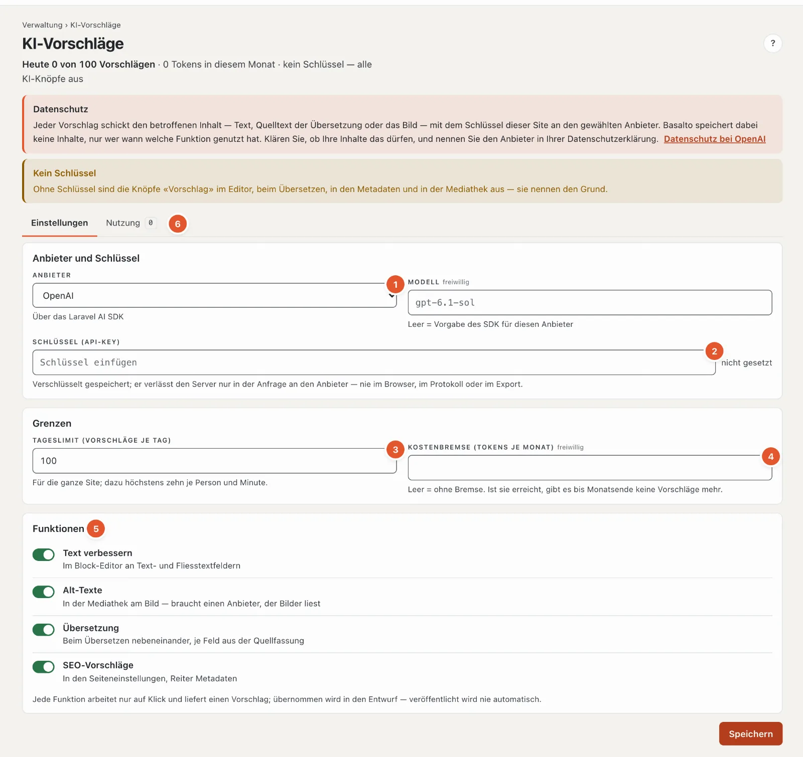

# KI-Vorschläge einrichten

Das Modul schlägt der Redaktion mit dem **Schlüssel des Kunden** vor: Text verbessern, Alt-Texte aus dem Bild,
Übersetzung je Feld und SEO-Angaben (Seitentitel, Beschreibung). Es arbeitet über das
[Laravel AI SDK](https://laravel.com/docs/ai-sdk) (`laravel/ai`) und ruft den Anbieter direkt aus der Installation an.

Es gilt für eigene Installationen und die SaaS gleich.

## Grundsätze

- **Nur auf Klick, immer ein Vorschlag.** Kein Aufruf im Hintergrund, keiner beim Laden einer Seite, kein Job. Die
  Antwort ist ein Vorschlag; «Übernehmen» legt ihn ins Feld, und das Autosave schreibt in den **Entwurf** — nie in eine
  veröffentlichte Fassung. Einzige Ausnahme: Alt-Texte gelten mit dem Speichern sofort (Medien haben keine Fassungen);
  die Übernahme steht im Protokoll (`ai.alt_text.applied`).
- **Der Schlüssel gehört dem Kunden** und ist je Site hinterlegt. Er liegt **verschlüsselt** mit dem `APP_KEY` in
  `ai_settings.api_key`, geht nie an den Browser (die Oberfläche zeigt nur «gesetzt ✓ · …1234»), nie ins Protokoll
  und nicht in den Export einer Site. Nach einem Umzug oder einem neuen `APP_KEY` tragen Sie ihn neu ein.
- **Jede Nutzung steht im Protokoll** (`ai_usages`): Site, Benutzer, Funktion, Inhalt oder Medium, Sprache, Anbieter,
  Modell, Tokens (wenn der Anbieter sie meldet), Erfolg oder Fehlerart, übernommen ja/nein. **Ohne** Text, Prompt,
  Antwort und Schlüssel. Fehlermeldungen des Anbieters kommen nicht ins Log, nur ihre Art (`rate_limited`, `auth` …).
- **Ab Werk aus.** Einschalten unter **Verwaltung › Sites › Site bearbeiten › Reiter «Module»** › «KI-Vorschläge».

## Einrichten

1. Modul für die Site einschalten (siehe oben).
2. **Verwaltung › KI-Vorschläge** (`/admin/ki`) — nur Betreiber und Administration der Site (bzw. Besitzer und
   Verwaltung des Kontos):
   - **Anbieter** wählen: OpenAI, Anthropic (Claude), Google Gemini, Mistral AI, xAI (Grok), DeepSeek, Groq oder
     OpenRouter. Alt-Texte brauchen einen Anbieter, der Bilder liest; bei DeepSeek und Groq ist die Funktion aus.
   - **Modell** — leer heisst: die Vorgabe des SDK für diesen Anbieter (steht als Platzhalter im Feld). Ein eigenes
     Modell (etwa ein günstigeres) tragen Sie mit seinem Namen beim Anbieter ein.
   - **Schlüssel** (API-Key) einfügen und speichern. Leer lassen behält den bisherigen; «Schlüssel entfernen» schaltet
     alle KI-Knöpfe der Site aus.
   - **Tageslimit** (Vorschläge je Tag für die ganze Site, Vorgabe 100) und **Kostenbremse** (Tokens je Monat, leer =
     ohne). Dazu gilt fest: höchstens zehn Vorschläge je Person und Minute.
   - **Funktionen** einzeln ein- oder ausschalten.
3. Einmal im Editor «✦ Text verbessern» probieren. Kommt eine Meldung statt eines Vorschlags, nennt sie den Grund
   (Schlüssel abgelehnt, Guthaben aufgebraucht, Anbieter überlastet, Modell unbekannt).

Jede Änderung der Einstellung steht im Protokoll des Kerns (`ai.settings.changed`, vom Schlüssel nur «neu gesetzt»).

## Datenschutz

**Inhalte gehen an den Anbieter.** Jeder Vorschlag schickt den betroffenen Inhalt mit dem Schlüssel der Site an den
gewählten Anbieter: den Text eines Felds, den Quelltext einer Übersetzung, den Text einer Seite (SEO) oder das Bild
(Alt-Texte; die grösste Variante bis 1600 px, sonst das Original bis 8 MB). Die Oberfläche sagt das an jeder Stelle:
auf der Einstellungsseite als Hinweis mit Link zur Datenschutzerklärung des Anbieters und in jedem Vorschlagsfenster
mit dem Namen des Anbieters.

Was Sie klären sollten:

- **Auftragsverarbeitung:** Mit dem Anbieter besteht das Vertragsverhältnis des Kunden (sein Schlüssel, sein Konto).
  Prüfe dessen Bedingungen zu Speicherung und Training mit Eingaben; viele Anbieter bieten für API-Zugänge eine
  Einstellung ohne Training und mit kurzer Aufbewahrung.
- **Standort:** Mehrere Anbieter verarbeiten in den USA. Für Personendaten in Texten gelten die Regeln zur Übermittlung
  ins Ausland (revDSG, DSGVO).
- **Datenschutzerklärung der Site:** Den Anbieter nennen, wenn Inhalte mit Personendaten bearbeitet werden.
- **Redaktion schulen:** Nichts Vertrauliches vorschlagen lassen; die Redaktions-Hilfe ([KI-Vorschläge](../redaktion/ki.md))
  sagt es auch.

## Gateway oder Proxy

Läuft der Verkehr zum Anbieter über ein Gateway (Firmen-Proxy, EU-Endpunkt), setzen Sie die Basis-URL für die ganze
Installation in der `.env` — dieselben Schlüssel wie im SDK, z. B. `OPENAI_URL`, `ANTHROPIC_URL`, `GEMINI_URL`. Das
Modul übernimmt sie für jede Site; der Schlüssel bleibt der der Site.

## Sicherheit

- Eingaben sind begrenzt: höchstens 12'000 Zeichen je Vorschlag; Fliesstext mit Bildern, Tabellen, Aufgaben oder
  Einbettungen geht nicht an den Anbieter (die Teile gingen verloren).
- Ausgaben werden gesäubert: Fliesstext kommt als Markdown zurück und geht durch den Umwandler des Kerns (rohes HTML
  fällt weg, Links nur mit http(s), mailto, tel oder relativ); Klartext ohne HTML und Steuerzeichen, auf die Länge des
  Felds gekürzt.
- Rechte wie beim Bearbeiten: Text verbessern und SEO verlangen «Inhalte bearbeiten», Übersetzen das Recht am Inhalt,
  Alt-Texte das Recht an der Mediathek. Fremde Sites sehen und nutzen nichts.

## Nutzung und Kosten

**Verwaltung › KI-Vorschläge › Nutzung** zeigt je Monat (die letzten zwölf) die Zahl der Vorschläge, davon übernommen
und gescheitert, die Tokens und die Verteilung auf die Funktionen, dazu die letzten 50 Aufrufe mit Person, Funktion,
Inhalt, Modell, Tokens und Ergebnis. Abgerechnet wird beim Anbieter, auf dem Konto des Kunden — Basalto rechnet nichts ab.

## Tabellen

| Tabelle | Inhalt | Export einer Site |
| --- | --- | --- |
| `ai_settings` | je Site Anbieter, Modell, Schlüssel (verschlüsselt), Tageslimit, Kostenbremse, Schalter | nein — Geheimnis |
| `ai_usages` | Nutzungsprotokoll ohne Inhalte | nein — Protokoll der Quellinstallation |

## Fehlerbilder

| Meldung | Ursache | Abhilfe |
| --- | --- | --- |
| «… hat den Schlüssel abgelehnt» | Schlüssel falsch, gesperrt oder ohne Recht aufs Modell | neuen Schlüssel beim Anbieter erzeugen und eintragen |
| «… ist das Guthaben aufgebraucht» | Prepaid-Guthaben leer | beim Anbieter aufladen |
| «… bremst gerade» | Rate-Limit des Anbieters | später noch einmal; ggf. höhere Stufe beim Anbieter |
| «… hat die Anfrage nicht angenommen — stimmt das Modell?» | Modellname unbekannt oder ohne Bildeingabe | Modell leeren (Vorgabe des SDK) oder korrigieren |
| «Das Tageslimit … ist erreicht» | Tageslimit der Site | Limit erhöhen oder bis morgen warten |
| «Die Kostenbremse … ist erreicht» | Tokens des Monats über der Grenze | Grenze erhöhen oder leeren |
| Knöpfe grau «(KI aus)» | kein Schlüssel oder Funktion aus | Einstellung prüfen |

## Weiter

- [KI-Vorschläge](../redaktion/ki.md)
- [Verwaltung](../verwaltung/README.md)
