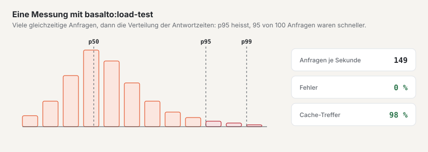

# Lasttest

`php artisan basalto:load-test` ruft Adressen gleichzeitig ab und meldet Anfragen je Sekunde, p50/p95/p99, Fehler,
Statuscodes und Treffer des Seiten-Caches (Kopfzeile `X-Basalto-Cache: HIT`). Er braucht kein weiteres Paket und
eignet sich für die eigene Instanz — fremde Hosts verweigert er ohne `--remote`.

| Option | Bedeutung |
| --- | --- |
| `url…` | eine oder mehrere Adressen, reihum abgerufen |
| `--concurrency` | gleichzeitige Anfragen (Vorgabe 10) |
| `--duration` | Dauer in Sekunden (Vorgabe 30), wenn `--requests` 0 ist |
| `--requests` | feste Zahl Anfragen statt einer Dauer |
| `--max-p95` | Ziel für p95 in ms — überschritten heisst Exit 1 |
| `--max-errors` | höchste Fehlerquote in Prozent (Vorgabe 1) — überschritten heisst Exit 1 |
| `--remote` | Hosts ausserhalb von `localhost`, `*.test`, `*.localhost` — nur eigene Instanzen |
| `--json` | Ergebnis als JSON (für Protokolle) |

## Eine Instanz messen

So prüfen Sie, ob eine Installation die erwarteten Spitzen trägt — am besten auf einer Kopie, nie auf einer Instanz
mit Kundendaten:

1. Mit Testdaten füllen: `php artisan basalto:benchmark --sites=100 --entries=1000` legt Sites `bench-n` an;
   `--clean` räumt sie wieder weg.
2. **Kalt** (nach einer Pause, etwa wenn die Instanz zwischen Anfragen schläft) einmal mit `--requests=1` messen und die
   Zeit notieren.
3. **Warm, mit Seiten-Cache:**
   `php artisan basalto:load-test https://bench-1.ihre-domain.ch/ https://bench-2.ihre-domain.ch/ --remote --concurrency=30 --duration=300 --max-p95=300 --json`
4. **Ohne Cache:** dieselbe Messung mit Seiten, die der Cache nicht hält — mit Formular oder Suche, etwa `/kontakt`
   und `/suche?q=…`.
5. Ergebnis mit Datum, Grösse der Instanz und Version festhalten; zum Schluss `--clean`.

**Richtwerte:** p95 unter 300 ms bei 30 gleichzeitigen Anfragen mit Seiten-Cache, unter 800 ms ohne; Fehlerquote
unter 1 %.

## Weiter

- [Hosting](hosting.md)
- [Monitoring](monitoring.md)
- [Befehle](befehle.md)
