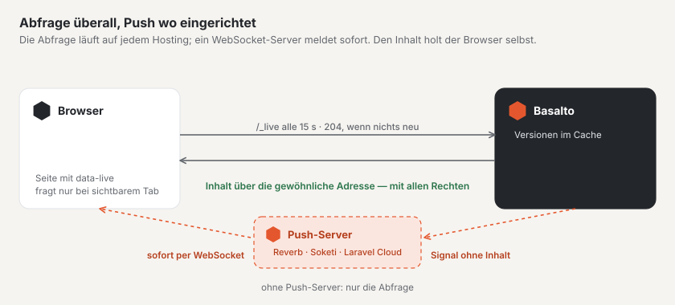

# Live-Aktualisierung einrichten

Basalto meldet Neues ohne Neuladen — im Forum (Beiträge, Themenlisten, Konversationen, Zähler) und an der Glocke im
Backend. Grundlage ist eine sparsame **Abfrage**, die auf jedem Hosting läuft und nichts braucht. Wo ein
**WebSocket-Server** nach dem Pusher-Protokoll läuft, kommt dieselbe Meldung sofort per **Push**; fällt er aus,
übernimmt die Abfrage.

## Abfrage

Seiten, die Neues erwarten, fragen alle 15 Sekunden unter `/_live` nach, ob sich etwas geändert hat — nur solange ihr
Tab sichtbar ist, sofort beim Zurückkehren in den Tab und nach Fehlern mit längeren Pausen.

- Ohne Änderung antwortet Basalto mit `204` und ohne Inhalt; gelesen werden nur Versionen aus dem Cache. Die Abfrage
  startet keine Sitzung und setzt keine Cookies.
- Die Seiten des Forums kommen für Gäste weiter aus dem Seiten-Cache; die Abfrage ist eine eigene Adresse.
- Was eine Seite beobachten darf, steht mit Unterschrift in der Seite selbst; persönliche Zähler gibt es nur in
  persönlichen Seiten.

| Einstellung | Bedeutung | Vorgabe |
| --- | --- | --- |
| `BASALTO_LIVE_INTERVAL` | Takt der Abfrage in Sekunden (mindestens 5) | `15` |
| `BASALTO_LIVE_RATE` | Abfragen je Minute und Adresse — auch für viele Tabs hinter einer gemeinsamen Adresse | `600` |

Der Cache sollte ein gemeinsamer Speicher sein (Redis, Valkey oder Datenbank), wenn mehrere Server die Site
ausliefern — sonst sieht jeder Server nur seine eigenen Versionen.

## Push

Push braucht einen WebSocket-Server, der das Pusher-Protokoll spricht: **Laravel Reverb** (in Laravel Cloud als
verwalteter Dienst oder als eigene kleine Anwendung auf Ihrem Server) oder **Soketi**. Basalto sendet ein Signal ohne
Inhalt an den Server; der Browser meldet sich über `/_live/auth` am Kanal an, ohne Sitzung — auch Gäste.

| Variable | Bedeutung |
| --- | --- |
| `REVERB_APP_ID`, `REVERB_APP_KEY`, `REVERB_APP_SECRET` | Anwendung, öffentlicher Schlüssel und Geheimnis beim Server |
| `REVERB_HOST`, `REVERB_PORT`, `REVERB_SCHEME` | wo der Browser den Server erreicht (etwa `ws.example.ch`, `443`, `https`) |
| `BASALTO_LIVE_PUSH_SERVER_HOST`, `…_PORT`, `…_SCHEME` | wo Basalto den Server erreicht, wenn das anders ist (etwa intern ohne TLS) — leer heisst gleich |
| `BASALTO_LIVE_PUSH` | `false` schaltet Push ab, auch wenn alles gesetzt ist |

Sind Anwendung, Schlüssel, Geheimnis und Host gesetzt, ist Push eingeschaltet. Echo und `pusher-js` lädt der Browser
nur dann; das Geheimnis verlässt den Server nie.

### Laravel Cloud

Hängen Sie der Umgebung einen **WebSocket-Cluster** an. Laravel Cloud setzt die `REVERB_…`-Variablen selbst; nach
dem nächsten Deploy ist Push eingeschaltet.

### Eigener Server

Betreiben Sie Reverb oder Soketi als eigenen Dienst neben Basalto (unter einem Prozess-Manager wie Supervisor),
leiten Sie `wss://` über Ihren Webserver an ihn weiter und tragen Sie dieselben Zugangsdaten in beide Seiten ein.
Basalto braucht dafür kein zusätzliches Paket — es spricht das Protokoll selbst.

### Einfaches Hosting

Ohne eigenen Prozess gibt es keinen WebSocket-Server. Die Abfrage trägt dann alles; Neues erscheint nach höchstens
einem Takt.

## Prüfen

Unter **Verwaltung › Betrieb** zeigt die Karte **«Live-Aktualisierung»** den Takt, die Grenze je Adresse und ob Push
eingerichtet und erreichbar ist. Ist der Server nicht erreichbar, steht das dort in Rot — das Forum funktioniert
weiter über die Abfrage.

## Weiter

- [Live-Aktualisierung](../community/live.md)
- [Monitoring](monitoring.md)
- [Hosting](hosting.md)
