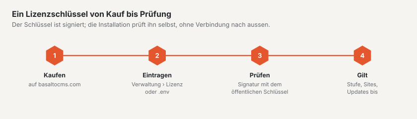

# Lizenz

Basalto ist **source-available**: Der Code ist öffentlich, die Nutzung regelt der Basalto-Lizenzvertrag. Sie lesen
ihn im Backend unter `/admin/recht/lizenzvertrag` und öffentlich unter `/_recht/de/lizenzvertrag`. Diese Seite zeigt
die Stufen und wie Sie einen Schlüssel eintragen und prüfen.



## Stufen

| Stufe | Kurz |
| --- | --- |
| **Free** | ohne Schlüssel: eine Site, ein Backend-Benutzer, alle Module; für Entwicklung, Tests und Privates |
| **Site** | eine Produktions-Domain, bis zu drei Sites in einer Installation; neue Versionen ein Jahr ab Kauf |
| **Agentur** | alle Sites und Installationen für Sie und Ihre Kunden; Unterlizenz-Schlüssel je Kunde, auf Wunsch ohne Marke Basalto im Backend |

Massgeblich sind §§ 3 bis 5 des Lizenzvertrags.

## Wie Basalto die Lizenz prüft

- **Offline.** Der Schlüssel ist mit Ed25519 signiert und wird gegen den öffentlichen Produktschlüssel im Kern geprüft —
  ohne Aufruf nach Hause.
- **Nie gesperrt.** Überschreitet eine Installation ihre Stufe (mehr Benutzer, mehr Sites, Domain nicht im Schlüssel),
  gilt sie als «unregistriert». Basalto zeigt dann Hinweise, sperrt aber keine Funktion.
- **Fussleiste nach 30 Tagen.** Ist eine Installation länger als `BASALTO_LICENSE_BANNER_DAYS` Tage (Vorgabe 30)
  unregistriert, zeigt das Frontend eine Fussleiste. Ab wann, steht unter Verwaltung › Lizenz.
- **Update-Anspruch.** Ist er abgelaufen, läuft die Software weiter; neue Versionen brauchen eine Verlängerung.
- Der Scheduler führt den Stand stündlich mit `basalto:license` nach.

## Schlüssel eintragen

Zwei Wege — der Eintrag im Backend hat Vorrang vor der `.env`:

1. **Verwaltung › Lizenz:** Schlüssel einfügen, prüfen, eintragen. Ein ungültiger Schlüssel wird nicht eingetragen.
   Die Seite zeigt Stufe, Stand, Grenzen und Hinweise.
2. **`.env`:**

   ```dotenv
   BASALTO_LICENSE_KEY=<schlüssel>
   ```

> **Achtung:** `.env.example` enthält die leere Zeile `BASALTO_LICENSE_PUBLIC_KEY=`. Ein leerer Wert überschreibt den
> Produktschlüssel im Kern, und Basalto kann dann keinen Schlüssel prüfen («Kein öffentlicher Lizenzschlüssel
> konfiguriert»). Entfernen Sie die Zeile oder kommentieren Sie sie aus; setzen müssen Sie sie nur für
> Tests und eigene Ausstellungen.

## Mit dem Kundenkonto verbinden

Wer eine Lizenz auf basaltocms.com gekauft hat, sieht Schlüssel, Rechnungen und Marktplatz-Käufe direkt im eigenen
Backend — auf basaltocms.com bleibt nur der Kauf. Unter **Verwaltung › Lizenz › Kundenkonto beim Hersteller**
(nur Betreiber):

1. **E-Mail-Adresse** des Kundenkontos eingeben → **Code anfordern**. basaltocms.com schickt einen sechsstelligen Code
   an diese Adresse — nur, wenn es dort ein Kundenkonto gibt; die Antwort im Backend ist in beiden Fällen dieselbe.
   Die Mail nennt den Host dieser Installation.
2. **Code** eingeben → **Verbinden**. Die Installation erhält ein Token und speichert es verschlüsselt (mit dem
   `APP_KEY`); es steht nie in der Oberfläche und nie im Protokoll. Das Protokoll hält nur «verbunden» und «getrennt»
   mit dem Host des Herstellers fest.
3. Verbunden zeigt die Seite:
   - **Lizenzen** mit Stufe, Domains, Update-Anspruch und Stand (aktiv, gesperrt, in Bearbeitung). **Diesen Schlüssel
     verwenden** trägt einen Schlüssel ein wie das Formular daneben — dieselbe Prüfung, derselbe Speicherort.
   - **Rechnungen** mit Nummer, Datum, Betrag, Stand und **PDF**. Der PDF-Link ist eine signierte Adresse auf
     basaltocms.com, gilt eine Stunde und nur, solange die Installation verbunden ist.
   - **Käufe im Marktplatz** mit Quittung, wenn es welche gibt.

Die Daten bleiben zehn Minuten im Cache; **Aktualisieren** holt sie sofort neu. Die Seite wartet nie auf den
Hersteller: Die Daten laden nach, und ist basaltocms.com nicht erreichbar (Zeitlimit wenige Sekunden), steht eine
Meldung da statt einer hängenden Seite.

**Signatur.** basaltocms.com signiert jede Antwort mit dem Marktplatz-Schlüssel; die Installation prüft mit dem
öffentlichen Schlüssel im Kern (`basalto.marketplace.public_key`). Ist die Signatur falsch oder gehört die Antwort zu
einer anderen Installation, zeigt die Seite einen Fehler und keine Daten. Fehlt die Signatur, erscheinen die Daten mit
der Marke «unsigniert». Links aus der Antwort erscheinen nur, wenn sie auf den Hersteller zeigen.

**Trennen** widerruft das Token bei basaltocms.com und löscht es hier. Ist basaltocms.com gerade nicht erreichbar,
wird es trotzdem hier gelöscht und ist damit unbrauchbar.

Auch im **Kundenkonto** auf basaltocms.com stehen die verbundenen Installationen mit Host und letztem Abruf; **Trennen** dort widerruft das Token ebenso.

Die Lizenzprüfung selbst bleibt **offline** — verbunden wird nur für diese Übersicht. Die Adresse des Herstellers kommt
aus `BASALTO_VENDOR_URL` (Vorgabe `https://basaltocms.com`, lokal `https://basalto.test`); ändert sie sich, gilt die
Installation als nicht verbunden.

## `basalto:license`

```sh
php artisan basalto:license                     # Lizenzstand anzeigen und festhalten
php artisan basalto:license --check=<schlüssel> # Schlüssel prüfen, ohne ihn einzutragen
php artisan basalto:license --help              # alle Optionen
```

Die übrigen Optionen (`--keypair`, `--issue` mit `--plan`, `--licensee`, `--domains`, `--seats`, `--sites`,
`--updates-until`, `--agency`, `--customer`, `--white-label`, `--secret-file`, sowie `--revoke`) dienen dem Ausstellen
und Sperren von Schlüsseln. Sie brauchen den privaten Produktschlüssel, der nur bei basaltocms.com liegt, und sind im
Betrieb einer Installation nicht nötig.


Fragen zur Lizenz: email@basaltocms.com.

## Weiter

- [Lizenz](../verwaltung/lizenz.md)
- [Installation](installation.md)
