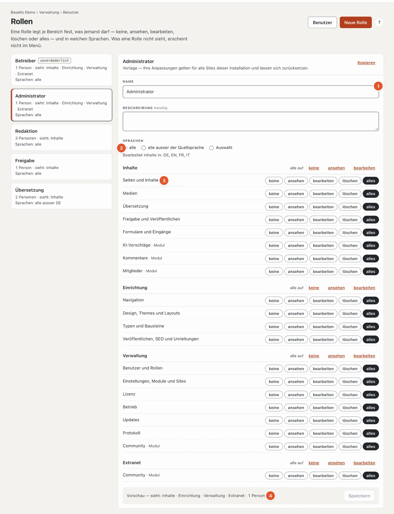

# Rollen und Rechte

Wer was im Backend darf, legt die **Rolle** fest. Eine Person hat je Site genau eine Rolle; die Rollen selbst gelten
für alle Sites der Installation (bzw. des SaaS-Kontos). Sie pflegen sie unter **Verwaltung › Rollen**.

## Bereiche und Stufen

Eine Rolle hat je **Bereich** eine **Stufe**. Die Stufen bauen aufeinander auf:

| Stufe | Bedeutet |
| --- | --- |
| **keine** | Der Bereich erscheint nicht im Menü, seine Adressen antworten mit 403. |
| **ansehen** | Lesen, ohne etwas zu ändern. |
| **bearbeiten** | Anlegen und ändern. |
| **löschen** | Zusätzlich löschen. |
| **alles** | Zusätzlich die heiklen Einstellungen des Bereichs — etwa den Webhook eines Formulars, die Einstellungen und den Export der Mitglieder oder den Schlüssel der KI-Vorschläge. |

Die Bereiche sind in drei Gruppen geordnet. Sieht eine Rolle in einer Gruppe keinen einzigen Bereich, fehlt auch der
Modus-Schalter dorthin.

| Gruppe | Bereiche |
| --- | --- |
| **Inhalte** | Seiten und Inhalte · Medien · Übersetzung · Freigabe und Veröffentlichen · Formulare und Eingänge · aus Modulen: Kommentare, Mitglieder, KI-Vorschläge |
| **Einrichtung** | Navigation · Design, Themes und Layouts · Typen und Bausteine · Veröffentlichen, SEO und Umleitungen |
| **Verwaltung** | Benutzer und Rollen · Einstellungen, Module und Sites · Lizenz · Betrieb · Protokoll · aus Modulen: Lizenzverkauf, Marktplatz, Testmanagement |

Module melden ihre Bereiche selbst an; ein neu installiertes Modul erscheint sofort in der Matrix.

## Vorlagen

Fünf Rollen sind vorgegeben. Sie können sie anpassen und jederzeit auf den Stand ab Werk **zurücksetzen** —
ausser «Betreiber».

| Vorlage | Darf |
| --- | --- |
| **Betreiber** | Alles. Unveränderlich, damit sich keine Site aussperren kann. Jede Site behält mindestens einen Betreiber. |
| **Administrator** | Alles, ausser die Rolle Betreiber vergeben. |
| **Redaktion** | Seiten, Medien und Formulare bis «löschen», Übersetzung, Kommentare, Mitglieder und KI-Vorschläge «bearbeiten». Keine Einrichtung, keine Verwaltung, kein Freigeben. |
| **Freigabe** | Freigabe und Veröffentlichen «alles»; Seiten, Medien, Übersetzung, Formulare und Kommentare «ansehen». |
| **Übersetzung** | Seiten und Übersetzung «bearbeiten», Medien «ansehen», KI-Vorschläge «bearbeiten» — in allen Sprachen **ausser der Quellsprache**. |

Besitzer und Verwaltung eines SaaS-Kontos dürfen auf allen Sites des Kontos alles, wie ein Betreiber.

## Eigene Rollen

**Neue Rolle** legt eine leere Rolle an (darf nichts) oder eine Kopie einer bestehenden («Ausgehend von» bzw.
**Kopieren**). In der Matrix wählen Sie je Bereich die Stufe; «alle auf» setzt eine ganze Gruppe auf einmal. Unten
zeigt die Vorschau, was die Rolle sieht («Inhalte · Einrichtung · Verwaltung»), und wie viele Personen sie haben.
Gespeichert wird mit **Speichern** — Rechte ändern sich nicht nebenbei. Die Änderung gilt ab der nächsten Anfrage.

Vergeben wird eine Rolle wie bisher unter **Benutzer** (Auswahl in der Liste oder beim Einladen). Eine eigene Rolle
lässt sich **löschen**, solange niemand sie hat und keine offene Einladung auf sie lautet.

## Sprachen

Je Rolle legen Sie fest, in welchen Sprachen sie Inhalte bearbeiten darf: **alle**, **alle ausser der Quellsprache**
oder eine **Auswahl**. Die Quellsprache (Standardsprache der Site) ist nur dabei, wenn Sie sie wählen. Seiten anlegen,
löschen, verschieben und ihre Einstellungen ändern verlangt die Quellsprache. Die Sperre gilt im Editor, in der
Übersicht «Übersetzung», bei den KI-Vorschlägen, auf der Seite selbst (Frontend-Editor) und über die API.

## Regeln, die niemand umgeht

- **Betreiber bleibt unveränderlich.** Die Rolle lässt sich weder ändern noch löschen; den letzten Betreiber einer
  Site kann niemand herabstufen oder deaktivieren.
- **Keine Rechte verschenken.** Wer eine Rolle vergibt, entzieht oder ändert, braucht in jedem Bereich mindestens
  dieselbe Stufe und jede ihrer Sprachen. Die Rolle Betreiber vergibt nur ein Betreiber.
- **Rollen ändern verlangt «Benutzer und Rollen · alles».** Ansehen genügt «ansehen».
- **API-Tokens** handeln mit den Rechten ihres Benutzers — ein Token einer Übersetzung ändert die Quellsprache nicht.
- **Alles steht im Protokoll:** Rolle angelegt, geändert (vorher/nachher), zurückgesetzt, gelöscht und jede neue
  Zuweisung.

## Für Entwickler

Ein Modul meldet seine Bereiche im Service-Provider an und ordnet seine Routen zu; Routen ohne Zuordnung verlangen
«Einstellungen · alles» (lieber zu streng als zu offen), und ein Test findet sie. Prüfen lässt sich ein Recht mit
`Gate::allows('area', [$site, 'bereich', Level::Edit])`. Einzelheiten unter
[Erweiterungen](../entwickler/erweiterungen.md).

## Weiter

- [Rollen](../verwaltung/rollen.md)
- [Benutzer](../verwaltung/benutzer.md)
