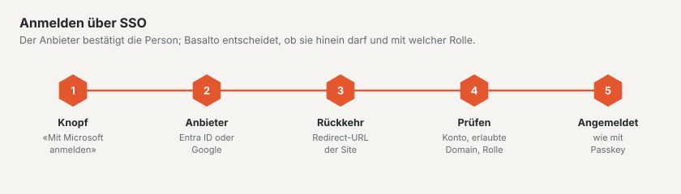

# SSO für Backend-Benutzer

Backend-Benutzer einer Site melden sich mit dem Konto ihrer Firma an: «Mit Microsoft anmelden» (Microsoft Entra ID)
oder «Mit Google anmelden» (Google Workspace bzw. Google-Konto). Passkey und Mail-Code bleiben daneben bestehen — fällt
der Anbieter aus, kommt man weiter hinein.

Das gilt für eigene Installationen und die SaaS gleich.

## Grundsätze

- **Je Site eingerichtet**, nicht je Konto: Rollen hängen an der Site, und eine Agentur führt in einem Konto Sites
  verschiedener Firmen mit verschiedenen Tenants. Zwei Sites derselben Firma brauchen zwei Einträge (dieselbe
  App-Registrierung darf beide Male verwendet werden, mit beiden Redirect-URLs).
- **Nur bestehende Benutzer.** Angemeldet wird, wer in Basalto einen Benutzer mit der bestätigten E-Mail hat **und** eine
  Rolle auf der Site. Beim ersten Mal verknüpft Basalto den Benutzer mit seiner Kennung beim Anbieter; danach zählt die
  Kennung (eine geänderte Adresse beim Anbieter bricht die Anmeldung nicht).
- **Automatisch anlegen ist ab Werk aus.** Wer es einschaltet, wählt eine Rolle (Redaktion, Freigabe oder Übersetzung —
  nie Betreiber oder Administrator). Bei Google geht das nur mit **erlaubter Domain**, sonst bekäme jedes Google-Konto
  der Welt Zugang. Neue Benutzer stehen im Protokoll («Benutzer über SSO angelegt»).
- **Deaktivierte Konten** bleiben ausgesperrt, auch über SSO.
- **Das Client-Secret** liegt verschlüsselt mit dem `APP_KEY` in der Datenbank, geht nie an den Browser, nie ins
  Protokoll und nicht in den Export einer Site. Nach einem Umzug richten Sie SSO neu ein.
- **Einrichten dürfen** der Betreiber der Site sowie Besitzer und Verwaltung des Kontos — nicht der Administrator der
  Site: wer den Anbieter festlegt, bestimmt, wessen Konten sich anmelden.

## Wo im Backend

**Verwaltung › Sites › (Site) › Anmeldung über SSO** (`/admin/sites/<id>/anmeldung`). Dort stehen

- die **Anmeldeadresse** der Site (`/admin/login?site=<handle>`) — unter einer Domain der Site erscheinen die Knöpfe
  auch ohne Zusatz; auf einer Installation mit nur einer Site immer. Eine Liste aller Sites zeigt die Anmeldeseite nie.
- je Anbieter die Felder, ein Schalter (aus = kein Knopf), die **Redirect-URLs zum Kopieren** (eine je Adresse, unter
  der das Backend erreichbar ist) und **«Verbindung testen»**.

«Verbindung testen» ist ein Hinweis, keine Garantie: Bei Entra holt Basalto ein Token für die App selbst und übersetzt
die Fehlercodes (Tenant unbekannt, Client-ID nicht im Tenant, Secret falsch oder abgelaufen); bei Google prüft es, ob
Client-ID und Secret bekannt sind. Ob die Redirect-URL stimmt und Benutzer zustimmen dürfen, zeigt erst eine echte
Anmeldung — am besten einmal in einem privaten Fenster.

## Microsoft Entra ID: App registrieren

1. [Microsoft Entra Admin Center](https://entra.microsoft.com) › **Identität › Anwendungen › App-Registrierungen ›
   Neue Registrierung**.
2. Name, z. B. «Basalto – Muster AG». **Unterstützte Kontotypen: «Nur Konten in diesem Organisationsverzeichnis»**
   (ein Mandant). Basalto nimmt ohnehin nur den eingetragenen Tenant an.
3. **Umleitungs-URI:** Plattform **Web**, die Redirect-URL aus Basalto, z. B.
   `https://muster.ch/admin/login/sso/entra/callback`. Weitere Adressen (Alias, `APP_URL`) unter
   **Authentifizierung › URI hinzufügen**.
4. In der **Übersicht** stehen **Anwendungs-ID (Client-ID)** und **Verzeichnis-ID (Mandanten-ID, Tenant-ID)** — beide
   GUIDs nach Basalto übernehmen. `common`, `organizations` oder ein Domainname gehen nicht.
5. **Zertifikate & Geheimnisse › Neuer geheimer Clientschlüssel**, Ablauf wählen (höchstens 24 Monate), den **Wert**
   (nicht die «Geheimnis-ID») sofort kopieren und in Basalto eintragen. Vor dem Ablauf ein neues erzeugen und eintragen.
6. **API-Berechtigungen:** Microsoft Graph, delegiert: `openid`, `profile`, `email`, `User.Read` (ist meist schon da).
   Je nach Einstellung des Tenants **«Administratorzustimmung erteilen»** — sonst sehen Benutzer beim ersten Mal eine
   Zustimmungsfrage oder eine Ablehnung.
7. Optional: unter **Unternehmensanwendungen › (App) › Eigenschaften** «Zuweisung erforderlich» einschalten und nur
   bestimmte Gruppen zuweisen.

**Welche Adresse zählt:** der Benutzerprinzipalname (UPN) — seine Domain ist immer eine bestätigte Domain des Tenants.
Das Feld `mail` zählt nur, wenn es dieselbe Domain hat. **Gastkonten** (`…#EXT#@…`) werden abgewiesen: ihre Adresse gehört
einem anderen Verzeichnis. Der Tenant des Kontos wird bei der Rückkehr gegen den eingetragenen geprüft.

## Google: OAuth-Client anlegen

1. [Google Cloud Console](https://console.cloud.google.com) › Projekt wählen oder anlegen.
2. **APIs & Dienste › OAuth-Zustimmungsbildschirm** (bzw. «Google Auth Platform»): Nutzertyp **Intern**, wenn nur
   Konten eurer Workspace-Organisation zugelassen sind, sonst **Extern**. App-Name, Support-Adresse, Logo nach Wunsch.
   Bereiche: `openid`, `email`, `profile` — keine sensiblen Bereiche, keine Prüfung durch Google nötig.
3. **Anmeldedaten › Anmeldedaten erstellen › OAuth-Client-ID**, Anwendungstyp **Webanwendung**.
4. **Autorisierte Weiterleitungs-URIs:** die Redirect-URL(s) aus Basalto, z. B.
   `https://muster.ch/admin/login/sso/google/callback`.
5. **Client-ID** (endet auf `.apps.googleusercontent.com`) und **Clientschlüssel** nach Basalto übernehmen.
6. **Erlaubte Domain** in Basalto setzen (z. B. `muster.ch`), wenn nur Workspace-Konten dieser Domain hinein sollen.
   Basalto prüft dann `hd` und die Domain der E-Mail bei der Rückkehr; ohne Domain gilt jedes Google-Konto mit
   bestätigter E-Mail, zu der es in Basalto einen Benutzer mit Rolle gibt.

## Ablauf und Sicherheit

- **Weiterleiten** mit `state` und PKCE (beides in der Sitzung), bei Entra immer an den eingetragenen Tenant, mit
  `prompt=select_account`. **Rückkehr** nur mit passender Sitzung; abgelaufene oder fremde Rückkehr → «Die Anmeldung
  ist abgelaufen».
- **Entra:** Socialite prüft das ID-Token (Signatur, Aussteller, Zielgruppe, Ablauf); Basalto vergleicht den Tenant.
  **Google:** `email_verified` muss wahr sein; mit erlaubter Domain zusätzlich `hd` und die Domain der E-Mail.
- **Fehler** gehen freundlich und ohne Einzelheiten an die Anmeldeseite. Den Grund hält das Protokoll fest
  («SSO abgewiesen»: fremder Tenant, Gastkonto, nicht bestätigt, falsche Domain, unbekannt, ohne Rolle, deaktiviert) —
  von Fremden nur die Domain der E-Mail, nie die ganze Adresse.
- **Limits:** Weiterleiten und Rückkehr teilen sich die Grenze der Code-Prüfung (20 Anfragen je Minute und IP),
  «Verbindung testen» zehn je Minute.
- **Protokoll:** «Anmeldung» mit Methode `sso-entra` bzw. `sso-google` und der Site, «SSO verknüpft» beim ersten Mal,
  «SSO eingerichtet»/«SSO entfernt» bei Änderungen (mit «Secret geändert: ja/nein», nie dem Wert).
- **Auskunft und Löschung** (Datenschutz) nennen bzw. entfernen die Verknüpfungen eines Benutzers.

## Hinter einem Proxy

Die Redirect-URL baut Basalto aus Schema und Host der Anfrage. Hinter einem Proxy oder Load Balancer müssen
`TrustProxies` und `X-Forwarded-Proto` stimmen, sonst entsteht `http://…` statt `https://…` und der Anbieter weist die
Rückkehr ab (Entra: AADSTS50011, Google: `redirect_uri_mismatch`). Prüfe die angezeigten Redirect-URLs deshalb
auf der Zielumgebung selbst, nicht lokal.

## Fehlerbilder

| Meldung / Code | Ursache | Abhilfe |
| --- | --- | --- |
| AADSTS50011 / `redirect_uri_mismatch` | Redirect-URL fehlt beim Anbieter oder weicht ab (Schema, Host, Schrägstrich) | URL aus Basalto genau so eintragen |
| AADSTS700016 | Client-ID nicht im eingetragenen Tenant | Tenant-ID und Client-ID derselben Registrierung nehmen |
| AADSTS7000215 / 7000222 | Secret falsch bzw. abgelaufen | neuen Wert erzeugen und eintragen |
| AADSTS65001 | Zustimmung fehlt | Administratorzustimmung erteilen |
| «Mit diesem Konto ist keine Anmeldung … möglich» | Konto ohne Benutzer/Rolle, Gast, fremder Tenant, falsche Domain | im Protokoll unter «SSO abgewiesen» den Grund lesen; Benutzer einladen oder Rolle geben |
| «Die Anmeldung ist abgelaufen» | Rückkehr ohne passende Sitzung (anderer Host, Cookie blockiert, zu lange gewartet) | über die Anmeldeadresse der Site neu beginnen; Host der Redirect-URL = Host der Anmeldung |

## Weiter

- [Sites](../verwaltung/sites.md)
- [Rollen und Rechte](rollen.md)
