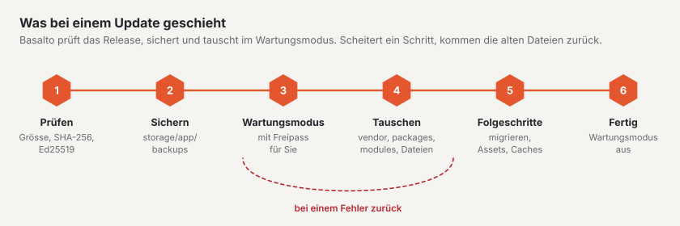

# Updates

Neue Versionen von Basalto, den mitgelieferten Modulen, Plugins und Themes spielen Sie im Backend unter
**Verwaltung › Updates** oder auf der Konsole ein. Basalto lädt das signierte Release, sichert vorher, tauscht die
Dateien und holt bei einem Fehler den alten Stand zurück.



## Im Backend oder auf der Konsole

Im Browser: [Updates](../verwaltung/updates.md). Auf der Konsole:

```sh
php artisan basalto:update                   # prüfen: Kern, Plugins, Themes — mit Quelle
php artisan basalto:update --kern            # Kern aus dem signierten Release einspielen
php artisan basalto:update --plugin=anbieter/paket
```

- **Was passiert:** Archiv laden (`/_download/latest.json` der Quelle), Grösse, SHA-256 und Ed25519 prüfen,
  Sicherung nach `storage/app/backups`, Wartungsmodus. Dann tauschen: `vendor`, `packages` und `modules` als Ganzes,
  alles andere Datei für Datei. Danach `package:discover`, `migrate --force`, Assets und `optimize:clear`, jeweils in
  einem frischen PHP-Prozess. Scheitert ein Schritt, kommen die alten Dateien zurück.
- **Was bleibt:** `.env`, `storage`, `auth.json`, `public/storage`, `public/hot`, jede `*.sqlite` und alles, was nicht
  im Archiv steht.
- **Von Hand zurückholen:** Die ersetzten Dateien liegen nach dem Lauf in `storage/app/updates/lauf-<zeit>/vorher/`
  (nur der letzte Lauf bleibt). Zurückkopieren, dann `php artisan optimize:clear`.
- **Stand und Protokoll:** `storage/app/updates/status.json` (die Seite im Backend liest ihn) und
  `storage/logs/update.log`.
- **Quelle:** `BASALTO_UPDATES_URL`, sonst basaltocms.com.
- **Täglicher Check:** Der Scheduler ruft `basalto:update --benachrichtigen` um 04:10 auf (ausschalten mit
  `BASALTO_UPDATES_CHECK=false`).
- **Plugins:** Dafür braucht es E-Mail und Token des Kundenkontos (`auth.json` oder `BASALTO_MARKETPLACE_EMAIL` und
  `BASALTO_MARKETPLACE_TOKEN`).

Vor einem grossen Sprung lohnt sich trotzdem eine eigene Sicherung mit Rückspielprobe ([Backup](backup.md)).

## Installationen mit Composer

Führt Ihre Installation Basalto als Composer-Pakete, zeigt die Seite «Updates» den Stand und die Befehle; eingespielt
wird dann mit Composer:

1. Sichern und prüfen, Wartungsmodus einschalten:

   ```sh
   php artisan basalto:backup
   php artisan basalto:backup-verify
   php artisan down
   ```

2. Neue Versionen holen — in der Entwicklung, nicht auf dem Server:

   ```sh
   composer update "basalto/*"     # nur Kern, Lava und Module
   composer update                 # alles
   ```

3. Den neuen Stand (`composer.json`, `composer.lock`) auf den Server bringen und dort einspielen:

   ```sh
   composer install --no-dev --optimize-autoloader
   php artisan migrate --force
   php artisan vendor:publish --tag=basalto-assets --force
   php artisan optimize
   ```

## Caches nach dem Update

| Was | Befehl | Wann |
| --- | --- | --- |
| Laravel-Caches | `php artisan optimize` | nach jedem Update; bei Problemen erst `php artisan optimize:clear` |
| Seiten-Cache | `php artisan basalto:page-cache clear`, dann `php artisan basalto:page-cache warm` | wenn der Seiten-Cache eingeschaltet ist; `--site=<handle>` für eine einzelne Site |
| Suchindex | `php artisan basalto:search-index` | wenn das Update die Suche betrifft oder nach einem Treiberwechsel; `--site=<handle>` für eine einzelne Site |
| Warteschlange | `php artisan queue:restart` | nur mit eigenem Worker; über den Scheduler startet `queue:work` jede Minute neu |

Der Seiten-Cache hängt am Fingerabdruck der Theme-Quelle und an der Generation der Site, nicht am Release. Ändert ein
Update die Ausgabe des Kerns, leeren Sie ihn deshalb von Hand.

## Prüfen nach dem Update

```sh
php artisan up
```

1. **`/up`** meldet «bereit» (Datenbank und Herzschlag).
2. **Verwaltung › Betrieb:** Herzschlag aktuell, Warteschlange leer oder in Arbeit, keine neuen fehlgeschlagenen Jobs,
   letzter Lauf der Aufgaben ohne Fehler.
3. **Theme prüfen**, falls sich Lava geändert hat:

   ```sh
   php artisan basalto:check --site=<handle>          # Theme aus der Datenbank
   php artisan basalto:check --theme=themes/<name>    # Theme aus Dateien
   php artisan basalto:publish <handle> --dry-run     # Prüfung vor dem Livegang, ohne zu schreiben
   ```

4. Im Frontend eine Seite mit Bildern und ein Formular öffnen, im Backend eine Seite bearbeiten.
5. **Verwaltung › Lizenz:** Ist der Update-Anspruch abgelaufen, erscheint dort ein Hinweis ([Lizenz](lizenz.md)).
6. **MariaDB oder MySQL:** `php artisan basalto:db-zeitzone` meldet, ob ältere Zeitpunkte umzurechnen sind
   ([Zeitzone der Datenbank](installation.md#zeitzone-der-datenbank)).

Geht etwas schief: Wartungsmodus bleibt an, Stand aus der Sicherung zurückholen ([Backup](backup.md#wiederherstellen)).

## Weiter

- [Updates](../verwaltung/updates.md)
- [Backup](backup.md)
- [Befehle](befehle.md)
