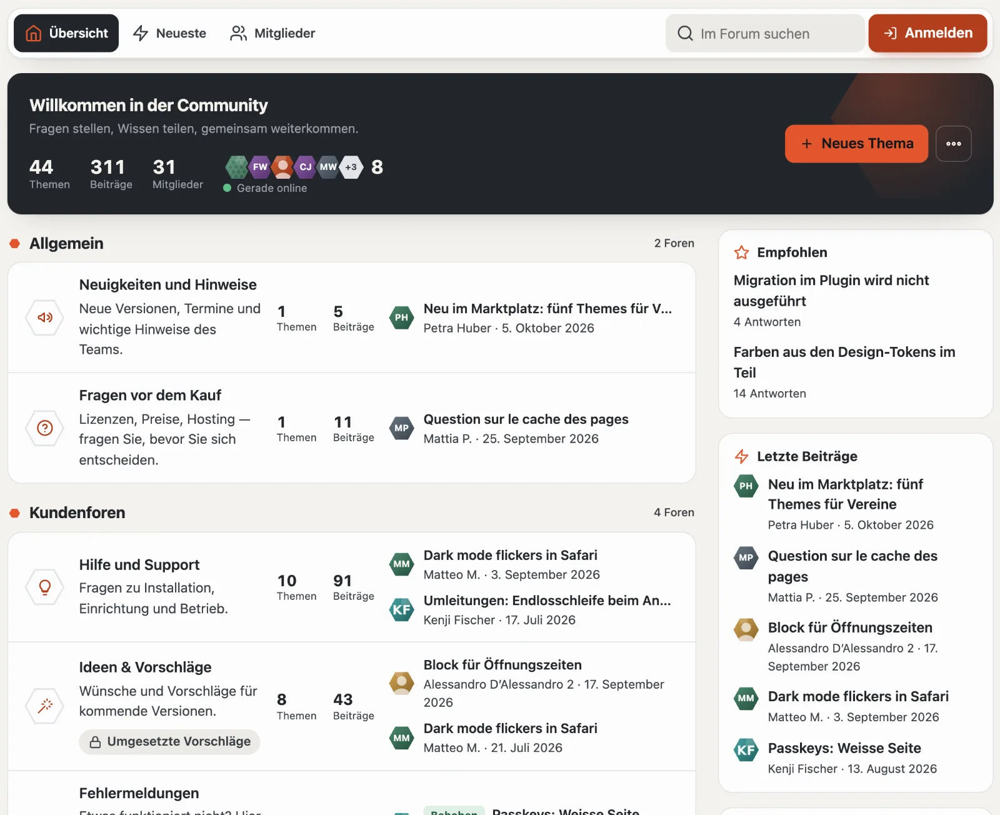
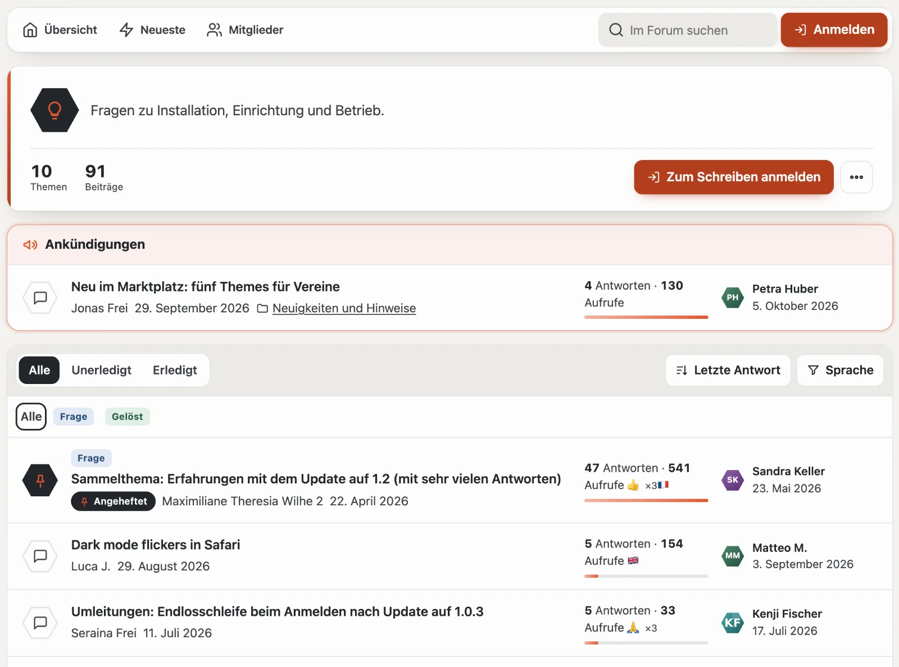
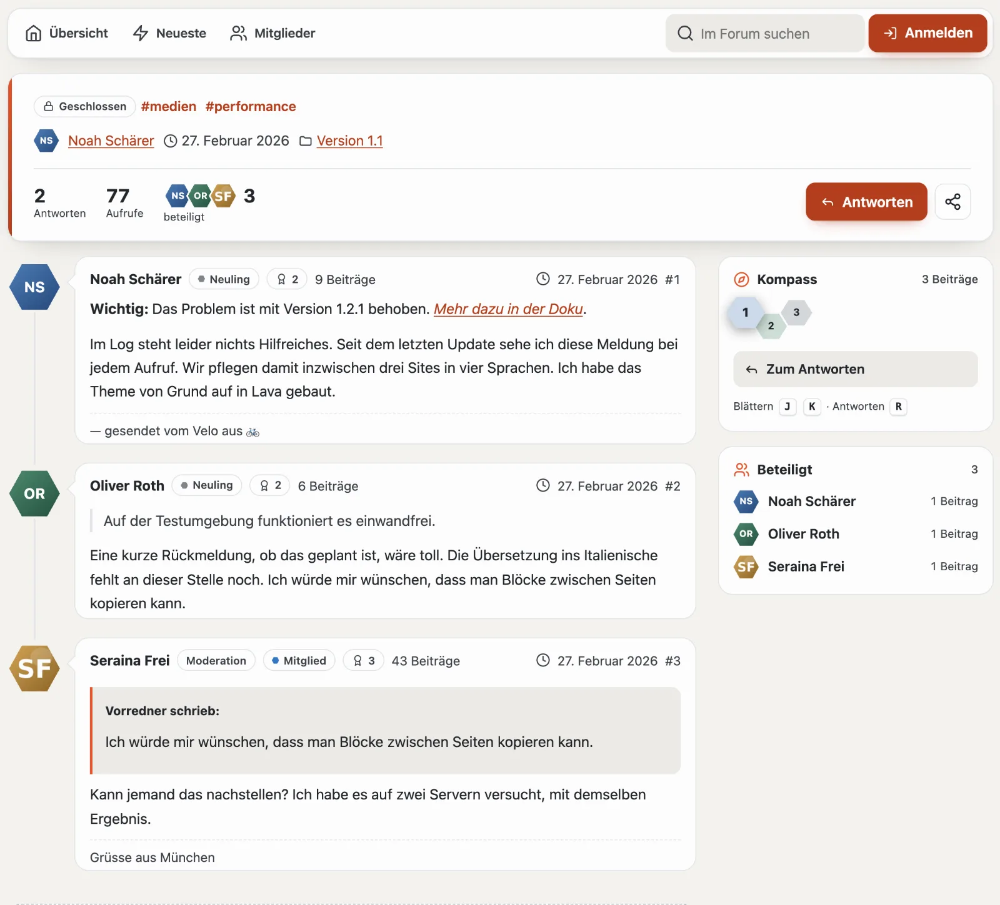
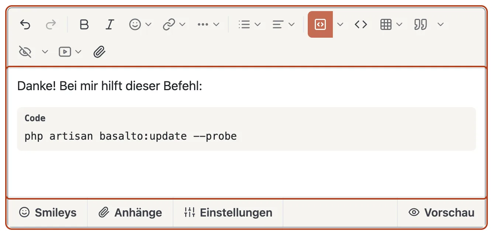
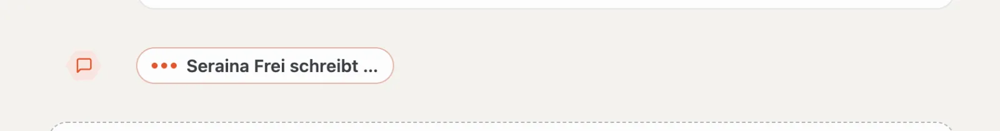
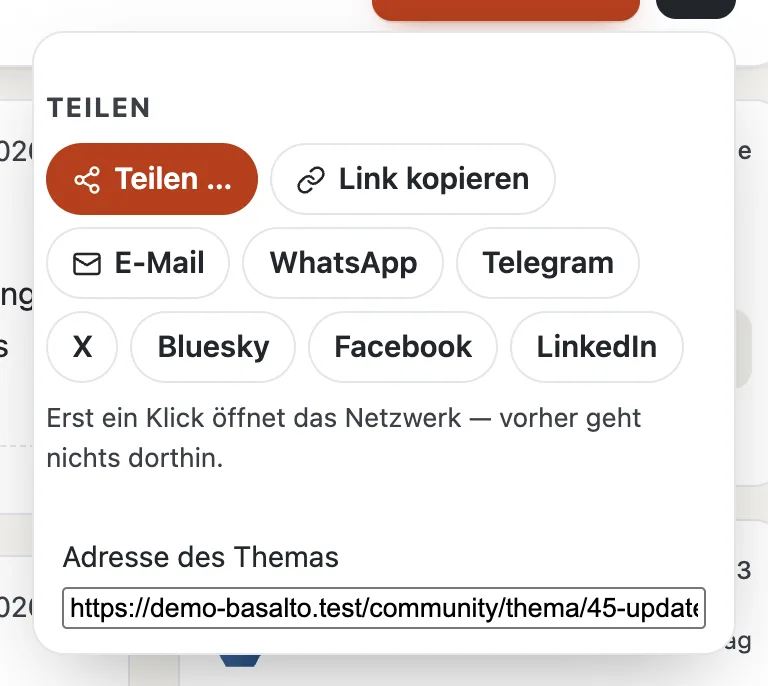

# Forum

Die Übersicht unter `/community` beginnt mit dem **Puls**: Begrüssung, was seit Ihrem letzten Besuch neu ist, Themen, Beiträge, Mitglieder und wer gerade online ist, dazu **«+ Neues Thema»** und das Menü **«…»** (alles gelesen, RSS, Suche, Mitglieder). Darunter stehen die Kategorien mit ihren Foren. Je Forum zeigt das Sechseck ein Symbol — in Lava, wenn es Neues gibt —, daneben die Zahl der Themen und Beiträge, die Unterforen und die zwei letzten Themen mit Bild, Präfix, Name und Zeit. Rechts stehen Kästen: Empfohlen, letzte Beiträge, aus dem Blog, heisse Themen und Schlagwörter. Ganz unten folgt ein Band mit der Statistik (Beiträge pro Tag, neuestes Mitglied) und «Mitglieder online» samt Rekord.

Über jeder Seite des Forums steht der **Navigator**: **Übersicht**, **Neueste**, **Ungelesen** (mit Zahl), **Abonniert**, **Gefolgt**, **Mitglieder**, die Suche, Nachrichten, die Glocke, für Moderierende der Schild mit den offenen Fällen und Ihr Profil. Auf dem Telefon werden die Wege zu einer Leiste mit Symbolen.

Die Kästen gibt es auch als Lava-Teile für jede Region eines Layouts (`forum.latest`, `forum.hot`, `forum.featured`, `forum.online`, `forum.stats`, `forum.members`, `forum.team`).

## Lesen

- **Themenliste:** Der Kopf zeigt Symbol, Beschreibung und Zahlen des Forums, **«+ Neues Thema»**, **Abonnieren** (Glocke) und das Menü «…». Ankündigungen stehen darüber, angeheftete Themen oben. Das Sechseck vor jedem Thema zeigt den Stand: Lava = neu, grün = erledigt, gestreift = wartet auf die Moderation, dunkel = angeheftet. Der Balken unter den Zahlen zeigt, wie lebhaft ein Thema ist. **Alle**, **Unerledigt** und **Erledigt** filtern; **Sortieren** nach letzter Antwort, Erstelldatum, Antworten oder Titel; Präfixe als Chips, die Sprache im Menü. Ungelesenes ist fett und springt zum ersten neuen Beitrag.
- **Thema:** Im Kopf stehen Präfix, Stand und Schlagwörter, wer es wann in welchem Forum eröffnet hat, Antworten, Aufrufe, die Beteiligten und — waren Sie schon hier — **«neu für Sie»**. Sprünge führen zur hilfreichsten Antwort und zu offiziellen Beiträgen des Teams. Die Beiträge hängen an einer Linie mit den Profilbildern; neue färben sie Lava und tragen **«Neu»**. Im Kopf jedes Beitrags: Name, Gruppe, Rang, Trophäen, Beitragszahl, Zeit und Nummer. Die hilfreichste Antwort trägt ein grünes Band.
- **Kompass:** Rechts zeigt er die Beiträge der Seite als Waben in der Farbe der Person, die geschrieben hat — so sehen Sie, wer das Gespräch trägt. Neu, Lösung, wartend und Team sind hervorgehoben, der Beitrag, den Sie gerade lesen, ist grösser. Ein Klick springt hin; mit der Tastatur blättern **J** und **K** von Beitrag zu Beitrag, **R** springt zum Antworten.

- **Listen:** Neueste, Ungelesen, Abonniert, Gefolgt (Neues von Personen, denen Sie folgen).

## Schreiben

- **Thema eröffnen:** Schon beim Tippen des Titels zeigt das Forum **ähnliche Themen** — vielleicht ist die Frage schon beantwortet. Dazu Titel, Präfix, Themenfelder des Forums, Schlagwörter (höchstens fünf, mit Komma getrennt), Text, Anhänge und auf Wunsch eine Umfrage.
- **Editor:** Die Leiste oben hat alles für einen guten Beitrag:
  - **Rückgängig** und **Wiederholen**, **Fett**, **Kursiv**, **Emoji** und **Link** (Adresse und Text in einem kleinen Formular);
  - **«…»** für das Absatzformat (Absatz, Überschrift 1 bis 3), Unterstrichen, Durchgestrichen, Tief- und Hochgestellt, Format entfernen und den **Markierstift** in fünf Farben;
  - **Listen** (Aufzählung, nummeriert, Einzug verkleinern und vergrössern) und **Ausrichtung** (links, zentriert, rechts, Blocksatz);
  - **Codeblock:** ein Klick fügt ihn ein, der Pfeil daneben wählt die Sprache (oder die automatische Erkennung), die erste Zeilennummer und einen Dateinamen. Beim Lesen ist der Code farbig hervorgehoben, mit Zeilennummern und dem Knopf **«Kopieren»**; sind Zeilen abgeschnitten, bricht **«Mehr»** sie um, bis der ganze Code zu sehen ist;
  - **Code im Text**, **Tabelle** (Grösse im Raster wählen; steht die Schreibmarke in einer Tabelle, fügt das Menü Zeilen und Spalten ein oder entfernt sie), **Zitat** (mit den gemerkten Zitaten), **Spoiler** (auf Wunsch mit Titel), **Video** und **Datei**.

  Erwähnungen schreiben Sie mit `@` und den ersten Buchstaben. Team und Moderation (oder wem die Verwaltung das Recht «Gruppen erwähnen» gibt) erwähnen auch ganze Gruppen, etwa `@Moderation` — alle ihre Mitglieder bekommen eine Benachrichtigung. Die Leiste geht auch mit der Tastatur: Tab springt hinein, die Pfeiltasten wandern, Escape schliesst ein Menü. Ohne Skript bleibt ein einfaches Textfeld.
- **Reiter unter dem Text:** **Smileys**, **Anhänge** (Hochladen, erlaubte Arten, Grösse je Datei, freier Speicher), **Einstellungen** (etwa «offizieller Beitrag des Teams»), beim Eröffnen **Umfrage** und rechts die **Vorschau** — sie zeigt den Beitrag genau so, wie er nach dem Absenden erscheint.
- **Wer schreibt gerade:** Tippt jemand anderes eine Antwort im selben Thema, steht am Ende der Beiträge und in der Ecke Ihres Antwortfelds **«Anna schreibt …»** — so antworten nicht zwei gleichzeitig dasselbe. Mehr unter [Live-Aktualisierung](live.md).
- **Bearbeiten:** im Zeitfenster der Site, mit Grund; der Verlauf bleibt sichtbar.
- Manche Foren schalten neue Beiträge erst frei — dann erscheint Ihr Beitrag, sobald die Moderation ihn freigibt. Zwischen zwei Beiträgen liegt ein kurzer Mindestabstand.

## Mitmachen

- **Reaktionen:** Unter jedem Beitrag stehen sie als Zählung, Ihre eigene hervorgehoben. Der Knopf mit dem Smiley öffnet die Auswahl 👍 ❤️ 😂 😮 😢 🙏; erneut wählen nimmt sie zurück.
- **Antworten, Zitieren, Merken** stehen unter jedem Beitrag. **Bearbeiten**, **Verlauf**, **Hilfreichste Antwort** und **Melden** liegen im Menü «…» des Beitrags.
- **Abonnieren** ist die Glocke im Kopf eines Themas oder Forums, **Ignorieren** steht im Menü «…». Die Glocke im Navigator zeigt Neues, E-Mails kommen sofort, täglich oder nie (im Profil).
- **Hilfreichste Antwort** wählt, wer das Thema eröffnet hat.
- **Melden:** im Menü «…» eines fremden Beitrags — wer geschrieben hat, erfährt nicht, wer gemeldet hat.
- **Teilen:** Im Kopf eines Themas öffnet **«Teilen»** E-Mail, WhatsApp, Telegram, X, Bluesky, Facebook und LinkedIn — als gewöhnliche Links: Erst Ihr Klick öffnet das Netzwerk, vorher erfährt es nichts. Dazu **«Link kopieren»** und auf dem Telefon das Teilen des Geräts. Als Vorschaubild zeigen die Netzwerke das erste Bild des Startbeitrags.

## Finden

- **Suche im Forum** unter `/community/suche`; die Themen stehen auch in der Suche der ganzen Site, mit dem Filter «Forum».
  Die Suche läuft beim Tippen mit: Auf der Suchseite erneuern sich die Treffer, im Suchfeld der Forumsleiste erscheinen
  bis zu fünf Themen als Vorschlag und «Alle … Treffer anzeigen» (Pfeiltasten, Enter, Escape).
  Gesucht wird nach Wörtern: Jedes muss vorkommen, die Reihenfolge ist frei, Gross- und Kleinschreibung und Akzente
  zählen nicht («ubersetzung» findet «Übersetzung»). Ein Treffer zeigt den passenden Beitrag mit Name, Nummer und Datum
  und führt direkt dorthin.
- **Schlagwörter:** `#Theme` führt zu allen Themen mit diesem Schlagwort.
- **RSS:** `/community/feed` für das ganze Forum, `/community/<forum>/feed` je Forum.

## Weiter

- [Profile und Konversationen](profile.md)
- [Moderation](moderation.md)
- [Community](README.md)
