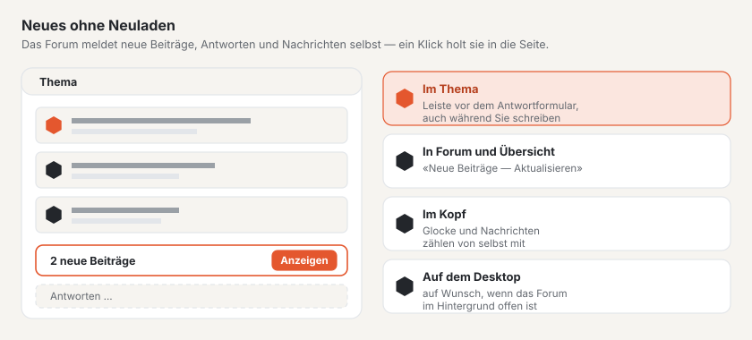

# Live-Aktualisierung

Das Forum meldet Neues von selbst: neue Beiträge im offenen Thema, neue Themen und Antworten in der Themenliste, neue
Nachrichten in einer Konversation und ungelesene Benachrichtigungen im Kopf. Niemand muss die Seite neu laden — ein
Klick holt das Neue in die Seite. Das funktioniert auf jedem Hosting; wo ein WebSocket-Server eingerichtet ist,
erscheint es sofort, sonst nach höchstens etwa 15 Sekunden.

## Im Thema

Kommt eine Antwort dazu, während Sie ein Thema lesen, erscheint unten im Fenster die Leiste **«1 neuer Beitrag»** mit
dem Knopf **«Anzeigen»**. Ein Klick fügt den Beitrag am Ende der Seite ein — mit Nummer, Reaktionen und allen
Knöpfen, als wäre die Seite neu geladen. Die Leiste steht direkt über dem Antwortformular und haftet am unteren Rand
des Fensters: Sie sehen sie auch, während Sie selbst schreiben, und können vor dem Absenden lesen, was inzwischen
geantwortet wurde.

- Auf einer früheren Seite des Themas führt die Leiste **«Zur letzten Seite»**.
- Sind es mehr neue Beiträge, als auf eine Seite passen, führt der Knopf ebenfalls zur letzten Seite.
- Es erscheint nur, was Sie ohnehin sehen dürften: Beiträge, die auf die Freischaltung warten, erst nach der
  Freischaltung; Beiträge von Personen, die Sie blockiert haben, zugeklappt wie auf der Seite.
- Nachgeladene Beiträge gelten als gelesen.

## In Forum und Übersicht

Kommt in einem Forum ein Thema oder eine Antwort dazu, erscheint über der Themenliste **«Neue Beiträge in diesem
Forum»** mit **«Aktualisieren»**. Das gilt auch für die Foren darüber (eine Antwort in einem Unterforum ändert die
Übersicht der Kategorie) und für die Übersicht des Forums.

## Konversationen

In einer offenen Konversation erscheint **«Neue Nachricht in dieser Konversation»**, sobald jemand anderes schreibt.
**«Anzeigen»** lädt die Konversation und springt zum Antwortformular.

## Wer schreibt gerade

Beginnt jemand, im Thema eine Antwort zu tippen, erscheint am Ende der Beiträge **«Anna schreibt …»** mit drei
pulsierenden Punkten — für alle, die das Thema lesen, auch für Gäste. Wer selbst schreibt, sieht es zusätzlich in der
Ecke des eigenen Antwortfelds. Bei zwei Personen steht «Anna und Ben schreiben …», bei mehr die Zahl.

- Die Anzeige verschwindet einige Sekunden nach der letzten Taste, beim Absenden oder wenn die Person die Seite verlässt.
- In Konversationen sehen es nur die Teilnehmenden.
- Sich selbst sehen Sie nicht; wer eine Schreibsperre hat, erscheint nicht.

## Glocke und Nachrichten

Wer angemeldet ist, sieht im Kopf des Forums die Zahl der ungelesenen Benachrichtigungen (Glocke) und Nachrichten.
Beide Zahlen zählen von selbst mit, ohne die Seite zu laden.

## Desktop-Benachrichtigungen

Auf der Seite **Benachrichtigungen** lassen sich Desktop-Benachrichtigungen einschalten. Der Browser fragt einmal um
Erlaubnis; danach zeigt er die neueste Benachrichtigung als Hinweis des Systems, wenn das Forum in einem Tab im
Hintergrund offen ist. Ein Klick darauf öffnet sie. Ist das Forum im Vordergrund, genügen Glocke und Zähler. Die Wahl
gilt für diesen Browser und lässt sich dort wieder ausschalten.

## Gut zu wissen

- Die Seite fragt nur nach, solange ihr Tab sichtbar ist — im Hintergrund nur mit eingeschalteten
  Desktop-Benachrichtigungen, und dann seltener.
- Ohne JavaScript funktioniert das Forum wie bisher; Neues erscheint dann beim nächsten Laden.
- Was das Forum überträgt, ist nur ein Signal «es gibt Neues». Den Inhalt lädt der Browser über die gewöhnliche
  Adresse, mit denselben Rechten wie die Seite.

## Weiter

- [Forum](forum.md)
- [Profile und Konversationen](profile.md)
- [Live-Aktualisierung einrichten](../betrieb/live.md)
