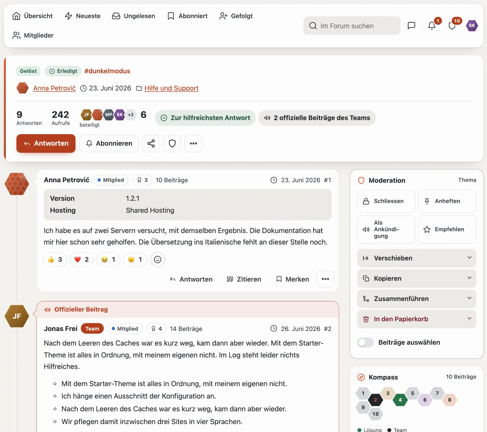
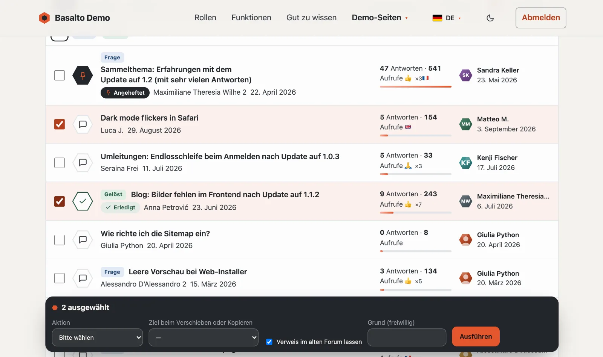
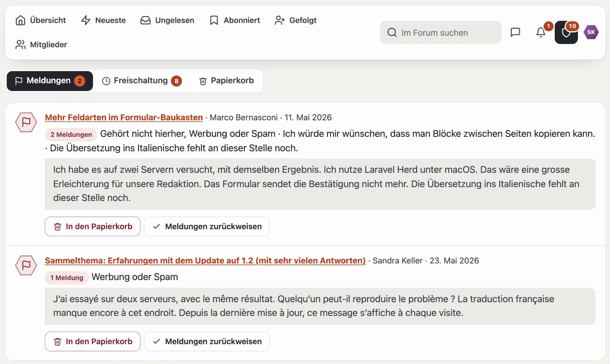
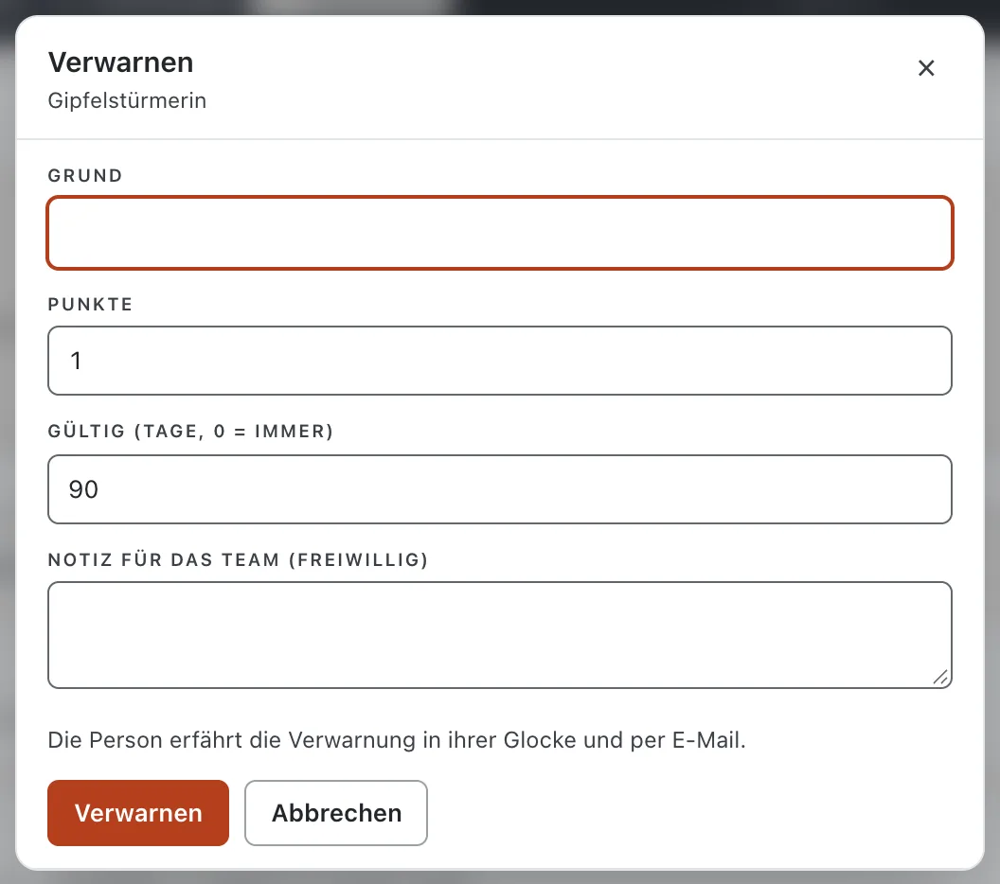

# Moderation

Moderieren darf, wer in einem Forum das Recht **«Moderieren»** hat (ab Werk die Gruppen Moderation und Team). Jede Handlung gibt es an zwei Orten — an Ort und Stelle im Forum und in der Verwaltung (Extranet oder Backend) — mit denselben Folgen und derselben Zeile im **Moderationsprotokoll**.

## An Ort und Stelle

- **Karte Moderation am Thema:** Rechts neben den Beiträgen stehen Kacheln für **Schliessen**, **Anheften**, **Als Ankündigung** und **Empfehlen**. Ist etwas aktiv, ist die Kachel dunkel und nennt den Rückweg (etwa «Angeheftet · lösen»). Darunter klappen **Verschieben** (auf Wunsch mit Verweis im alten Forum, der nach einigen Tagen verschwindet), **Kopieren** (mit allen sichtbaren Beiträgen, Schlagwörtern und der Umfrage ohne Stimmen), **Zusammenführen** und **In den Papierkorb** auf. Auf dem Telefon steht die Karte am Ende des Themas; der Schild im Kopf springt hin.
- **Auswählen:** Der Schalter **«Auswählen»** über der Themenliste und **«Beiträge auswählen»** in der Karte blenden Ankreuzfelder ein. Die dunkle Leiste «n ausgewählt» führt die Aktion für alle aus.

- **Am Beitrag:** Wartet ein Beitrag oder ist er gemeldet, steht oben ein Streifen mit dem Entscheid (**Freischalten**, **In den Papierkorb**, **Meldungen zurückweisen**) sowie **Verwarnen** und **Als Spammer entfernen**. Bei allen anderen Beiträgen stehen Verwarnen und Als Spammer entfernen im Menü «…».
- **Beiträge:** freischalten, ausblenden, in den Papierkorb, in ein neues Thema teilen.
- **Bearbeiten sperren:** Im Menü «…» eines Beitrags sperrt die Moderation das Bearbeiten für die Person, die ihn geschrieben hat (etwa bei einem Streit über den Inhalt); sie sieht «Bearbeiten gesperrt (Moderation)». «Bearbeiten erlauben» hebt es auf, die Moderation selbst darf immer.
- Die Liste `/community/moderation` sammelt Meldungen, Wartendes und den Papierkorb; die Reiter zeigen die Zahl der offenen Fälle, der Schild im Navigator ihre Summe.

## Meldungen

Mitglieder melden Beiträge mit einem Grund. Ab der eingestellten Zahl offener Meldungen (Vorgabe drei) ist ein Beitrag vorläufig ausgeblendet, bis die Moderation entscheidet. Meldungen zu Bewertungen im Marktplatz und zu Nachrichten liegen in derselben Liste der Verwaltung.

## Verwarnungen und Sperren

- Eine **Verwarnung** hat einen Grund, Punkte und eine Gültigkeit. Die verwarnte Person erfährt es in der Glocke und per E-Mail.
- Ab den eingestellten Punkten folgt automatisch eine **Schreibsperre** (lesen ja; schreiben, reagieren, abstimmen und Nachrichten nein) oder eine **Sperre** (die Person zählt wie ein Gast).
- **Als Spammer entfernen:** sperrt ohne Ende, legt alle Themen und Beiträge in den Papierkorb und erledigt offene Meldungen — die Zähler stimmen danach.
- Unter **Mitglieder** setzen und heben Sie Sperren von Hand auf und nehmen Verwarnungen zurück.

## Schutz vor Missbrauch

- **Freischaltung:** Steht «Ohne Freischaltung schreiben» für eine Gruppe (global oder je Forum) auf «Nein», wartet jeder neue Beitrag auf die Moderation.
- **Mindestabstand** zwischen zwei Beiträgen (Flood-Control); Moderation und Team warten nie.
- **Zensur:** Eine Wortliste (`*` für beliebig viele Buchstaben) blockiert das Absenden mit Hinweis — nichts wird still verändert.

## Hinweise

Unter **Hinweise** legen Sie Banner an — für die ganze Community, die Übersicht oder ein Forum, für alle, nur Gäste, nur Angemeldete oder bestimmte Gruppen, mit Zeitraum. Angemeldete blenden ausblendbare Hinweise für sich aus; Gäste ebenfalls — ihr Browser merkt es sich.

## Weiter

- [Verwaltung der Community](verwaltung.md)
- [Forum](forum.md)
