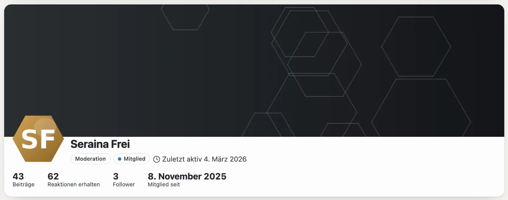
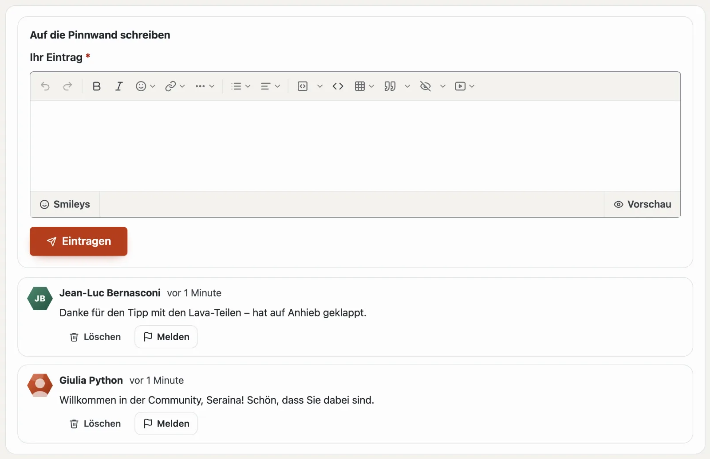
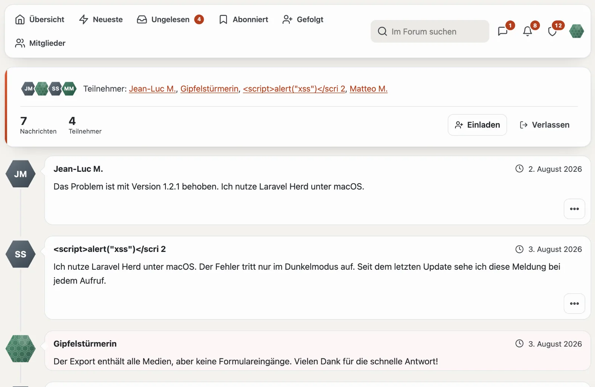

# Profile und Konversationen

## Ihr Profil

Unter «Ihr Profil» (`/community/konto`) legen Sie fest:

- **Anzeigename** (einmalig in der Community), **Profilbild** und **Signatur**,
- **Über mich**, ein **Cover-Foto** und die **eigenen Felder** der Site (etwa Website oder Ort) — jedes Feld zeigt, wer es sieht: alle, angemeldete Mitglieder oder nur das Team,
- E-Mails zu Antworten und Erwähnungen (sofort, täglich, nie) und ob Sie Themen automatisch abonnieren, in denen Sie schreiben.

Das öffentliche Profil unter `/community/mitglied/<nummer>-<name>` zeigt Rang, Trophäen, Beiträge, erhaltene Reaktionen, Follower und Reiter aus allen Modulen: Beiträge und Themen aus dem Forum, Einträge und Bewertungen aus dem Marktplatz.

## Pinnwand

Im Profil steht der Reiter **Pinnwand**: Mitglieder schreiben einander dort einen Gruss, einen Dank oder eine Frage —
öffentlich wie das Profil. Unter «Ihr Profil» bestimmen Sie, **wer auf Ihre Pinnwand schreiben darf**: alle
Mitglieder, nur Personen, denen Sie folgen, oder niemand.

- Sie erfahren in der Glocke (und per E-Mail), wenn jemand auf Ihre Pinnwand schreibt.
- Löschen dürfen, wer geschrieben hat, Sie selbst und das Team; jeder fremde Eintrag lässt sich **melden**.
- Wer blockiert ist, schreibt nicht auf Ihre Pinnwand — und Sie nicht auf seine.

## Folgen und Blockieren

- **Folgen:** Sie erfahren in der Glocke, wenn die Person ein Thema eröffnet; «Gefolgt» listet ihre neuen Beiträge.
- **Blockieren:** Beiträge der Person sind für Sie zugeklappt, ihre Antworten, Erwähnungen, Zitate und Reaktionen lösen keine Nachricht aus, und sie kann Ihnen nicht schreiben. Blockieren ist privat; das Team lässt sich nicht blockieren.

## Konversationen

- «Nachricht senden» im Profil oder «Neue Konversation» unter **Nachrichten** — an eine oder mehrere Personen (Anzeigenamen mit Komma).
- Nur Teilnehmende lesen mit. Sie können weitere Personen einladen oder die Konversation verlassen.
- Neue Nachrichten zählen in der Leiste und kommen in die Glocke und per E-Mail.
- **Melden** einer Nachricht zeigt dem Team nur diese eine Nachricht, nie die ganze Konversation.

## Ränge und Trophäen

- **Ränge** richten sich nach der Zahl Ihrer Beiträge (manche nur für eine Gruppe) und stehen neben Ihrem Namen — mit einem Zeichen wie ⭐, wenn die Community eines gewählt hat.
- **Trophäen** vergibt die Community nach Regeln — erster Beitrag, viele Reaktionen, hilfreichste Antworten, Lizenz gekauft — oder das Team von Hand. Einmal vergeben, bleiben sie.

## Weiter

- [Forum](forum.md)
- [Community](README.md)
