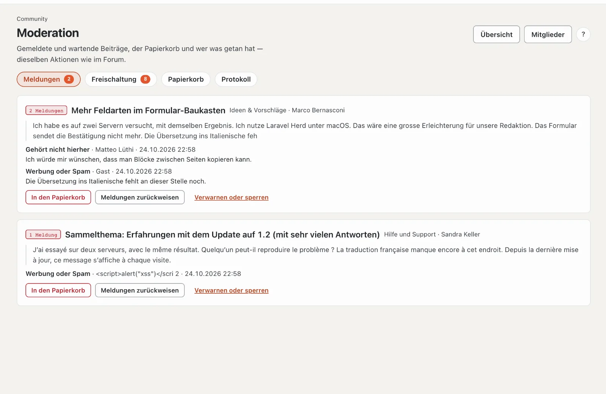
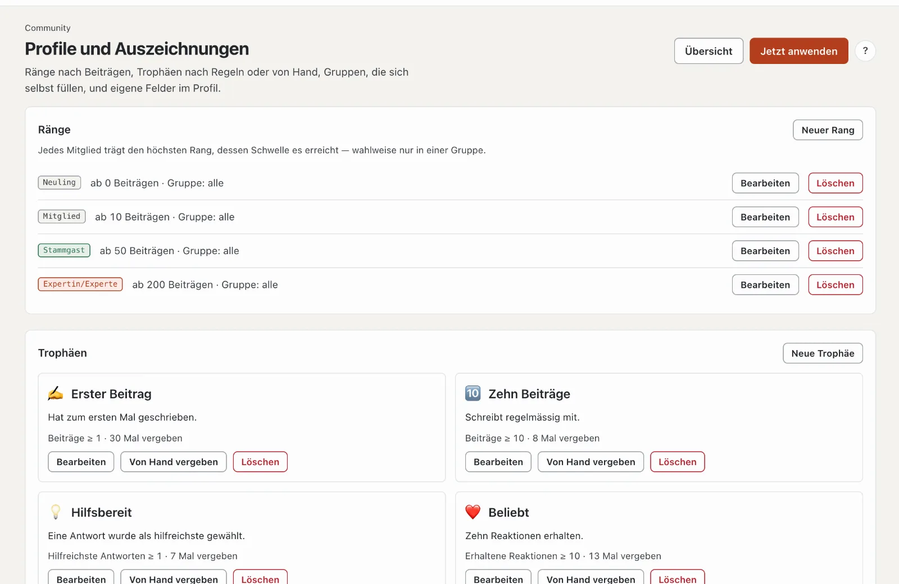

# Verwaltung der Community

Die Verwaltung liegt auf basaltocms.com im **Extranet** unter «Community», auf jeder anderen Site im Backend unter **Verwaltung › Community** — dieselben Seiten mit denselben Aktionen.

| Seite | Wofür |
| --- | --- |
| **Übersicht** | Zahlen, offene Moderation, Seite im Frontend, Ihr Konto im Team, Einstellungen |
| **Foren** | Baum mit Kategorien, Foren, Unterforen und Verweisen; Präfixe und Themenfelder je Forum |
| **Gruppen und Rechte** | Besuchergruppen und die Rechte-Matrix, global und je Forum (Ja, Nein, Nie) |
| **Moderation** | Meldungen, Freischaltung, Papierkorb, Protokoll mit Filter |
| **Mitglieder** | Suche und Filter (gesperrt, Schreibsperre, verwarnt); verwarnen, sperren, Spammer entfernen |
| **Hinweise** | Banner mit Bereich, Zielgruppe und Zeitraum, mit Vorschau |
| **Profile und Auszeichnungen** | Ränge, Trophäen, automatische Gruppen, eigene Profilfelder |

## Profile und Auszeichnungen

- **Ränge:** Titel, Farbe und auf Wunsch ein Zeichen (etwa ⭐, steht statt des farbigen Punkts) ab einer Zahl Beiträge, wahlweise nur für eine Gruppe.
- **Trophäen:** nach einer Regel oder von Hand. Regeln bringen die Module mit: Beiträge, erhaltene Reaktionen, Mitglied seit, Follower (Kern), eröffnete Themen und hilfreichste Antworten (Forum), «hat eine Lizenz» (Lizenzverkauf), «Autorin im Marktplatz» (Marktplatz). Die Vorschau zeigt, wie viele Mitglieder eine Regel heute trifft.
- **Eigene Profilfelder:** Text, mehrzeilig, Adresse oder **Auswahl** mit festen Möglichkeiten (eine je Zeile), je mit Sichtbarkeit (alle, angemeldete Mitglieder, nur Team) und auf Wunsch als Pflicht.
- **Automatische Gruppen:** Eine Regel füllt eine eigene Gruppe und nimmt nur die Mitgliedschaften wieder weg, die sie selbst gesetzt hat.
- Der Lauf geschieht täglich um 03:30 (`basalto:community-rules`) oder sofort mit «Jetzt anwenden».

## Einstellungen

Auf der Übersicht: Bearbeitungsfenster, Anhänge (Arten, Grösse, Speicher je Konto, **Anhänge je Beitrag**), welche **Reaktionen** zur Wahl stehen, Verweis nach dem Verschieben, Mindestabstand, Schwelle der Meldungen, Gültigkeit der Verwarnungen und die Punkte für Schreibsperre und Sperre mit ihrer Dauer, Zensur und was beim Löschen eines Kontos mit den Beiträgen geschieht.

### Bedingungen der Community

Ab Werk stimmt zu, wer das Forum öffnet: Ein Fenster nennt die Nutzungsbedingungen und die Community-Richtlinien (Seiten
des Themes, sonst Impressum und Datenschutz) und verlangt den Haken. Ohne Zustimmung zählt ein Konto wie ein Gast —
lesen ja, schreiben, reagieren, Nachrichten und Moderation nicht; das Forum dahinter ist gesperrt. Gäste stimmen im
Browser zu (Cookie `basalto_community_terms`). Im Kundenkonto stehen Datum, Uhrzeit und Fassung der Zustimmung,
mit «Zustimmung widerrufen» — danach kommt das Fenster wieder.

In den Einstellungen: **Zustimmung verlangen** (an/aus) und **Fassung** — eine neue Fassung (etwa das Datum der
Änderung) fragt alle noch einmal.

## Datenschutz

Auskunft und Löschen (`basalto:privacy`) umfassen Profil, Bilder, Beiträge, Anhänge, Reaktionen, Abos, Folgen, Blockieren, Nachrichten, Trophäen, Verwarnungen und Meldungen. Beiträge bleiben ab Werk **anonymisiert** stehen (die Diskussion bleibt lesbar); in den Einstellungen lässt sich «löschen» wählen — Themen ohne Beiträge anderer verschwinden dann ganz. Nachrichten in Konversationen bleiben für die übrigen Teilnehmenden anonym stehen.

## Suche, Sitemap und Feeds

Themen aus Foren, die Gäste lesen dürfen, stehen in der Suche der Site (Filter «Forum»), in der Sitemap und in den RSS-Feeds; jedes Thema trägt strukturierte Daten (`DiscussionForumPosting`). Ändern sich die Rechte, baut sich der Index neu; von Hand: `php artisan basalto:search-index`.

## Befehle

| Befehl | Wofür |
| --- | --- |
| `php artisan basalto:forum-seed <site>` | Startstruktur der Basalto-Community wie bei WoltLab: Allgemein (Neuigkeiten und Hinweise, Fragen vor dem Kauf), Kundenforen (Hilfe und Support, Ideen & Vorschläge, Fehlermeldungen — je mit Unterforum für Erledigtes), Individuelle Anpassung (Themes und Lava, Module und Plugins, Verweis auf die Entwickler-Doku), Sonstiges (Off-Topic); mit Symbolen, Präfixen und Themenfeldern — legt nichts doppelt an |
| `php artisan basalto:testdaten <site>` | füllt das Forum (und alles andere) mit vielen Testdaten zum Ausprobieren; `--entfernen` räumt sie wieder ab |
| `php artisan basalto:forum-recount [site]` | Zähler der Foren, Themen und Profile neu rechnen |
| `php artisan basalto:community-rules [site]` | Trophäen vergeben und Gruppen nach Regeln zuordnen |
| `php artisan basalto:community-digest` | tägliche Zusammenfassung per E-Mail |
| `php artisan basalto:forum-benchmark` | Lasttest mit 100 000 Beiträgen auf einer Wegwerf-Site: Themenliste und Thema unter 300 ms |

## Weiter

- [Moderation](moderation.md)
- [Einstellungen](../verwaltung/einstellungen.md)
