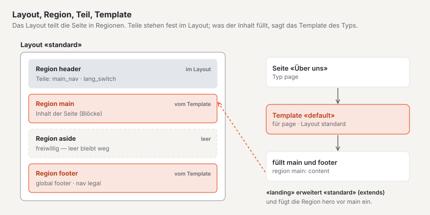
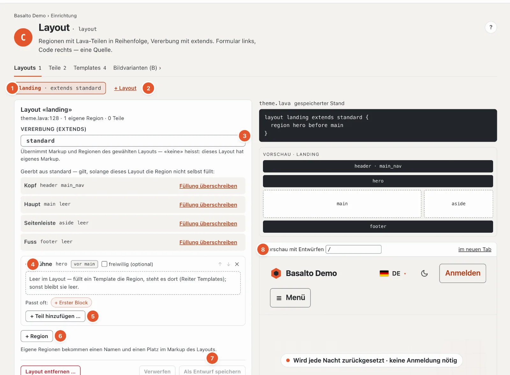
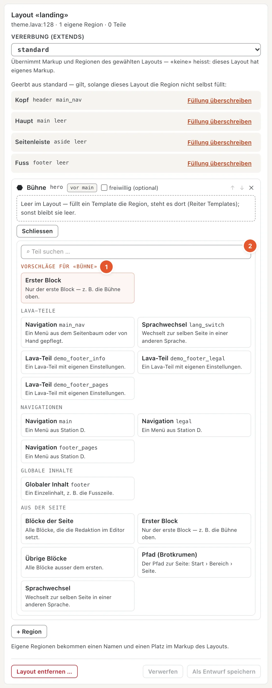
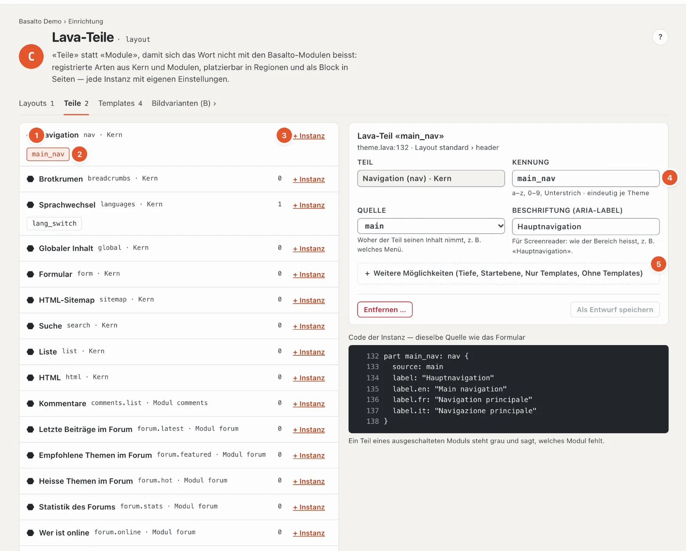
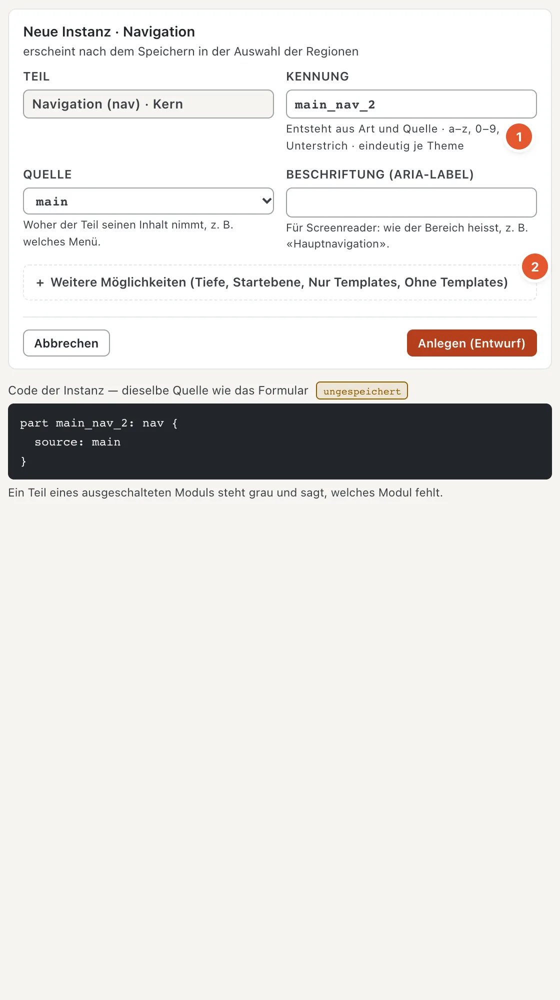
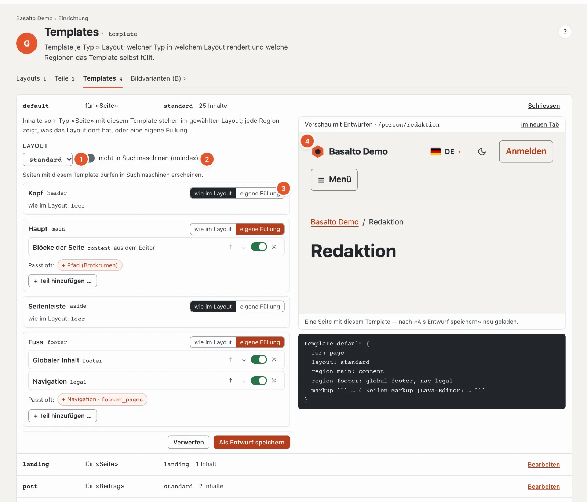

# Aufbau: Layouts, Teile und Templates

Die Station **«Wie ist sie gebaut?»** legt fest, aus welchen Bereichen eine Seite besteht und was in welchem Bereich steht. Sie fasst zwei Prüfungen zusammen: Layout (C) und Template (G).

- Ein **Layout** ist das Gerüst einer Seite: Kopf, Hauptteil, Fuss. Es teilt die Seite in **Regionen**.
- Ein **Teil** (Lava-Teil) ist ein fertiges Stück, das in einer Region steht — zum Beispiel die Hauptnavigation oder der Sprachwechsel. Teile kommen aus dem Kern und aus Modulen; Sie stellen sie mit eigenen Einstellungen auf.
- Ein **Template** sagt, wie ein Inhaltstyp in einem Layout erscheint und welche Regionen der Inhalt selbst füllt.
- Ein Layout kann ein anderes **erweitern** («extends»): Es übernimmt alles und ergänzt Regionen — im Starter fügt «landing» vor dem Hauptteil eine Bühne ein.

## Wo

Modus «Einrichtung» › «Wie ist sie gebaut?» › **«Layouts öffnen»**. Die Seite hat die Reiter **Layouts**, **Teile** und **Templates**, dazu einen Sprung zu den [Bildvarianten](aussehen.md#bildvarianten).

Liegt das Theme noch im Ordner der Installation, zeigt die Seite oben «Dieses Theme liegt im Ordner» und lässt sich nur ansehen; ändern lässt sie sich nach **«In die Datenbank übernehmen»**. Alle Änderungen entstehen danach als **Entwurf** und gehen über die Freigabe live — siehe [Entwürfe und Freigabe](entwuerfe.md).

## Reiter «Layouts»

1. **Das Layout wählen** — je Layout ein Knopf, mit «extends …», wenn es ein anderes erweitert.
2. **«+ Layout»** — ein neues Layout: Name (Vorschläge wie «schmal» oder «landing» per Klick) und **«Erbt von»** — darunter steht, welche Regionen es übernimmt. Das Markup (HTML) eines Layouts bleibt Code; ein Layout ganz ohne Vorlage legt man im Theme-Editor an.
3. **Vererbung (extends)** — von welchem Layout dieses Markup und Regionen übernimmt; «— keine: eigenes Markup» bei Layouts mit eigenem HTML.
4. **Die Regionen** — je Region eine Karte mit Name, Kennung und Platz («vor main»). **«freiwillig (optional)»** heisst: Bleibt die Region leer, fällt sie ganz weg. Mit ↑ und ↓ ändern Sie die Reihenfolge, ✕ entfernt die Region. Geerbte Regionen tragen «Geerbt aus …»; **«Füllung überschreiben»** gibt diesem Layout eine eigene Füllung. Eine leere Region füllt das Template — steht es dort nicht, bleibt sie leer.
5. **Teil hinzufügen** — siehe unten. Die Teile einer Region stehen in Reihenfolge und lassen sich verschieben, aus- und einschalten und entfernen.
6. **«+ Region»** — eine eigene Region: Name und Platz im Markup des Layouts (davor oder danach, bezogen auf eine bestehende Region). Häufige Regionen — Bühne, Seitenleiste, Hinweisband, Aufruf — setzen Name und Platz mit einem Klick. Setzt das Markup die Region schon ein, ist kein Platz nötig.
7. **«Als Entwurf speichern»** und **«Verwerfen»**; **«Layout entfernen …»** löscht ein Layout nach einer Rückfrage. Stimmt etwas nicht, heisst es «Nichts gespeichert — ein Theme mit Fehler geht nie live», und der Code zeigt die Stelle.
8. **Vorschau mit Entwürfen** — die Website mit Ihren gespeicherten Entwürfen, für einen Pfad Ihrer Wahl («/» ist die Startseite); «im neuen Tab» öffnet sie gross.

### Was in eine Region kommt

Unter jeder Region schlägt Basalto vor, was dort oft hingehört — als Knöpfe «Passt oft: + Navigation · main …»: im
**Kopf** die Hauptnavigation und den Sprachwechsel, im **Fuss** die Fusszeile und die Menüs für Rechtliches, in der
**Bühne** den ersten Block, im **Hauptbereich** die Blöcke der Seite, in der **Seitenleiste** Suche und Listen.
**«+ Teil hinzufügen …»** öffnet die ganze Auswahl:

1. **Vorschläge für die Region** — oben, ohne was schon drin ist.
2. **Suche** und die Gruppen **Lava-Teile**, **Navigationen**, **Globale Inhalte** und **Aus der Seite** (alle Blöcke,
   nur der erste, die übrigen, Pfad, Sprachwechsel) — je Eintrag ein Satz, wofür er da ist. Enter nimmt den ersten
   Treffer.

Rechts stehen dazu der **Code** des Layouts (gespeicherter Stand), **«Markup zeigen»** für das HTML, die **Befunde** mit E (Fehler) und W (Warnung) und eine **schematische Vorschau** der Regionen. Unten zeigt «Template je Typ × Layout», welche Templates dieses Layout nutzen und wie viele Inhalte daran hängen.

## Reiter «Teile»

1. **Die Arten von Teilen** — aus dem Kern (Navigation, Brotkrumen, Sprachwechsel, Globaler Inhalt, Formular, HTML-Sitemap, Suche, Liste, HTML) und aus Modulen (zum Beispiel Kommentare, Anmeldung für Mitglieder). Rechts die Zahl der Instanzen.
2. **Eine Instanz** — ein aufgestelltes Teil mit eigenem Namen, zum Beispiel «main_nav». Ein Klick öffnet seine Einstellungen.
3. **«+ Instanz»** — ein neues Teil dieser Art anlegen.
4. **Kennung** — Kleinbuchstaben, Ziffern und Unterstrich, eindeutig im Theme. Darunter die **Einstellungen der Art** mit einem Satz je Einstellung — bei einer Navigation zum Beispiel Quelle (welches Menü) und die Beschriftung für Screenreader.
5. **Weitere Möglichkeiten** — Tiefe, Startebene, **Nur Templates / Ohne Templates** (das Teil erscheint nur in bestimmten Templates oder in allen ausser diesen) und die Beschriftung je weiterer Sprache.

Bei einer **neuen Instanz** ist die erste Quelle schon gewählt, und die **Kennung** entsteht aus Quelle und Art
(1) — «main» und «nav» ergeben «main_nav» —, bis Sie sie selbst ändern. Selten Gebrauchtes steht unter **«Weitere
Möglichkeiten»** (2).

Instanzen stehen in Regionen eines Layouts — und als Block auf einzelnen Seiten («+ Lava-Teil» im Editor). Entfernen lässt sich eine Instanz erst, wenn sie in keiner Region mehr steht; sonst heisst es «Er steht in: … — zuerst dort herausnehmen». Gehört ein Teil zu einem Modul, das für die Site aus ist, steht es grau: Die Instanz bleibt, ausgegeben wird nichts.

## Reiter «Templates»

Je Template eine Zeile: Name, für welchen Typ («für «Seite»»), in welchem Layout und wie viele Inhalte es nutzen.
«Bearbeiten» öffnet es; oben steht in einem Satz, was ein Template tut:

1. **Layout** — in welchem Layout Inhalte mit diesem Template stehen.
2. **Nicht in Suchmaschinen (noindex)** — Seiten mit diesem Template erscheinen nicht bei Google & Co. und fehlen in
   der Sitemap. Heisst das Template wie eine Rechts-, Danke- oder Fehlerseite («legal», «danke», «404»), schlägt
   Basalto vor, noindex einzuschalten.
3. **Je Region: «wie im Layout» oder «eigene Füllung»** — alle Regionen des Layouts stehen da, auch solche, die nur das
   Markup einsetzt. «Eigene Füllung» übernimmt zuerst, was das Layout dort hat; danach ändern Sie es mit denselben
   Vorschlägen und derselben Auswahl wie im Layout («Passt oft», «+ Teil hinzufügen …»).
4. **Vorschau mit Entwürfen** — eine Seite, die dieses Template nutzt, mit Ihren gespeicherten Entwürfen; nach
   «Als Entwurf speichern» lädt sie neu.

Darunter steht der **Code** — das Template als Lava. Sein Markup (das HTML des Inhalts) bleibt Code und wird im
Theme-Editor geändert. Ein Typ kann mehrere Templates haben; welches eine Seite nutzt, wählen Sie in den Einstellungen
der Seite, Reiter «Layout» (siehe [Seiten](../redaktion/seiten.md)).

## Häufige Fragen

**Warum kann ich nichts ändern?**
Das Theme liegt im Ordner der Installation — übernehmen Sie es in die Datenbank. Oder Ihre Rolle erlaubt den Bereich «Design, Themes und Layouts» nur zum Ansehen.

**Ich habe gespeichert, aber die Website zeigt es nicht.**
Gespeichert wird als Entwurf. Die «Vorschau mit Entwürfen» zeigt ihn; live geht er erst nach der Freigabe (siehe [Entwürfe und Freigabe](entwuerfe.md)).

## Weiter

- [Menüs](menues.md)
- [Bausteine](bausteine.md)
- [Entwürfe und Freigabe in der Einrichtung](entwuerfe.md)
