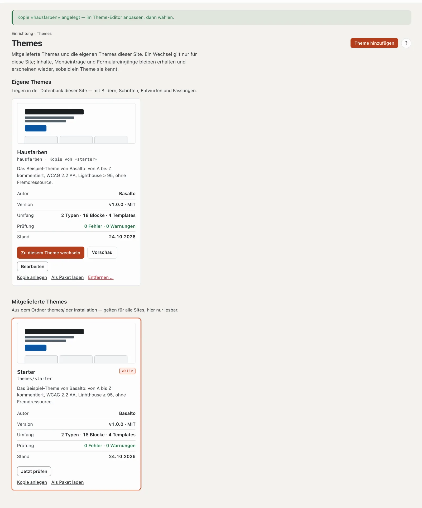
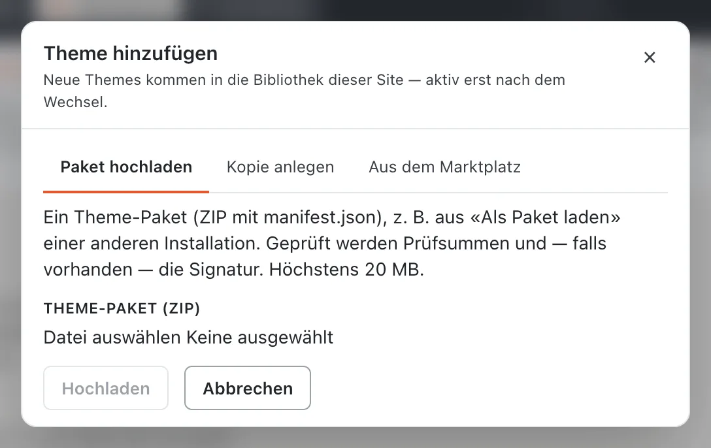
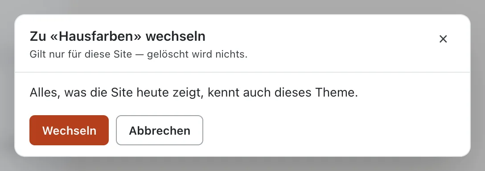
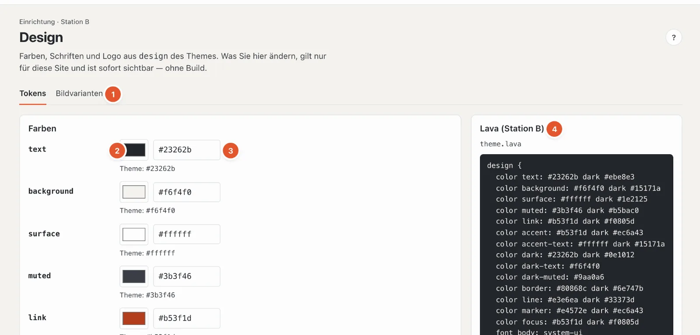
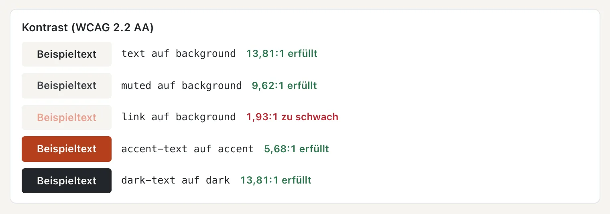
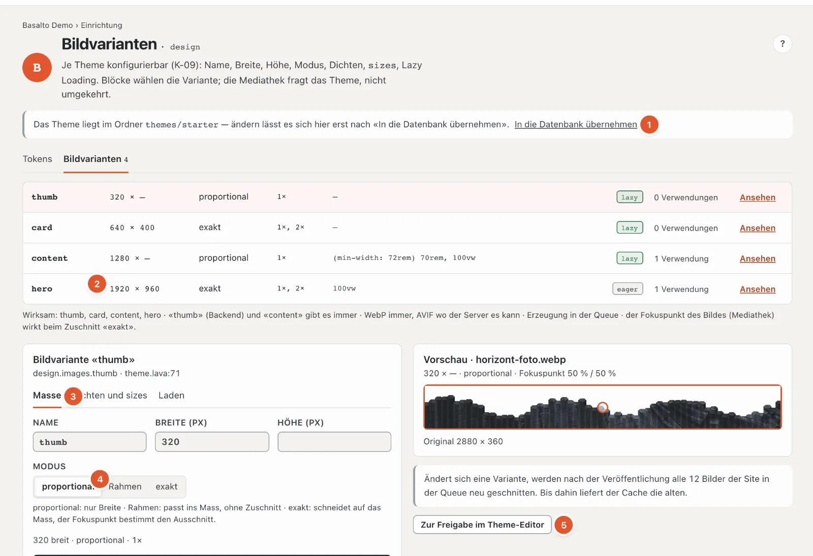
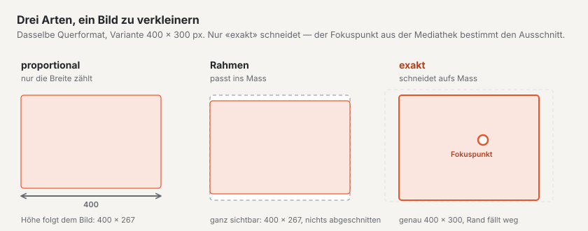

# Aussehen: Themes, Design und Bildvarianten

Die Station **«Wie sieht sie aus?»** bestimmt die Gestalt der Site. Das **Theme** gibt sie vor; im **Design** passen Sie Farben, Schriften und Logo an, in den **Bildvarianten** die Grössen, in denen Bilder ausgeliefert werden — alles ohne Code.

## Themes

Modus «Einrichtung» › «Wie sieht sie aus?» › **Themes** (im Fahrplan das Kästchen mit dem Namen des aktiven Themes).

Die Seite zeigt zwei Gruppen:

- **Eigene Themes** — liegen in der Datenbank dieser Site, mit Bildern, Schriften, Entwürfen und Fassungen. Sie lassen sich ändern.
- **Mitgelieferte Themes** — kommen aus dem Ordner `themes/` der Installation, gelten für alle Sites und sind hier nur lesbar.

Jede Karte zeigt ein Vorschaubild, Name und Herkunft (zum Beispiel «Kopie von «starter»», «aus dem Marktplatz», «aus Paket (signiert)»), die Beschreibung, **Autor**, **Version**, **Umfang** (Typen, Blöcke, Templates), das Ergebnis der **Prüfung** und den **Stand**. Das aktive Theme trägt die Marke «aktiv».

Die Knöpfe einer Karte:

- **«Zu diesem Theme wechseln»** — siehe unten.
- **«Vorschau»** — zeigt die Website mit diesem Theme, nur in Ihrer Sitzung. Oben steht dann «Vorschau mit Theme … läuft in Ihrer Sitzung — die Site selbst ist unverändert»; **«Vorschau beenden»** kehrt zurück. Die Vorschau steht allen offen, die die Seite sehen.
- **«Bearbeiten»** — öffnet das eigene Theme im Theme-Editor (Code).
- **«Jetzt prüfen»** — prüft das Theme neu; bei Fehlern führt **«Befunde ansehen»** zu den Meldungen. Ein Theme mit Fehlern lässt sich nicht wählen.
- **«Kopie anlegen»** — eine Kopie mit allen Dateien, Bildern und Schriften, der beste Start für ein eigenes Theme. Das Original bleibt unverändert.
- **«Als Paket laden»** — lädt das Theme als ZIP herunter, zum Beispiel für eine andere Installation.
- **«Entfernen …»** (nur eigene Themes) — löscht Dateien, Bilder, Schriften, Entwürfe und alle Fassungen des Themes; die Inhalte der Site bleiben. Ist das Theme aktiv, zeigt die Site danach sofort wieder das mitgelieferte Theme gleichen Namens. Wer es später noch braucht, wählt vorher **«Erst als Paket laden»**.
- **«Ausblenden»** (nur mitgelieferte, nicht aktive Themes) — nimmt ein Theme aus der Liste; unten holt **«Wieder einblenden»** es zurück.

### Ein Theme hinzufügen

**«Theme hinzufügen»** bietet drei Wege. Neue Themes kommen in die Bibliothek dieser Site — aktiv erst nach dem Wechsel.

- **Paket hochladen** — ein Theme-Paket (ZIP mit `manifest.json`), zum Beispiel aus «Als Paket laden» einer anderen Installation, bis 20 MB. Geprüft werden Prüfsummen und, falls vorhanden, die Signatur.
- **Kopie anlegen** — **Vorlage** wählen, **Bezeichnung** (wie das Theme im Backend heisst) und **Name** (Kleinbuchstaben, Ziffern und Bindestriche — so heisst das Theme in Lava und im Paket).
- **Aus dem Marktplatz** — Themes aus dem Marktplatz sind vom Hersteller signiert. Installiert kommen sie als eigenes Theme in die Bibliothek; ein späteres Update erscheint im Theme-Editor als Entwurf.

### Zu einem anderen Theme wechseln

**«Zu diesem Theme wechseln»** prüft zuerst, was die Site mit dem neuen Theme nicht mehr zeigen könnte, und listet es in einem Bericht:

- Inhaltstypen, die das Theme nicht kennt,
- Blöcke, die nicht mehr angezeigt werden,
- Templates, auf die Seiten verweisen,
- Menüs mit eigenen Einträgen,
- Formulare mit Eingängen.

Ein Wechsel gilt nur für diese Site, und **gelöscht wird nichts**: Was das neue Theme nicht kennt, bleibt in der Datenbank und erscheint wieder, sobald ein Theme es kennt. Steht nichts im Bericht («Alles, was die Site heute zeigt, kennt auch dieses Theme»), heisst der Knopf «Wechseln»; sonst **«Trotzdem wechseln»**.

Wechseln, hinzufügen und entfernen darf, wessen Rolle den Bereich «Design, Themes und Layouts» bearbeiten darf; sonst steht oben «Ihre Rolle erlaubt nicht, Themes zu wechseln, hinzuzufügen oder zu entfernen».

## Design

Modus «Einrichtung» › «Wie sieht sie aus?» › **«Design anpassen»**, Reiter **Tokens**. Was Sie hier ändern, gilt nur für diese Site und ist sofort sichtbar — ohne Build. Das Theme selbst bleibt unverändert.

1. **Tokens · Bildvarianten** — die zwei Reiter der Station.
2. **Farbwähler** — ein Klick öffnet die Farbauswahl des Systems.
3. **Farbe als Code** — `#rgb` oder `#rrggbb`. Darunter steht der Wert des Themes («Theme: #23262b»); weicht Ihre Farbe ab, setzt **«zurücksetzen»** sie zurück.
4. **Lava (Station B)** — der Teil `design` des Themes, nur zum Lesen. Darunter die **Stylesheets** des Themes und dieselben Werte **für Tailwind 4**, falls jemand die Site mit Tailwind weiterbaut.

Welche Farben es gibt, bestimmt das Theme — im Starter zum Beispiel `text`, `background`, `surface`, `muted`, `link`, `accent`, `accent-text`, `dark`, `dark-text`, `dark-muted`, `border`, `line`, `marker` und `focus`.

### Farbvariante

Bringt das Theme Farbvarianten mit, steht über den Farben die Karte **Farbvariante**: **Standard** (die Farben des Themes) und je Variante eine Karte mit ihrem Namen, einer Vorschau hell und dunkel und drei Farbpunkten. Ein Klick wählt die Variante; sie gilt sofort auf der ganzen Site, auch in der dunklen Darstellung.

- Die Farbfelder folgen der Variante; darunter steht ihr Wert («Salbei: #23402f»).
- Eine Farbe, die Sie selbst gesetzt haben, bleibt beim Wechsel der Variante stehen und gilt zusätzlich. «zurücksetzen» am Feld führt zum Wert der Variante.
- Themes ohne Farbvarianten zeigen die Karte nicht.

### Kontrast

Unter den Farben prüft Basalto jedes Paar aus Schrift- und Hintergrundfarbe gegen die Regel der Barrierefreiheit (WCAG 2.2 AA): **mindestens 4,5:1**. Die Paare ergeben sich aus den Namen — `text` auf `background`, `link` auf `background`, `accent-text` auf `accent` und so weiter. Je Paar sehen Sie einen Beispieltext, das Verhältnis und «erfüllt» oder **«zu schwach»**.

Ist ein Paar zu schwach, wird die Farbe **nicht gespeichert**; am Feld steht zum Beispiel «Kontrast «link» auf «background» ist 1,93:1 — mindestens 4,5:1». Wählen Sie eine dunklere oder hellere Farbe.

### Schriften

Je Rolle der Schrift (zum Beispiel **body**, **heading**, **code**) ein Feld mit dem Namen der Schrift; darunter der Wert des Themes und das Gewicht. Die Schrift muss im Theme liegen oder auf dem Gerät vorhanden sein — sonst gilt die Ersatzschrift. «zurücksetzen» stellt den Wert des Themes wieder her.

### Logo

Das Theme zeigt das Logo dort, wo es `{{ site.logo }}` setzt. Sie wählen:

- **aus dem Theme** — das Logo, das das Theme mitbringt (Vorgabe),
- **Bild aus der Mediathek** — ein eigenes Bild,
- **kein Logo**.

Sobald etwas vom Theme abweicht, erscheint oben rechts **«Alles wie im Theme»**: Es setzt die Farbvariante, alle Farben, Schriften und das Logo auf das Theme zurück.

## Bildvarianten

Reiter **Bildvarianten** neben «Tokens». Eine **Bildvariante** ist eine Grösse, in der Basalto jedes Bild der Mediathek bereithält — zum Beispiel «thumb» für Vorschaubilder, «card» für Karten, «hero» für die Bühne. Blöcke wählen die Variante; Redaktorinnen und Redaktoren laden nur das Original hoch.

1. **Theme im Ordner** — liegt das Theme noch im Ordner der Installation, lassen sich die Varianten erst nach **«In die Datenbank übernehmen»** ändern (siehe [Entwürfe und Freigabe](entwuerfe.md)).
2. **Die Varianten** — je Zeile Name, Masse (Breite × Höhe, «—» heisst frei), Modus, Dichten, `sizes`, «lazy» oder «eager», wie oft die Variante verwendet wird, und «Ansehen» bzw. «Bearbeiten». **«+ Variante»** legt eine neue an.
3. **Die gewählte Variante** in drei Reitern: **Masse** (Name, Breite, Höhe, Modus), **Dichten und sizes**, **Laden**. Darunter der Code der Variante.
4. **Modus** — wie das Bild auf das Mass kommt (siehe Schema).
5. **Speichern** — von selbst in den Entwurf (der Name beim Verlassen des Felds); **«Zur Freigabe im Theme-Editor»** reicht die Änderung ein.

Die Einstellungen im Einzelnen:

- **Modus**: **proportional** — nur die Breite zählt, die Höhe folgt dem Bild; **Rahmen** — passt ganz ins Mass, ohne Zuschnitt; **exakt** — schneidet auf das Mass, der **Fokuspunkt** des Bildes (in der Mediathek gesetzt) bestimmt den Ausschnitt.
- **Dichten** — 1× für normale, 2× für hochauflösende Bildschirme. Höhere Dichten entstehen nur, wenn das Original gross genug ist; sonst steht «2× bräuchte … px Breite — bleibt 1×».
- **sizes** — sagt dem Browser, wie breit das Bild auf der Seite erscheint, zum Beispiel «100vw» für volle Breite.
- **Lazy Loading** — Bilder laden erst, wenn sie ins Bild scrollen. Aus für Bilder oben auf der Seite (Bühne), sonst an.

Wichtig:

- «thumb» (für das Backend) und «content» gibt es immer.
- Basalto liefert immer WebP, dazu AVIF, wo der Server es kann. Die Varianten entstehen im Hintergrund (Warteschlange).
- Ändert sich eine Variante, werden **nach der Veröffentlichung** alle Bilder der Site neu geschnitten; bis dahin liefert der Cache die alten. Hat die Site schon Bilder, zeigt eine Vorschau den neuen Zuschnitt am ersten Bild.

## Häufige Fragen

**Die Farbe lässt sich nicht speichern.**
Der Kontrast ist zu schwach. Die Meldung am Feld nennt das Paar und das Verhältnis — mindestens 4,5:1.

**Ich habe eine Farbvariante gewählt, aber eine Farbe passt nicht dazu.**
Sie haben diese Farbe früher selbst gesetzt; eigene Farben gelten über der Variante. «zurücksetzen» am Feld übernimmt den Wert der Variante.

**Ich habe das Theme gewechselt, und ein Teil der Seiten sieht leer aus.**
Das neue Theme kennt deren Blöcke oder Templates nicht. Nichts ist verloren: Wechseln Sie zurück, oder ergänzen Sie das neue Theme.

**Was ist der Unterschied zwischen Design und Theme-Editor?**
Im Design ändern Sie Werte, die das Theme freigibt (Farben, Schriften, Logo). Im Theme-Editor ändern Sie das Theme selbst, in Lava.

## Weiter

- [Aufbau: Layouts, Teile und Templates](aufbau.md)
- [Themes](../entwickler/themes.md)
- [Marktplatz für Installationen](../marktplatz/installieren.md)
