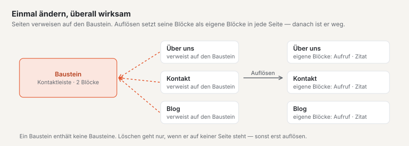
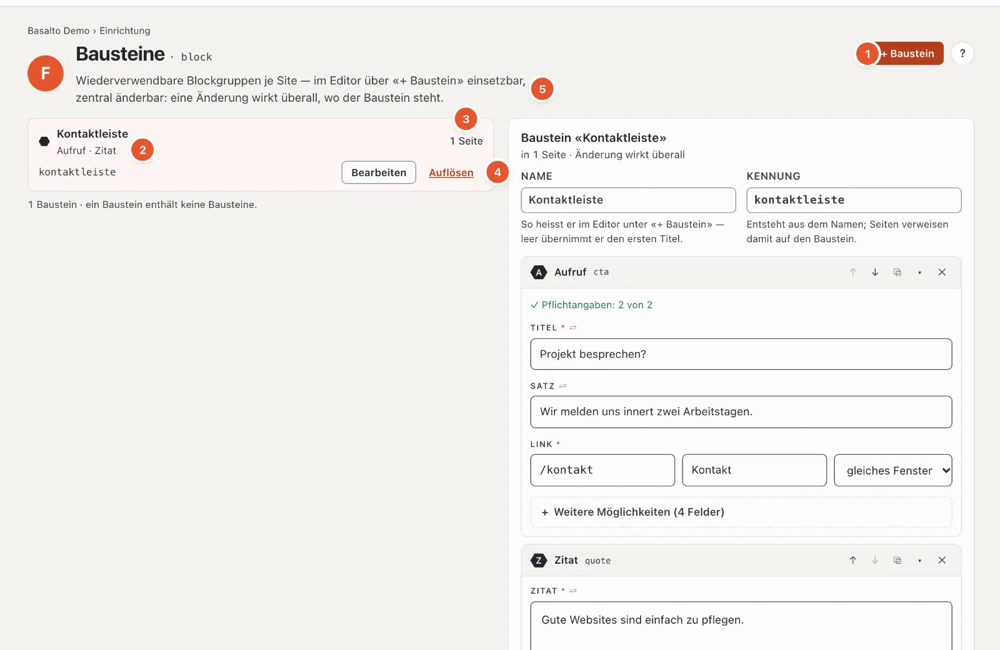

# Bausteine

Die Station **«Woraus bestehen Seiten?»** hat zwei Seiten: Die **Blöcke** — Text, Bild, Aufruf, Karten und so weiter — bringt das Theme mit; was es gibt, sehen Sie in der Block-Palette des Editors (siehe [Inhalte mit Blöcken bearbeiten](../redaktion/bloecke.md)). **Bausteine** dagegen legen Sie selbst an: eine Gruppe von Blöcken, die auf mehreren Seiten gleich steht — eine Kontaktleiste, ein Aufruf, ein Hinweis zu den Öffnungszeiten.

Der Unterschied:

| | Block | Baustein | Lava-Teil |
| --- | --- | --- | --- |
| Was | ein Stück Inhalt einer Seite | eine Gruppe von Blöcken mit festem Inhalt | ein Stück des Themes mit Einstellungen (Menü, Suche, Formular) |
| Woher | Theme | Sie, hier | Kern und Module, aufgestellt unter [Aufbau](aufbau.md#reiter-teile) |
| Ändern | auf jeder Seite einzeln | einmal — wirkt überall | in seinen Einstellungen |

## Wo

Modus «Einrichtung» › «Woraus bestehen Seiten?» › **«Bausteine verwalten»**. Den Code der Blöcke zeigt «Blöcke im Code ansehen» im Theme-Editor.

1. **«+ Baustein»** legt einen neuen an.
2. **Die Liste** — je Baustein Name, die Blöcke darin (hier «Aufruf · Zitat»), Kennung und «Bearbeiten».
3. **Wo er steht** — auf wie vielen Seiten der Baustein eingesetzt ist; im geöffneten Baustein unter «Steht auf» mit Links zu den Seiten.
4. **«Auflösen»** — siehe unten.
5. **Der geöffnete Baustein** — «in 1 Seite · Änderung wirkt überall».

## Einen Baustein anlegen und ändern

1. **«+ Baustein»**, dann **Name** (zum Beispiel «Kontaktleiste»). Die **Kennung** entsteht daraus; sie lässt sich anpassen (Kleinbuchstaben, Ziffern, Bindestrich). Lassen Sie den Namen leer, übernimmt er den ersten Titel, den Sie im ersten Block schreiben.
2. Blöcke hinzufügen — mit der Block-Palette wie im Editor einer Seite, mit denselben Feldern, ↑ ↓, Duplizieren und Entfernen. Das Formular zeigt das Wichtigste zuerst, Hilfe an jedem Feld und unter «Weitere Möglichkeiten» die Feineinstellungen ([Die Felder eines Blocks](../redaktion/bloecke.md#die-felder-eines-blocks)).
3. Rechts unten zeigt das Fenster **«Live-Vorschau»** den Baustein mit dem Theme Ihrer Site, bei jeder Eingabe neu — das Feld, in dem Sie schreiben, leuchtet darin auf, und ein Klick in die Vorschau springt zum Feld ([Live-Vorschau](../redaktion/bloecke.md#live-vorschau-im-fenster)).
4. **«Anlegen»**. Der Baustein erscheint im Editor jeder Seite unter **«+ Baustein»**. Danach speichern sich Änderungen selbst; die Kennung ändert sich erst mit Enter oder beim Verlassen des Felds — Seiten verweisen darauf.

**Achtung:** Ein Baustein hat keine Fassungen. Eine Änderung gilt nach dem Speichern (eine kurze Pause nach dem Tippen) **sofort auf allen Seiten**, die ihn tragen — ohne Einreichen und Freigabe. Die Änderung steht im Protokoll.

Ein Baustein enthält keine Bausteine — in der Palette fehlt dort die Gruppe «Wiederverwendbar» für Bausteine.

## Einen Baustein einsetzen

Im Editor einer Seite: **«+ Block einfügen»** › Gruppe «Wiederverwendbar» › **«+ Baustein»** und den Baustein wählen («Baustein einsetzen»). Auf der Seite steht dann ein **Verweis** mit dem Hinweis «Verweis — Änderungen am Baustein wirken auf allen Seiten, die ihn tragen»; der Inhalt lässt sich dort nicht ändern.

Soll eine Seite den Inhalt abweichend zeigen, lösen Sie den Verweis **auf dieser Seite** auf: Seine Blöcke werden zu Kopien, die Sie hier frei ändern. Der Baustein selbst und die übrigen Seiten bleiben, wie sie sind.

## Auflösen oder löschen

- **«Auflösen»** — auf allen Seiten, die den Baustein tragen, werden seine Blöcke zu **eigenen Blöcken** der Seite; nichts geht verloren. Danach ist der Baustein weg. Basalto fragt vorher: «… auflösen?» und nennt die Seiten.
- **«Löschen»** — nur möglich, wenn der Baustein auf keiner Seite steht. Sonst lösen Sie ihn zuerst auf oder nehmen ihn aus den Seiten heraus.

Ändern dürfen Rollen mit dem Bereich «Typen und Bausteine»; sonst steht oben «Ihre Rolle erlaubt, Bausteine anzusehen, nicht zu ändern». Einsetzen geht für alle, die Seiten bearbeiten dürfen.

## Häufige Fragen

**Ich habe einen Baustein geändert — warum ist das schon live?**
Bausteine haben keine Fassungen; eine Änderung wirkt sofort überall.

**Kann ein Baustein auf einer Seite anders aussehen?**
Nicht als Baustein — er ist überall gleich. Lösen Sie ihn im Editor dieser Seite auf (dann sind es eigene Blöcke), oder legen Sie einen zweiten Baustein an.

## Weiter

- [Inhaltstypen](inhaltstypen.md)
- [Inhalte mit Blöcken bearbeiten](../redaktion/bloecke.md)
