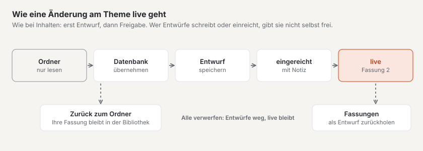
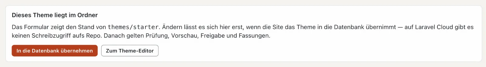
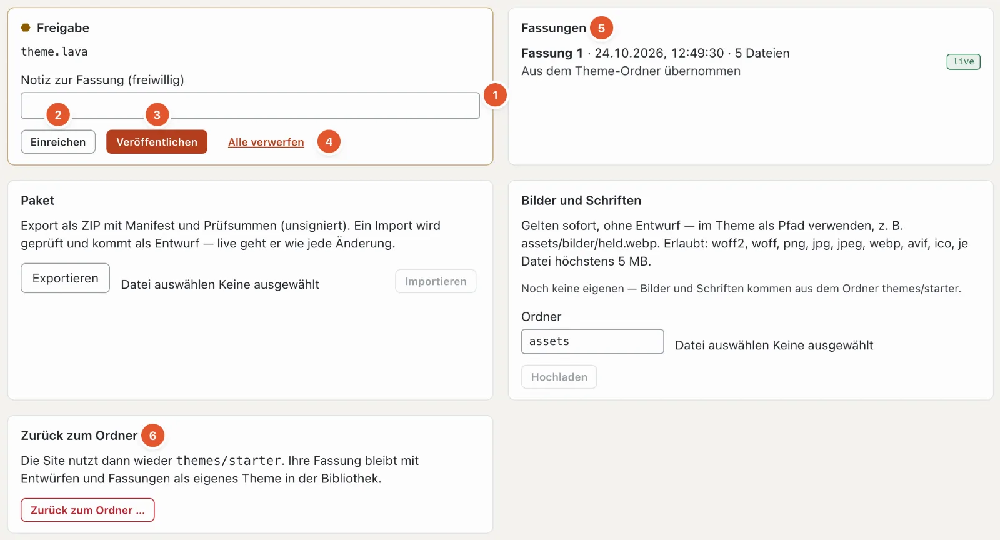

# Entwürfe und Freigabe in der Einrichtung

Änderungen an Layouts, Teilen, Templates, Bildvarianten und am Code des Themes gehen nicht sofort live. Sie entstehen als **Entwurf**, werden geprüft und erst mit **«Veröffentlichen»** zur neuen **Fassung** des Themes — wie Inhalte im Modus «Inhalte».

Ausnahmen, die sofort gelten: die Werte im [Design](aussehen.md#design) (Farben, Schriften, Logo), die Einstellungen der [Site](site.md), [Menüs](menues.md), [Bausteine](bausteine.md) und Bilder und Schriften des Themes.

## Theme im Ordner oder in der Datenbank

Ein mitgeliefertes Theme liegt im Ordner `themes/` der Installation. Diesen Ordner ändert Basalto nie — auf gehosteten Installationen gibt es dort auch keinen Schreibzugriff. Darum zeigen Layouts, Bildvarianten und Theme-Editor anfangs «Dieses Theme liegt im Ordner» und lassen sich nur ansehen.

**«In die Datenbank übernehmen»** legt für diese Site eine eigene Fassung des Themes in der Datenbank an (Fassung 1, «Aus dem Theme-Ordner übernommen»). Ab dann gelten Prüfung, Vorschau, Entwürfe, Freigabe und Fassungen. Im Prüfbericht steht danach «Datenbank» statt «Dateien».

## Entwürfe

Jedes **«Als Entwurf speichern»** — in den Layouts, bei den Bildvarianten oder im Theme-Editor — legt einen Entwurf an. Basalto prüft dabei das ganze Theme: Hat es einen Fehler, wird **nichts gespeichert** («ein Theme mit Fehler geht nie live»), und der Code zeigt die Stelle.

Was die Entwürfe bewirken, zeigt die **Vorschau mit Entwürfen** — in den Layouts und im Theme-Editor, für einen Pfad Ihrer Wahl. **«Ganze Site mit den Entwürfen durchsehen»** schaltet die Vorschau für Ihre Sitzung auf die ganze Website; Besucher sehen weiter die live Fassung.

## Die Freigabe

Unten im Theme-Editor (Modus «Einrichtung» › «Code») steht die Karte **Freigabe**:

Oben nennt sie die Dateien mit Entwürfen (hier `theme.lava`).

1. **Notiz zur Fassung** — freiwillig, zum Beispiel «Bildvariante thumb breiter». Sie steht später in der Liste der Fassungen.
2. **«Einreichen»** — die Entwürfe gehen zur Prüfung.
3. **«Veröffentlichen»** — die Entwürfe werden zur neuen Fassung und gehen live. Ändern sich dabei Bildvarianten, schneidet Basalto alle Bilder der Site im Hintergrund neu.
4. **«Alle verwerfen»** — alle Entwürfe weg; die live Fassung bleibt.
5. **Fassungen** — jede veröffentlichte Fassung mit Zeitpunkt, Zahl der Dateien und Notiz; «live» markiert die aktuelle. **«Als Entwurf zurückholen»** macht eine alte Fassung wieder zum Entwurf — so nehmen Sie eine Änderung zurück.
6. **«Zurück zum Ordner …»** — die Site nutzt wieder das mitgelieferte Theme aus dem Ordner. Ihre Fassung bleibt mit Entwürfen und Fassungen als eigenes Theme in der [Bibliothek](aussehen.md#themes).

Verlangt die Site das **Vier-Augen-Prinzip** («Verwaltung › Einstellungen», Gruppe «Freigabe», «Vier-Augen-Prinzip» — ab Werk aus), müssen Entwürfe zuerst eingereicht werden, und wer sie geschrieben oder eingereicht hat, gibt sie nicht selbst frei. Ohne diese Einstellung dürfen Sie direkt veröffentlichen.

Daneben stehen die Karten **Paket** (das Theme als ZIP exportieren oder ein Paket importieren — ein Import kommt als Entwurf) und **Bilder und Schriften** (Dateien des Themes hochladen; sie gelten sofort, ohne Entwurf).

## Häufige Fragen

**Ich habe gespeichert, aber die Website zeigt die Änderung nicht.**
Sie haben einen Entwurf gespeichert. Veröffentlichen Sie ihn in der Karte «Freigabe» des Theme-Editors — oder lassen Sie ihn freigeben, wenn das Vier-Augen-Prinzip gilt.

**«Nichts gespeichert» — was nun?**
Das Theme hätte mit Ihrer Änderung einen Fehler. Der Befund nennt die Stelle; korrigieren Sie sie und speichern Sie erneut.

## Weiter

- [Live gehen](live-gehen.md)
- [Einrichtung: die Site gestalten und aufbauen](README.md)
