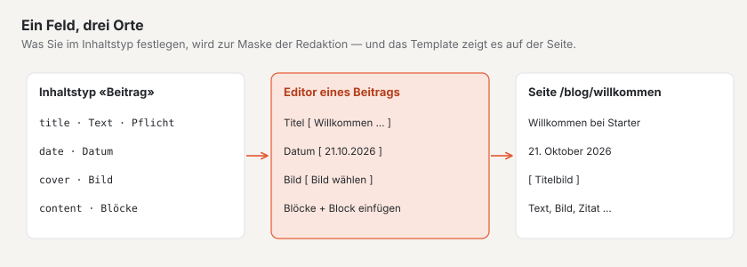
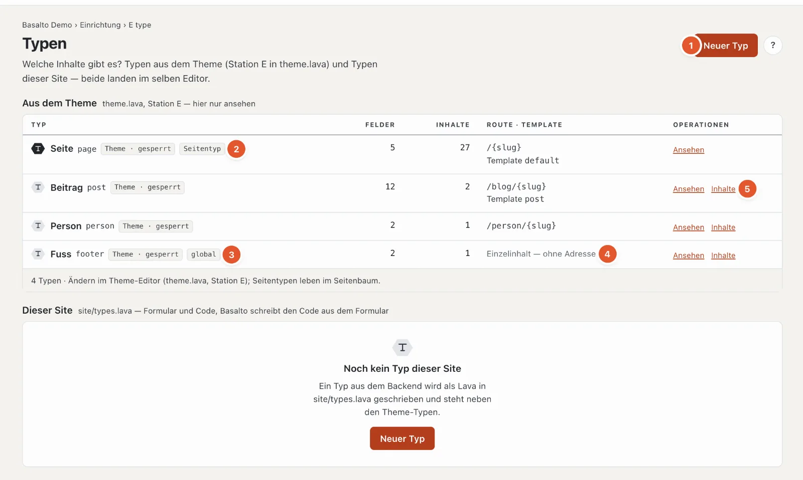
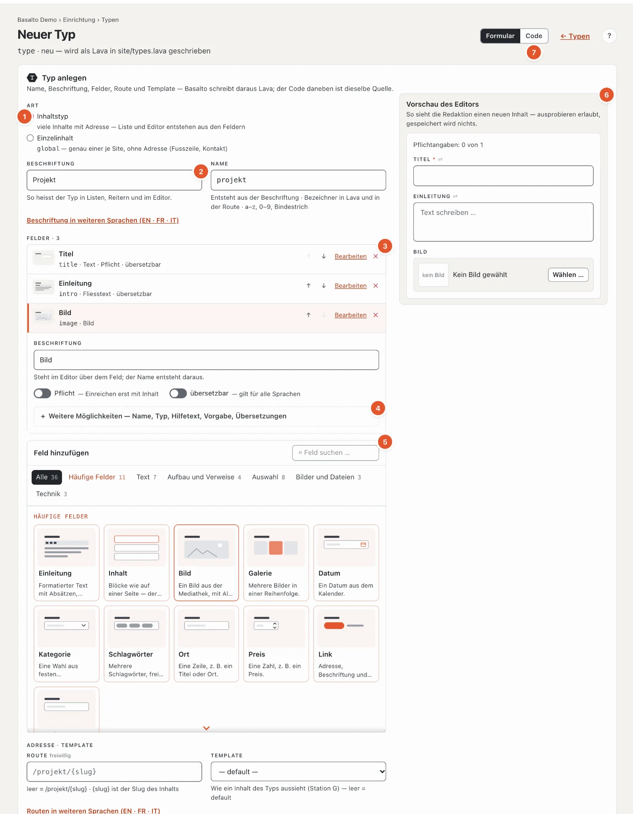
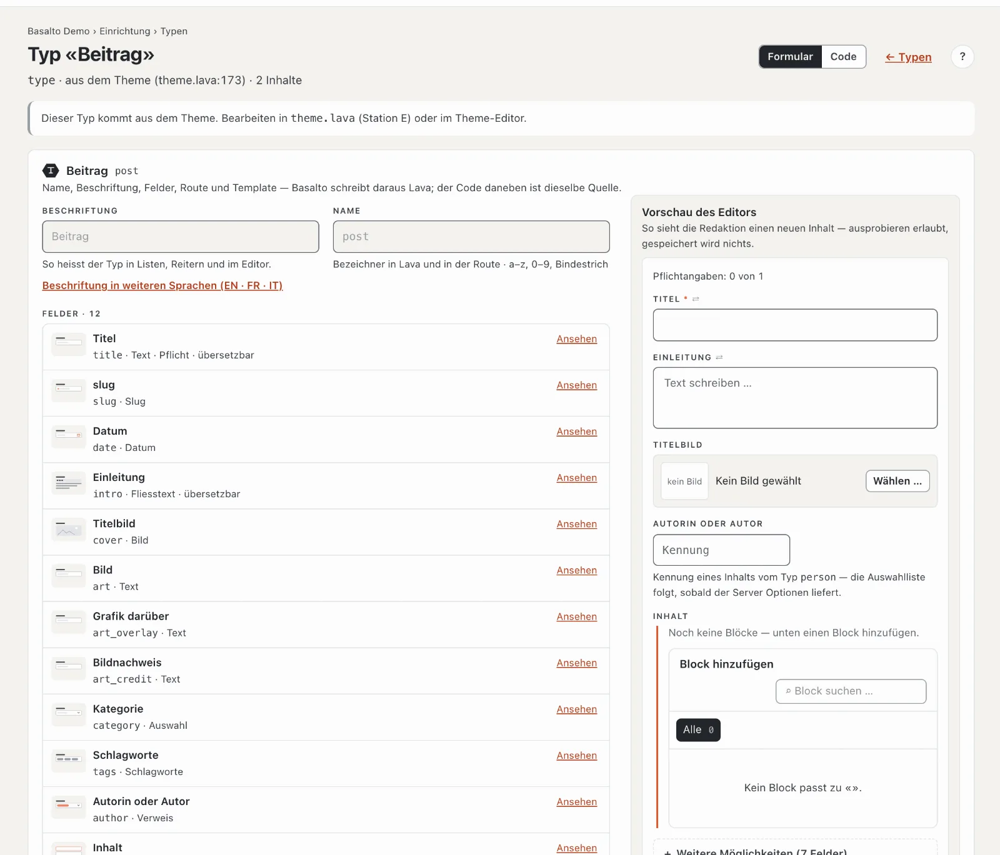

# Inhaltstypen

Die Station **«Was lässt sich pflegen?»** legt fest, welche Arten von Inhalten die Site kennt — Seiten, Beiträge, Personen, Veranstaltungen — und welche **Felder** jede Art hat. Aus den Feldern entsteht die Maske, die die Redaktion im Editor ausfüllt.

## Wo

Modus «Einrichtung» › «Was lässt sich pflegen?» › **«Inhaltstypen öffnen»**.

Die Seite hat zwei Listen:

- **Aus dem Theme** — die Typen, die das Theme mitbringt. Hier nur ansehen; ändern lassen sie sich im Theme-Editor (Station E).
- **Dieser Site** — Typen, die Sie im Backend anlegen. Basalto schreibt sie als Lava in `site/types.lava`; sie stehen gleichberechtigt neben den Typen des Themes.

Je Typ: Name und Kennung, Marken wie «Theme · gesperrt», die Zahl der Felder und der Inhalte, Adresse (Route) und Template, und die Operationen.

1. **«Neuer Typ»** legt einen Typ dieser Site an.
2. **Seitentyp** — der Typ «Seite» lebt im [Seitenbaum](../redaktion/seiten.md); seine Inhalte haben dort ihren Platz.
3. **global** — ein **Einzelinhalt**: genau einer je Site, ohne Adresse, zum Beispiel die Fusszeile.
4. Statt Route steht bei Einzelinhalten «Einzelinhalt — ohne Adresse».
5. **«Inhalte»** öffnet die Liste aller Inhalte dieses Typs (bei Einzelinhalten den einen Inhalt); **«Ansehen»** bzw. **«Bearbeiten»** den Typ.

Kennt das Theme einen Typ nicht mehr, von dem es noch Inhalte gibt, steht er mit «nicht mehr definiert — die Inhalte bleiben». Kompiliert das Theme nicht, zeigt die Seite oben die Befunde.

## Einen Typ anlegen

1. **Art**:
   - **Inhaltstyp** — viele Inhalte mit Adresse; Liste und Editor entstehen aus den Feldern (zum Beispiel Beiträge, Projekte).
   - **Einzelinhalt** — genau einer je Site, ohne Adresse und ohne Template; das Theme liest ihn über einen Baustein «global» (zum Beispiel Fusszeile, Kontaktangaben).
2. **Beschriftung** — so heisst der Typ in Listen, Reitern und im Editor, zum Beispiel «Projekt». Der **Name** entsteht daraus («projekt»): die Kennung in Lava und in der Adresse, aus Kleinbuchstaben, Ziffern und Bindestrich; ändern Sie ihn, bleibt er, wie Sie ihn schreiben. Beschriftungen in weiteren Sprachen stehen hinter «Beschriftung in weiteren Sprachen».
3. **Felder** — je Feld eine Zeile mit Zeichnung, Beschriftung, Name und Typ. Ein Inhaltstyp braucht das Feld **title**; es trägt den Titel in Listen und im Editor und ist schon da. Mit ↑ und ↓ ändern Sie die Reihenfolge, ✕ nimmt ein Feld weg, **«Bearbeiten»** öffnet seine Einstellungen — zuerst das Wichtigste: **Beschriftung** (der Name des Feldes folgt ihr, solange Sie ihn nicht selbst ändern), **Pflicht**, **übersetzbar** und was der Feldtyp braucht (Optionen einer Auswahl, erlaubte Blöcke, Zieltyp eines Verweises).
4. **Weitere Möglichkeiten** eines Feldes — Name, Feldtyp, **Hilfetext** (steht im Editor unter dem Feld), **Vorgabe** und die Beschriftung in weiteren Sprachen. Steht dort ein Fehler, ist der Bereich schon offen.
5. **Feld hinzufügen** — eine Palette wie bei den Blöcken: Zeichnung und Satz je Feldtyp, nach Gruppen, mit Suche. Die **häufigen Felder** bringen Beschriftung je Sprache und Name gleich mit: Einleitung, Inhalt (Blöcke — alle Blöcke des Themes erlaubt), Bild, Galerie, Datum, Kategorie, Schlagwörter, Ort, Preis, Link, Kunde.
6. **Vorschau des Editors** — rechts sehen Sie, was die Redaktion bei einem neuen Inhalt dieses Typs ausfüllt, bei jeder Änderung neu; ausprobieren geht, gespeichert wird nichts.
7. **Formular · Code** — oben rechts schalten Sie zur Code-Ansicht. Formular und Code sind zwei Ansichten derselben Quelle; der Code erscheint nach dem Speichern.

Darunter **Adresse und Template**: die **Route** der Inhalte, zum Beispiel `/projekte/{slug}` — `{slug}` ist der Slug des Inhalts, leer gilt `/‹name›/{slug}` — und das **Template** aus Station G (leer gilt «default»). Routen weiterer Sprachen stehen hinter «Routen in weiteren Sprachen»; ist dort eine Beschriftung eingetragen, schlägt Basalto die Route daraus vor («Aus der Beschriftung: /projects/{slug} übernehmen»).

**«Speichern»** legt den Typ an; danach speichern sich Änderungen selbst, Namen beim Verlassen des Feldes. **«Speichern und schliessen»** führt zurück zur Liste.

### Die Feldtypen

| Feldtyp | Wofür |
| --- | --- |
| Text · Mehrzeiliger Text | kurze oder längere Texte ohne Formatierung |
| Fliesstext · Markdown | formatierter Text |
| Blöcke | der Block-Editor; **Erlaubte Blöcke** bestimmt, welche Blöcke man einfügen darf — ohne Auswahl hat der Editor keinen Inhaltsbereich |
| Zahl · Ja/Nein · Datum · Datum und Zeit | Werte |
| Auswahl | eine Wahl aus **Optionen** (mit Komma getrennt) |
| Schlagworte | frei vergebene Stichwörter, zum Beispiel für den Blog |
| Bild · Galerie · Datei | aus der Mediathek |
| Link · URL · E-Mail | Adressen |
| Verweis | auf einen anderen Inhalt; **Zieltyp** sagt, auf welchen Typ (zum Beispiel ein Beitrag auf seine Autorin vom Typ «Person») |
| Wiederholung | eine Gruppe von Feldern, die sich mehrfach anlegen lässt |
| Slug · SEO · Farbe · Code · JSON | Spezialfälle |

**Übersetzbar** heisst: Das Feld hat je Sprache einen eigenen Wert und erscheint beim Übersetzen. Sonst gilt es für alle Sprachen («geteilt», siehe [Übersetzen](../redaktion/uebersetzen.md)).

## Einen Typ aus dem Theme ansehen

Typen aus dem Theme zeigen dieselbe Maske, gesperrt, mit dem Hinweis «Dieser Typ kommt aus dem Theme». So sehen Sie, welche Felder die Redaktion ausfüllt — hier zum Beispiel Titel, Datum, Einleitung, Titelbild, Kategorie (Auswahl), Schlagworte, Autor (Verweis auf «Person») und Blöcke mit den erlaubten Blöcken.

## Einen Typ löschen

Unten im Typ: **«Löschen»**, dann «Ja, löschen». Die Inhalte dieses Typs bleiben in der Datenbank; ohne Typ erscheinen sie nicht mehr, bis ein Typ mit gleichem Namen sie wieder kennt.

## Häufige Fragen

**Wo pflege ich einen Einzelinhalt, zum Beispiel die Fusszeile?**
Im Modus «Inhalte» › **Inhalte**: Er hat dort einen eigenen Reiter mit seiner Beschriftung («Fuss»). Weil es ihn genau einmal gibt, fehlt dort «Neuer Inhalt».

**Ich sehe meinen neuen Typ nicht in «Inhalte».**
Speichern Sie den Typ und laden Sie die Liste «Inhalte» neu. Seitentypen stehen im Seitenbaum, nicht dort.

**Kann ich einen Typ des Themes ändern?**
Nicht hier. Ändern Sie ihn im Theme-Editor — oder legen Sie einen eigenen Typ dieser Site an.

## Weiter

- [Bausteine](bausteine.md)
- [Seiten und Seitenbaum](../redaktion/seiten.md)
