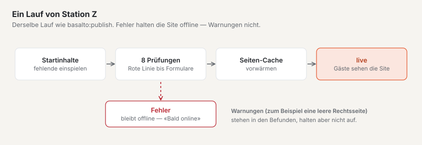
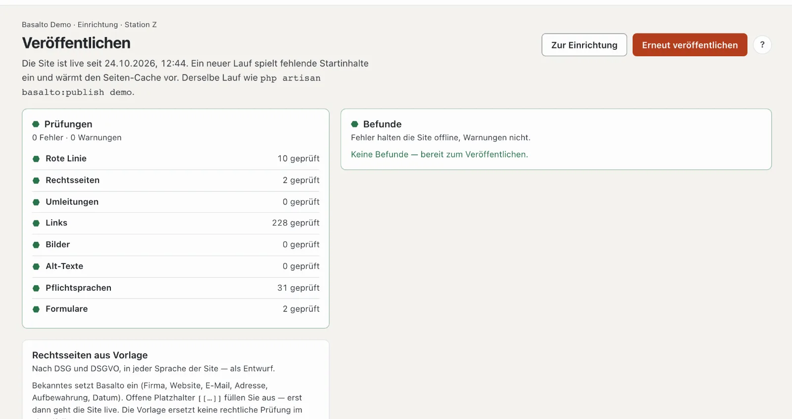

# Live gehen

Die letzte Station, **«Bereit für live?»** (Station Z), prüft die ganze Site und schaltet sie für Gäste frei. Bis dahin sehen Besucherinnen und Besucher eine Seite «Bald online»; Sie selbst sehen die Site, solange Sie im Backend angemeldet sind.

## Wo

Modus «Einrichtung» › «Bereit für live?» › **«Veröffentlichen»** — oder auf der Startseite der Einrichtung **«Veröffentlichen (Z)»**. In der Konsole ist es derselbe Lauf wie `php artisan basalto:publish <site>`.

Oben steht der Stand: «Die Site ist noch nicht live — Gäste sehen «Bald online»» oder «Die Site ist live seit …».

1. **«Live schalten»** bzw., wenn die Site schon live ist, **«Erneut veröffentlichen»** — startet den Lauf. Gibt es Fehler, ist der Knopf gesperrt: «Erst die Fehler beheben — die Liste zeigt, wo». «Zur Einrichtung» führt zurück zum Prüfbericht.
2. **Prüfungen** — acht Prüfungen, je mit Zeichen und «… geprüft».
3. **Befunde** — jede Meldung mit «Öffnen →» an die Stelle, wo sie sich beheben lässt. **Fehler halten die Site offline, Warnungen nicht.** Ohne Befunde: «Keine Befunde — bereit zum Veröffentlichen».
4. **Rechtsseiten aus Vorlage** — siehe unten.

## Was ein Lauf tut

1. **Startinhalte einspielen** — Seiten und Inhalte, die das Theme mitbringt (im Starter zum Beispiel Startseite, Über uns, Blog, Kontakt und die Fusszeile). Basalto spielt nur ein, was noch fehlt; Geändertes bleibt, wie es ist.
2. **Prüfen** — die acht Prüfungen unten.
3. **Den Seiten-Cache vorwärmen** — die Seiten liegen danach schon bereit, die ersten Gäste warten nicht.
4. **Live schalten** — wenn keine Fehler bleiben.

Oben erscheint danach zum Beispiel «Live geschaltet — 8 Startinhalte eingespielt, 23 Seiten vorgewärmt».

### Startinhalte

Station «Womit startet sie?» hat keine eigene Seite: Die Startinhalte spielt dieser Lauf ein. Wollen Sie sie sehen, führt der Fahrplan zu «Seiten ansehen». Startinhalte, die Sie geändert oder gelöscht haben, bleiben so: Ein neuer Lauf überschreibt nichts und holt auch nichts aus dem Papierkorb zurück.

## Die acht Prüfungen

| Prüfung | Was geprüft wird | Typischer Befund |
| --- | --- | --- |
| **Rote Linie** | die zehn Prüfungen A bis Z des Themes | ein Fehler im Theme |
| **Rechtsseiten** | Impressum und Datenschutzerklärung sind da und in jeder Sprache veröffentlicht, ohne offene Platzhalter | «Impressum «…» fehlt» · «hat einen offenen Platzhalter» (Fehler) · «ist leer» (Warnung) |
| **Umleitungen** | jede Umleitung führt zu einer veröffentlichten Seite und nicht im Kreis | «Umleitung /alt läuft im Kreis» |
| **Links** | Links in Inhalten und Menüeinträgen führen zu einer Seite | «Link auf /preise führt ins Leere» |
| **Bilder** | eingebundene Bilder gibt es und sie liegen nicht im Papierkorb | «Bild #12 fehlt oder liegt im Papierkorb» |
| **Alt-Texte** | eingebundene Bilder haben in jeder Sprache einen Alt-Text — wenn die Site «Alt-Text Pflicht» eingeschaltet hat oder das Theme die Prüfung verlangt (das Starter-Theme tut es) | «Bild … ohne Alt-Text in EN» |
| **Pflichtsprachen** | jeder veröffentlichte Inhalt ist in allen Pflichtsprachen veröffentlicht | «… ist in der Pflichtsprache EN nicht veröffentlicht» |
| **Formulare** | jedes Formular hat eine Aktion (Mail, Speichern oder Webhook) und gültige Empfänger | «Formular … hat keine Aktion» · Warnung, wenn der Mailer keine Mails verschickt |

## Rechtsseiten aus Vorlage

Ohne Impressum und Datenschutzerklärung geht die Site nicht live. Die Karte **«Rechtsseiten aus Vorlage»** legt beide nach Schweizer DSG und europäischer DSGVO an — in jeder Sprache der Site, als **Entwurf**:

1. **«Impressum einsetzen»** bzw. **«Datenschutzerklärung einsetzen»**. Basalto fragt vorher; ein bestehender Entwurf wird ersetzt, die veröffentlichte Fassung bleibt.
2. Bekanntes setzt Basalto ein: Firma, Website, E-Mail, Adresse, Aufbewahrungsfristen, Datum.
3. Offene **Platzhalter** `[[…]]` füllen Sie im Editor aus — solange einer offen ist, meldet die Prüfung einen Fehler.
4. Veröffentlichen Sie die Seiten wie jeden Inhalt (siehe [Freigabe](../redaktion/freigabe.md)).

Die Vorlage ersetzt keine rechtliche Prüfung im Einzelfall.

## Häufige Fragen

**Der Knopf «Live schalten» ist gesperrt.**
Es gibt mindestens einen Fehler. Die Befunde nennen ihn; «Öffnen →» führt hin.

**Muss ich nach jeder Änderung «Erneut veröffentlichen»?**
Nein. Inhalte gehen über die Freigabe live, das Theme über seine Freigabe. Ein neuer Lauf lohnt sich, wenn das Theme neue Startinhalte mitbringt oder Sie die ganze Site prüfen wollen.

## Weiter

- [Hosting](../betrieb/hosting.md)
- [Sites](../verwaltung/sites.md)
- [Einrichtung: die Site gestalten und aufbauen](README.md)
