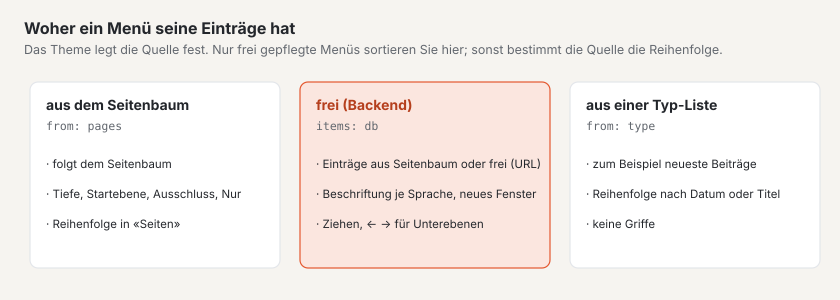
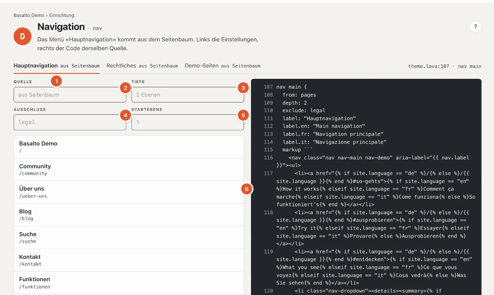
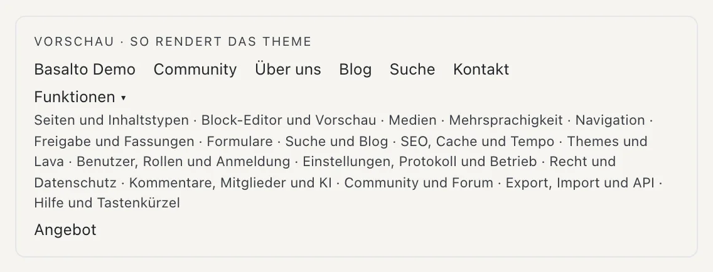

# Menüs

Die Station **«Wie findet man sich zurecht?»** zeigt die Menüs der Site: Hauptmenü, Fusszeile, Rechtliches und weitere. Welche Menüs es gibt und wo sie auf der Seite stehen, legt das Theme fest; hier sehen Sie ihre Einträge, stellen sie ein und — bei frei gepflegten Menüs — ordnen Sie sie.

## Wo

Modus «Einrichtung» › «Wie findet man sich zurecht?» › **«Menüs bearbeiten»**. Oben steht je Menü ein Reiter mit seiner Quelle, zum Beispiel «Hauptnavigation aus Seitenbaum», rechts die Stelle im Theme («theme.lava:107 · nav main»).

## Woher ein Menü seine Einträge hat

- **Aus dem Seitenbaum** — das Menü folgt dem [Seitenbaum](../redaktion/seiten.md). Eine neue Seite erscheint von selbst; die Reihenfolge ändern Sie in «Seiten» (der Link «Reihenfolge in «Seiten» ändern» führt hin). Hier gibt es deshalb «keine Griffe».
- **Frei gepflegt** — die Einträge entstehen hier im Backend: Seiten aus dem Baum oder freie Adressen, in beliebiger Reihenfolge und Tiefe.
- **Aus einer Typ-Liste** — zum Beispiel die neuesten Beiträge; die Reihenfolge folgt der Liste (Datum oder Titel).
- **Aus dem Theme** — feste Einträge, die im Theme stehen; ändern lassen sie sich nur dort.

## Ein Menü aus dem Seitenbaum

1. **Das Menü wählen** — je Menü ein Reiter.
2. **Quelle** — woher die Einträge kommen.
3. **Tiefe** — wie viele Ebenen des Baums das Menü zeigt, zum Beispiel «2 Ebenen» (Hauptseiten und ihre Unterseiten).
4. **Ausschluss** — Seiten, die das Menü auslässt, zum Beispiel die Rechtsseiten.
5. **Startebene** — ab welcher Ebene das Menü beginnt; 1 ist die oberste. Mit **Nur** zeigt ein Menü ausschliesslich bestimmte Seiten (im Starter das Menü «Rechtliches»).
6. **Die Einträge**, wie sie im Menü erscheinen, eingerückt nach Ebenen, mit Adresse.

Diese Einstellungen stehen im Theme und sind hier zur Kontrolle sichtbar. Im Menü erscheinen nur veröffentlichte, sichtbare Seiten — Seiten mit «Im Menü verstecken (bleibt erreichbar)» (Einstellungen der Seite, Reiter «Experten») und geschützte Seiten für Gäste fehlen. Ist die Liste leer, heisst es «Leer — das Menü zeigt nur veröffentlichte, sichtbare Seiten».

## Ein frei gepflegtes Menü

Kennt das Theme ein frei gepflegtes Menü, steht unter der Liste das Feld **«Eintrag hinzufügen»**:

- **Seite suchen** — tippen Sie einen Teil des Titels («üb»), und die passenden Seiten erscheinen mit Adresse; ein Klick
  oder Enter fügt die Seite ein. Ihre **Beschriftung** folgt dem Seitentitel, bis Sie sie überschreiben.
- **Adresse eingeben** — «/blog», «https://…», «www.…» (wird zu «https://www.…»), «mailto:» oder «tel:». Ist die
  Adresse eine Seite der Site, fügt Basalto die Seite ein (sie folgt dann Umbenennungen); sonst öffnet sich ein freier
  Eintrag mit dieser Adresse — fremde Websites gleich «In neuem Fenster».
- **«Fehlt noch:»** — veröffentlichte Seiten, die im Menü noch fehlen, oberste Ebene zuerst; ein Klick fügt sie ein.

Je Eintrag stellen Sie ein:

- **Beschriftung** — bei einer Seite leer lassen, dann heisst der Eintrag wie die Seite. Beschriftungen weiterer Sprachen
  stehen hinter «Beschriftung in weiteren Sprachen»; fehlt sie in einer Sprache, übernimmt der Eintrag die Beschriftung
  der Standardsprache («— übernimmt …»).
- **Ziel** — bei einem freien Eintrag die Adresse. Steht dort der Pfad einer Seite der Site, bietet Basalto **«Als Seite
  verknüpfen»** an.
- **Sichtbar** — ein ausgeblendeter Eintrag bleibt in der Liste («verborgen»), erscheint aber nicht im Menü.
- **In neuem Fenster** — der Link öffnet einen neuen Tab («↗ neues Fenster»); für fremde Websites üblich.

«Bearbeiten» öffnet einen Eintrag, «Löschen» entfernt ihn nach der Rückfrage «Wirklich löschen?». Änderungen speichern sich selbst; «✓ gespeichert» bestätigt es.

### Ordnen

- **Ziehen** sortiert die Einträge. Legen Sie einen Eintrag **weiter rechts** ab, wird er zum Untereintrag des Eintrags darüber.
- Mit der Tastatur: **↑ ↓** verschiebt, **→** macht einen Untereintrag (tiefer), **←** holt ihn eine Ebene zurück (höher).
- Die neue Reihenfolge speichert sich sofort; geht etwas nicht, meldet es unten rechts der Grund.

Ein Eintrag auf eine Seite, die nicht veröffentlicht ist, trägt «nicht veröffentlicht» und erscheint erst, wenn die Seite live ist.

## Die Vorschau

Unter dem Code steht **«Vorschau · so rendert das Theme»**: das Menü, wie Besucherinnen und Besucher es sehen, mit Untermenüs. Bei mehreren Sprachen wählen Sie die **Sprache der Beschriftung**.

Rechts daneben steht der Code des Menüs im Theme — dieselbe Quelle wie die Einstellungen links. Geändert wird er im Theme-Editor (Station D).

## Häufige Fragen

**Eine neue Seite fehlt im Menü.**
Ist sie veröffentlicht? Steht sie im Seitenbaum unter einer Seite, die das Menü zeigt, und nicht tiefer als die eingestellte Tiefe? Ist «Im Menü verstecken (bleibt erreichbar)» nicht angehakt?

**Ich kann die Reihenfolge nicht ändern.**
Das Menü kommt aus dem Seitenbaum, aus einer Typ-Liste oder aus dem Theme — die Reihenfolge gehört der Quelle. Steht «Sie dürfen dieses Menü nicht ändern», erlaubt Ihre Rolle den Bereich «Navigation» nur zum Ansehen.

## Weiter

- [Inhaltstypen](inhaltstypen.md)
- [Seiten und Seitenbaum](../redaktion/seiten.md)
