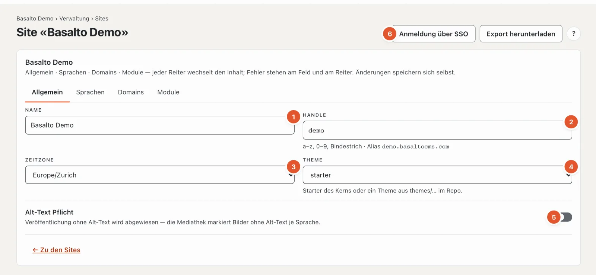
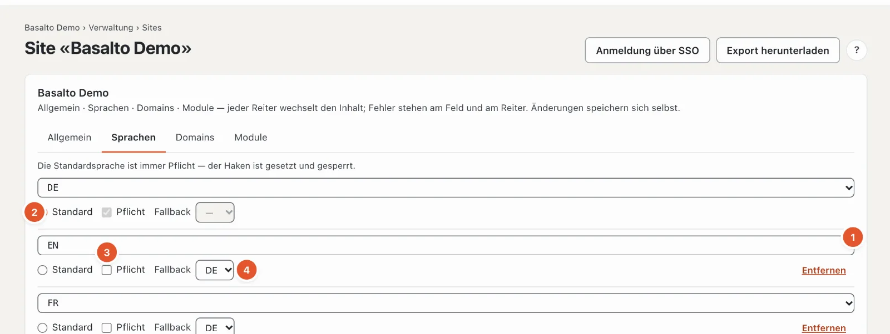
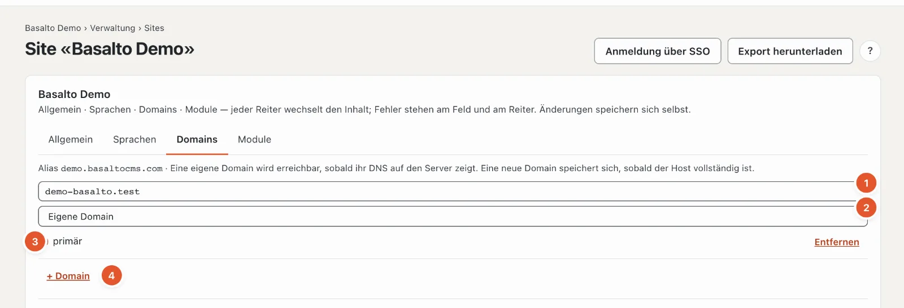
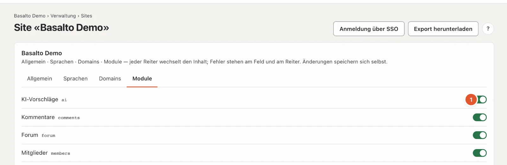

# Die Site

Die erste Station des Fahrplans, **«Was ist die Site?»**, legt die Grundlage für alles Weitere: Name, Sprachen, Domains, Zeitzone, Theme und Module. Sie liegt im Modus «Verwaltung» unter **Sites** — der Fahrplan führt direkt zur Site, in der Sie arbeiten.

## Wo

Modus «Verwaltung» › **Sites** › Site öffnen, oder im Fahrplan «Was ist die Site?» › «Site bearbeiten». Die Liste «Sites» zeigt alle Sites der Installation mit Sprachen, Domains und Stand; **«Neue Site»** legt eine weitere an (Name, Handle, Standardsprache, Theme — «Speichern und schliessen»).

Die Seite hat vier Reiter. Änderungen speichern sich selbst; «gespeichert» am Feld bestätigt es. Stimmt eine Angabe nicht, steht der Fehler am Feld und als Zahl am Reiter.

## Reiter «Allgemein»

1. **Name** — so heisst die Site im Backend, in Mails und im Titel der Website.
2. **Handle** — der technische Kurzname: Kleinbuchstaben, Ziffern und Bindestrich. Er steckt im **Alias**, der Adresse, unter der die Site ohne eigene Domain erreichbar ist (zum Beispiel «demo.basaltocms.com»), und in Befehlen wie `basalto:publish demo`. Ändern Sie ihn nur, wenn noch niemand die alte Adresse kennt.
3. **Zeitzone** — für Datum und Uhrzeit der Site, zum Beispiel bei geplanten Veröffentlichungen.
4. **Theme** — welches mitgelieferte Theme die Site nutzt. Bequemer wechseln Sie es unter [Themes](aussehen.md#themes): dort sehen Sie vorher, was sich ändert.
5. **Alt-Text Pflicht** — ist der Schalter an, wird jede Veröffentlichung abgewiesen, die ein Bild ohne Alt-Text in einer Sprache enthält; die Mediathek markiert solche Bilder. Ab Werk aus — manche Themes verlangen Alt-Texte aber von sich aus (das Starter-Theme tut es).
6. Oben rechts: **«Anmeldung über SSO»** richtet die Anmeldung über einen Firmen-Login ein (siehe [SSO](../betrieb/sso.md)); **«Anmeldung für Kundenkonten»** die Knöpfe «Mit Google anmelden» usw. im Frontend (siehe [Anmeldung für Kundenkonten](../verwaltung/kundenanmeldung.md)); **«Export herunterladen»** lädt die ganze Site als ZIP — Inhalte als JSON und alle Medien, im selben Format wie der Import, ohne Formulareingänge und Mitglieder. Beides sehen nur Betreiber und die Verwaltung des Kontos.

## Reiter «Sprachen»

Je Sprache eine Zeile:

1. **Sprache** — aus der Liste wählen.
2. **Standard** — die Hauptsprache der Site. Aus ihr entstehen alle Übersetzungen. Es gibt genau eine.
3. **Pflicht** — ohne diese Sprache wird ein Inhalt nicht freigegeben. Die Standardsprache ist immer Pflicht; ihr Haken ist gesetzt und gesperrt.
4. **Fallback** — fehlt in dieser Sprache die veröffentlichte Fassung, sehen Gäste die Fassung der Fallback-Sprache (und so weiter bis zur Standardsprache).
5. **«+ Sprache»** fügt eine Zeile hinzu, **«Entfernen»** nimmt eine Sprache weg. Die Inhalte dieser Sprache bleiben in der Datenbank, erscheinen aber nicht mehr.

Wie Übersetzen, Pflichtsprachen und Fallback im Alltag wirken, steht unter [Übersetzen](../redaktion/uebersetzen.md).

## Reiter «Domains»

Oben steht der **Alias** der Site. Darunter je Domain eine Zeile:

1. **Host** — die Adresse ohne «https://», zum Beispiel «www.ihre-firma.ch». Eine neue Domain speichert sich, sobald der Host vollständig ist.
2. **Art**:
   - **Eigene Domain** — die Adresse, unter der die Site erscheinen soll,
   - **Alias** — eine weitere Adresse derselben Site,
   - **Weiterleitung** — eine alte Adresse, die auf die Hauptadresse umleitet.
3. **primär** — die Hauptadresse; sie steht in der Sitemap, in Links und in Mails.
4. **«+ Domain»** und **«Entfernen»**.

Damit eine Domain funktioniert, muss sie im DNS auf den Server zeigen. Im Abo (SaaS) verwaltet das Konto Alias und eigene Domains: Der Reiter verweist dann auf **Konto › Domains** (siehe [Domains](../redaktion/domains.md)).

## Reiter «Module»

Jedes installierte Modul hat einen Schalter: **an** heisst, die Site nutzt es — Menüpunkte, Blöcke und Knöpfe des Moduls erscheinen. **«immer an»** steht bei Modulen, die sich nicht abschalten lassen. Welche Module installiert sind, regelt «Verwaltung › Module»; ohne Module heisst es «Keine Module installiert».

| Modul | Was es bringt |
| --- | --- |
| KI-Vorschläge | Text verbessern, Übersetzung, SEO und Alt-Texte vorschlagen lassen — siehe [KI-Vorschläge](../redaktion/ki.md) |
| Kommentare | Kommentare unter Beiträgen und Seiten — siehe [Kommentare](../redaktion/kommentare.md) |
| Mitglieder | Seiten nur für angemeldete Mitglieder — siehe [Mitglieder](../redaktion/mitglieder.md) |

## Häufige Fragen

**Ich sehe «Anmeldung über SSO», «Anmeldung für Kundenkonten» und «Export herunterladen» nicht.**
Beides ist dem Betreiber und der Verwaltung des Kontos vorbehalten.

**Ich habe eine Sprache entfernt — sind die Übersetzungen weg?**
Nein. Sie bleiben gespeichert und erscheinen wieder, sobald Sie die Sprache erneut hinzufügen.

## Weiter

- [Aussehen: Themes, Design und Bildvarianten](aussehen.md)
- [Sites](../verwaltung/sites.md)
