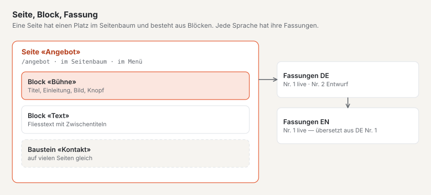

# Die wichtigsten Begriffe

Basalto verwendet wenige Begriffe, aber immer gleich. Diese Seite erklärt sie in einem Satz und zeigt, wie sie
zusammenhängen. Im Backend stehen dieselben Wörter.

## Installation und Site

| Begriff | Bedeutung |
| --- | --- |
| **Installation** | Basalto auf einem Server, mit einer Datenbank. Benutzer, Rollen, Lizenz und Updates gelten für die ganze Installation. |
| **Site** | Eine Website in der Installation, mit Name, Adresse (Domain), Sprachen und Theme. Eine Installation kann mehrere Sites haben. |
| **Domain** | Die Adresse, unter der eine Site erreichbar ist, zum Beispiel `praxis-muster.ch`. |
| **Standardsprache** | Die Hauptsprache der Site. Aus ihr entstehen alle Übersetzungen. |

## Inhalte

| Begriff | Bedeutung |
| --- | --- |
| **Seite** | Ein Eintrag im Seitenbaum mit eigener Adresse, zum Beispiel «Angebot» unter `/angebot`. |
| **Seitenbaum** | Die Ordnung aller Seiten: Hauptseiten und darunter ihre Unterseiten. Aus ihm entstehen Menüs, Adressen und Brotkrumen. |
| **Inhalt** | Ein Eintrag ohne festen Platz im Seitenbaum, zum Beispiel ein Blogbeitrag oder eine Person. |
| **Inhaltstyp** | Die Art eines Inhalts mit ihren Feldern, zum Beispiel «Beitrag» mit Titel, Datum und Text. |
| **Block** | Ein Baustein einer Seite: Bühne, Text, Bild, Karten, Fragen und Antworten, Formular … |
| **Baustein** | Eine Gruppe von Blöcken, die auf mehreren Seiten gleich steht und an einer Stelle geändert wird. |
| **Medien** | Bilder und Dateien der Site in der Mediathek. Jedes Bild bekommt einen Alt-Text für Menschen, die es nicht sehen. |

## Fassungen und Freigabe

| Begriff | Bedeutung |
| --- | --- |
| **Fassung** | Ein Stand eines Inhalts in einer Sprache. Jede Änderung beginnt als neue Fassung; ältere bleiben erhalten. |
| **Entwurf** | Eine Fassung, an der noch geschrieben wird. Basalto speichert sie automatisch. |
| **Einreichen** | Die Fassung zur Prüfung geben. |
| **Freigeben** | Die geprüfte Fassung für die Veröffentlichung freigeben. |
| **Veröffentlichen** | Die freigegebene Fassung live stellen — sofort oder zu einem geplanten Zeitpunkt. |
| **Live** | Die Fassung, die Gäste auf der Website sehen. |

## Gestaltung und Erweiterung

| Begriff | Bedeutung |
| --- | --- |
| **Theme** | Aussehen und Bauplan einer Site: Farben, Schriften, Layouts, Menüs, Blöcke, Inhaltstypen und Startinhalte. |
| **Lava** | Die Sprache, in der Themes geschrieben sind. Für die Redaktion unsichtbar. |
| **Layout** | Der Rahmen einer Seite mit ihren Regionen, zum Beispiel Kopf, Inhalt und Fuss. |
| **Modul** | Eine Erweiterung wie Formulare, Kommentare, Mitglieder oder Forum, je Site ein- und ausschaltbar. |
| **Plugin** | Ein Modul aus dem Marktplatz oder von einer Drittperson. |

## Personen

| Begriff | Bedeutung |
| --- | --- |
| **Benutzer** | Eine Person mit Zugang zum Backend. |
| **Rolle** | Was ein Benutzer in einer Site darf: Redaktion, Freigabe, Übersetzung, Administrator oder Betreiber. |
| **Mitglied** | Eine Besucherin mit Konto auf der Website, zum Beispiel für geschützte Seiten oder das Forum — kein Zugang zum Backend. |
| **Passkey** | Anmelden mit Fingerabdruck, Gesicht oder Gerätesperre statt mit einem Code per Mail. |

## Weiter

- [Basalto installieren](installieren.md)
- [Rundgang durchs Backend](rundgang.md)
