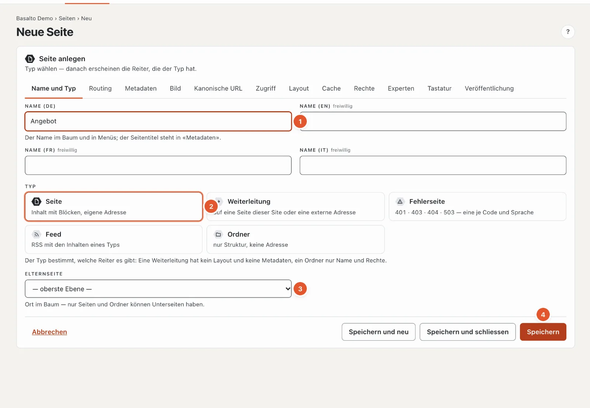
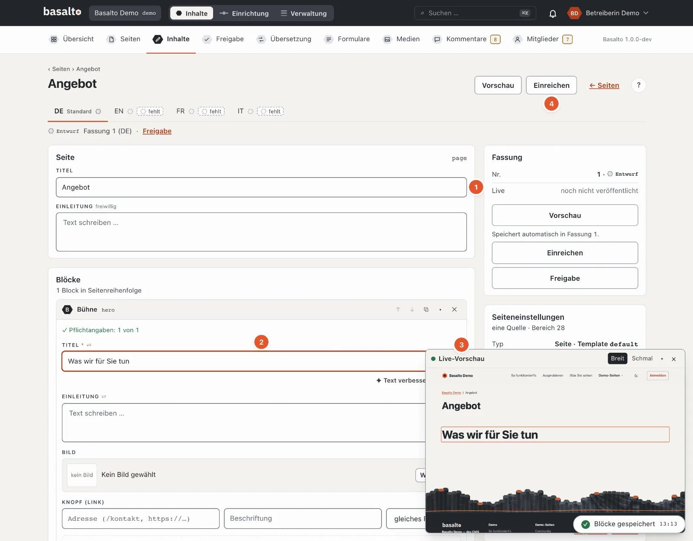
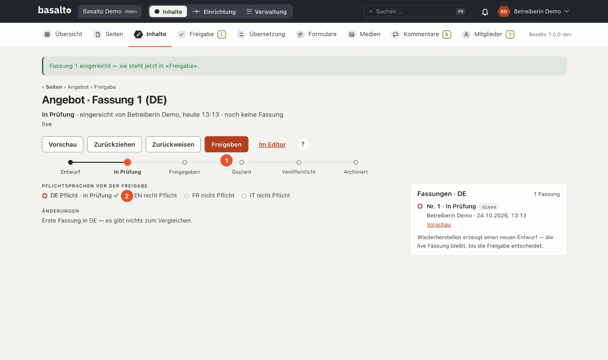
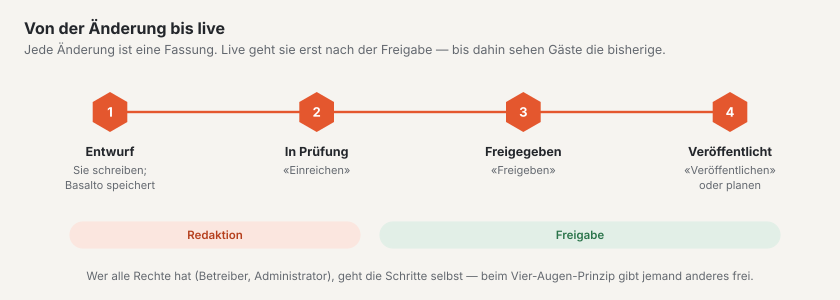
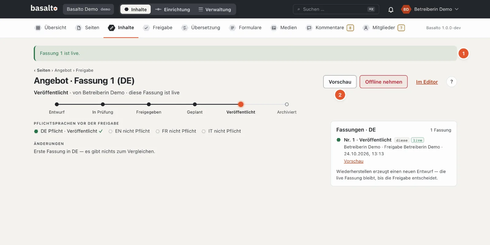

# Die erste Seite

Sie legen eine neue Seite «Angebot» an, füllen sie mit Blöcken, fügen ein Bild ein und veröffentlichen sie. Danach
steht die Seite auf der Website und im Menü. Das Beispiel dauert etwa eine Viertelstunde.

## 1. Die Seite anlegen

1. Modus «Inhalte» › **Seiten** › **«Neu»**.
2. Im Reiter «Name und Typ» (Zahlen wie im Bild oben):
   1. **Name** — «Angebot». Der Name steht im Seitenbaum und im Menü; aus ihm entsteht die Adresse `/angebot`.
   2. **Typ** — «Seite» ist vorgewählt: Inhalt mit Blöcken und eigener Adresse.
   3. **Elternseite** — «oberste Ebene» für eine Hauptseite. Wählen Sie eine andere Seite, wird «Angebot» deren
      Unterseite, etwa `/ueber-uns/angebot`.
   4. **«Speichern»**.
3. Basalto öffnet die Einstellungen der neuen Seite. Oben rechts führt **«Inhalt bearbeiten»** in den Editor.

Die übrigen Reiter — Metadaten, Bild, Zugriff, Layout und weitere — brauchen Sie jetzt nicht. Ihre Vorgaben passen
für eine gewöhnliche Seite.

## 2. Blöcke einfügen und schreiben

1. **Titel** — steht schon da: «Angebot». Darunter können Sie eine Einleitung schreiben.
2. Unter **«Blöcke»** wählen Sie in «Block hinzufügen» einen Block, hier **«Bühne»** — einen grossen Titel mit
   Einleitung, Bild und Knopf. Schreiben Sie in das Feld **«Titel»** des Blocks: «Was wir für Sie tun».
3. Die **Live-Vorschau** zeigt die Seite, wie Gäste sie sehen werden, und folgt jeder Eingabe. «Breit» und «Schmal»
   wechseln zwischen Bildschirm und Telefon.
4. Mit **«+ Block einfügen»** fügen Sie weitere Blöcke hinzu, zum Beispiel «Text» für Fliesstext oder «Karten» für
   mehrere Angebote nebeneinander. Die Pfeile am Block verschieben ihn, ✕ entfernt ihn.

Sie müssen nicht speichern: Basalto speichert gut eine Sekunde nach jeder Eingabe und meldet es unten rechts,
etwa «Blöcke gespeichert». Was Sie schreiben, bleibt ein **Entwurf** — auf der Website ändert sich noch nichts.

## 3. Ein Bild einfügen

1. Im Block «Bühne» unter **«Bild»** auf **«Wählen …»** klicken. Die Mediathek öffnet sich als Fenster.
2. Ein Bild wählen — oder mit **«Hochladen»** ein neues hinzufügen.
3. Den **Alt-Text** prüfen. Basalto belegt ihn aus dem Dateinamen vor; besser ist ein Satz, der sagt, was auf dem
   Bild zu sehen ist — für Menschen, die es nicht sehen. Sie ändern ihn in **Medien**, im Detail des Bildes. Das Theme
   Starter veröffentlicht keine Seite mit einem Bild ohne Alt-Text.

Basalto erzeugt aus jedem Bild selbst die passenden Grössen für Bildschirm und Telefon. Mehr unter
[Medien](../redaktion/medien.md).

## 4. Prüfen und veröffentlichen

Eine Fassung geht in drei Schritten live:

1. **«Einreichen»** — oben rechts im Editor. Die Fassung steht jetzt «In Prüfung» und erscheint unter «Freigabe».
2. **«Freigeben»** — auf der Freigabeseite (Link «Freigabe» unter dem Titel). Darunter steht, ob alle
   **Pflichtsprachen** bereit sind; ohne sie gibt Basalto nicht frei.
3. **«Veröffentlichen»** — die Fassung geht sofort live. Mit **«Veröffentlichung planen»** wählen Sie stattdessen
   Datum und Zeit.

Haben Sie alle Rechte (Betreiber oder Administrator), gehen Sie die drei Schritte selbst. Sonst gibt eine Person mit
der Rolle «Freigabe» Ihre Fassung frei; die Glocke meldet ihr, dass etwas wartet.

1. **«Fassung 1 ist live»** — die Seite steht auf der Website.
2. **«Vorschau»** zeigt sie; auf der Website erreichen Sie sie unter `/angebot`.

Ändern Sie die Seite später, entsteht **Fassung 2** als Entwurf. Gäste sehen weiter Fassung 1, bis Sie Fassung 2
veröffentlichen.

## Wenn etwas nicht klappt

| Sie sehen | Ursache | Lösung |
| --- | --- | --- |
| Beim Speichern «1 Angabe stimmt nicht» mit einer Zahl am Reiter «Routing» | Die Adresse ist schon vergeben. | Im Reiter «Routing» einen anderen Slug wählen, etwa `angebot-2025`. |
| «Freigeben» ist gesperrt: «Freigabe erst mit allen Pflichtsprachen» | Eine Pflichtsprache hat noch keine Fassung. | Die Seite übersetzen (siehe [Menü und Sprachen](menue-und-sprachen.md)) oder die Sprache nicht als Pflicht führen. |
| «Veröffentlichen» ist gesperrt wegen eines Bildes | Ein Bild hat keinen Alt-Text. | Den Alt-Text in der Mediathek nachtragen. |
| «Einreichen» fehlt, nur «Vorschau» | Ihre Rolle darf diese Seite nicht bearbeiten. | Die Person fragen, die Ihre Site verwaltet. |

## Weiter

- [Menü und Sprachen](menue-und-sprachen.md)
- [Inhalte mit Blöcken bearbeiten](../redaktion/bloecke.md)
- [Freigabe und Veröffentlichung](../redaktion/freigabe.md)
