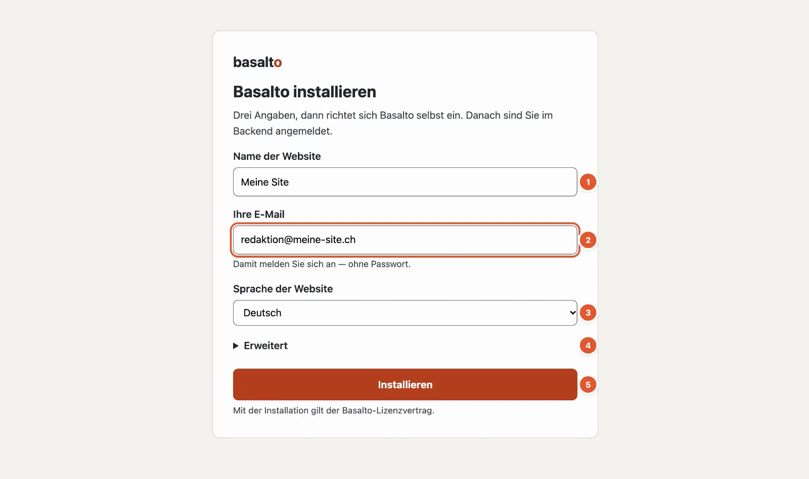
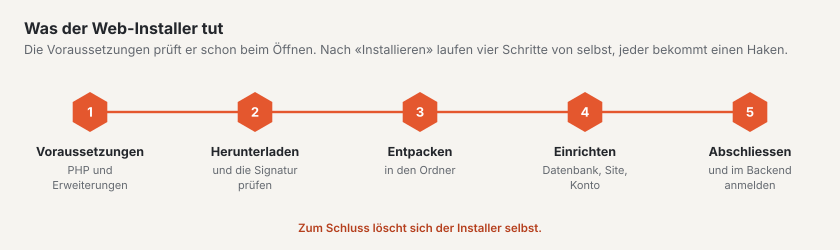

# Basalto installieren

Am einfachsten installieren Sie Basalto mit dem **Web-Installer**: eine einzige Datei, die Sie in einen leeren Ordner
legen und im Browser öffnen. Drei Angaben genügen, danach sind Sie im Backend angemeldet — ohne Terminal, ohne
Passwort und ohne Mail-Server.

## Was Sie brauchen

| Was | Wert |
| --- | --- |
| Webspace oder lokaler Webserver | mit PHP 8.4 oder neuer und HTTPS |
| PHP-Erweiterungen | `mbstring`, `intl`, `gd`, `zip`, `sodium` und `pdo_sqlite` (oder `pdo_mysql` bzw. `pdo_pgsql`) |
| Ein leerer Ordner | der Ordner Ihrer Domain beim Hoster, lokal ein Ordner, den der Webserver ausliefert |
| Eine E-Mail-Adresse | für Ihr erstes Konto |

Eine Datenbank müssen Sie nicht anlegen: Ab Werk nimmt Basalto SQLite, eine Datei im Ordner der Installation. Für
grosse Sites wählen Sie unter «Erweitert» MariaDB, MySQL oder PostgreSQL.

Fehlt eine Voraussetzung, nennt der Installer sie unter «Voraussetzungen fehlen», bevor er etwas tut.

## Schritt für Schritt

1. Laden Sie den Installer auf basaltocms.com unter **Download** herunter — eine Datei `index.php`.
2. Legen Sie sie in den **leeren** Ordner: beim Hoster per FTP in den Ordner der Domain, lokal zum Beispiel nach
   `~/Sites/meine-site`.
3. Öffnen Sie die Adresse im Browser, etwa `https://meine-site.ch` oder `http://meine-site.test`.
4. Füllen Sie das Formular aus (Zahlen wie im Bild oben):
   1. **Name der Website** — aus dem Ordnernamen vorgeschlagen; Sie können ihn später ändern.
   2. **Ihre E-Mail** — damit melden Sie sich künftig an, mit einem Code per Mail oder einem Passkey.
   3. **Sprache der Website** — die Standardsprache. Weitere Sprachen fügen Sie danach hinzu.
   4. **Erweitert** — nur, wenn Sie eine andere Datenbank nehmen oder gleich einen Lizenzschlüssel eingeben möchten.
   5. **«Installieren»**.
5. Warten Sie, bis die vier Schritte — herunterladen und Signatur prüfen, entpacken, einrichten, abschliessen —
   einen Haken haben. Danach leitet der Installer Sie ins Backend weiter.

Der Installer prüft die Signatur des heruntergeladenen Pakets, bevor er es entpackt: Ein verändertes Paket wird
abgewiesen. Danach richtet er die Datenbank ein, legt Ihre Site mit dem Theme Starter und ein paar Startseiten an und
meldet Sie an. Zum Schluss löscht er sich selbst.

## Nach der Installation

- **Passkey einrichten.** Die Übersicht im Backend schlägt es Ihnen vor. Mit einem Passkey melden Sie sich mit
  Fingerabdruck, Gesicht oder Gerätesperre an — auch wenn einmal keine Mail ankommt.
- **Die Startseiten ansehen.** Ihre Site hat schon eine Startseite, «Über uns», «Kontakt», «Suche», einen Blog,
  «Impressum» und «Datenschutz». Sie ersetzen deren Texte durch Ihre eigenen.
- **Eine Lizenz eintragen**, sobald die Site für eine Firma oder einen Verein arbeitet — mehr unter
  [Lizenz](../verwaltung/lizenz.md). Ohne Schlüssel läuft Basalto in der freien Stufe.

## Wenn etwas nicht klappt

| Sie sehen | Ursache | Lösung |
| --- | --- | --- |
| «Der Ordner ist nicht leer» mit einer Liste von Dateien | Im Ordner liegen schon Dateien. | Die genannten Dateien entfernen oder einen neuen Ordner nehmen. Dateien, die Hoster selbst anlegen (`.htaccess`, `.user.ini`, `.well-known`, `cgi-bin`, `error_log`), dürfen bleiben. |
| «Die Installation läuft bereits in einem anderen Browser» | Ein anderer Browser hat die Installation begonnen. | Dort weitermachen — oder die Datei `.basalto-install.json` im Ordner löschen und neu beginnen. |
| «Voraussetzungen fehlen» mit einer Liste | PHP ist zu alt oder eine Erweiterung fehlt. | In der Verwaltung Ihres Hosters die PHP-Version erhöhen bzw. die Erweiterung einschalten. |
| Nach der Installation zeigt der Browser eine Liste von Dateien oder «Forbidden» | Der Webserver beginnt im Hauptordner statt im Ordner `public/`. | Bei Apache legt der Installer eine `.htaccess` an, die das regelt; bei nginx die Wurzel der Domain auf `public/` setzen. |

## Andere Wege

Wer auf einem eigenen Server mit Konsole arbeitet, installiert Basalto mit Composer und dem Befehl
`php artisan basalto:install`. Das beschreibt die [Installation im Betriebshandbuch](../betrieb/installation.md),
zusammen mit Hosting, Sicherung und Updates.

## Weiter

- [Rundgang durchs Backend](rundgang.md)
- [Die erste Seite](erste-seite.md)
