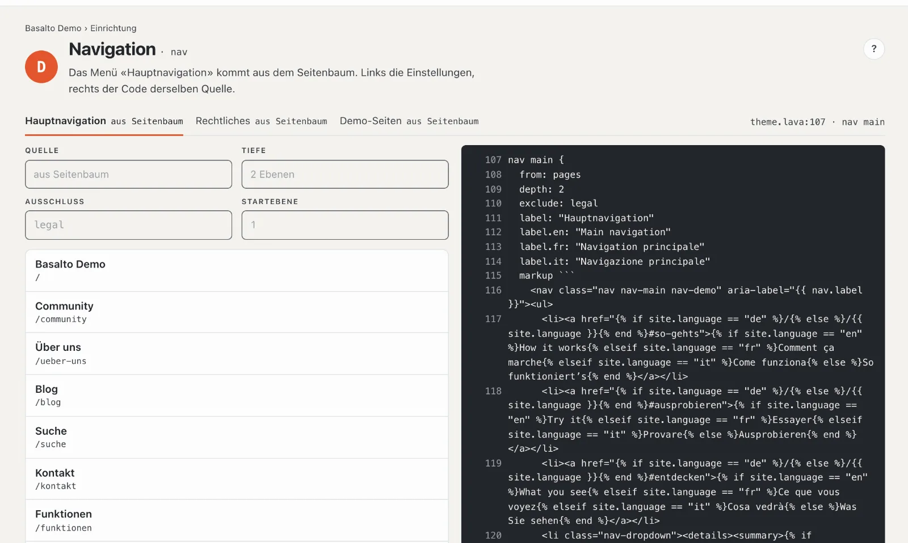
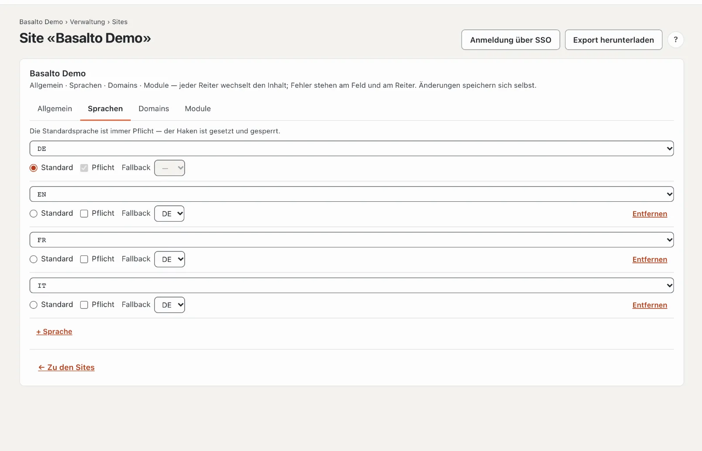
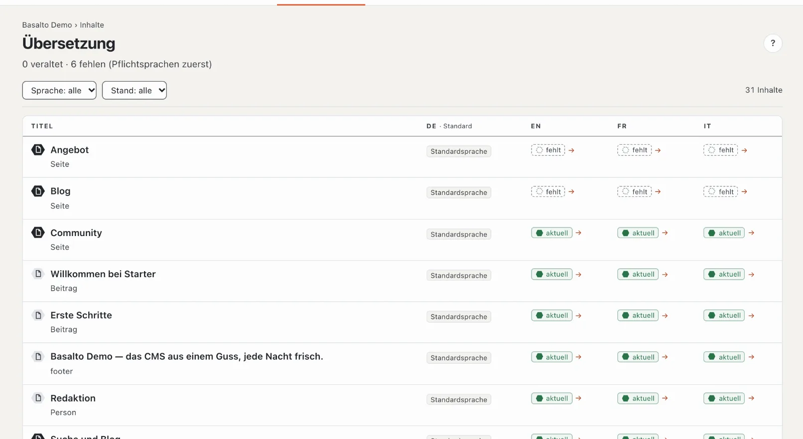

# Menü und Sprachen

Die neue Seite steht nach dem Veröffentlichen von selbst im Menü. Hier sehen Sie, woher das Menü seine Einträge hat,
wie Sie die Reihenfolge ändern und wie Ihre Site eine zweite Sprache bekommt.

## Das Menü

Im Theme Starter folgt das **Hauptmenü dem Seitenbaum**: Jede veröffentlichte Seite der obersten Ebene erscheint
darin, ihre Unterseiten darunter. Sie müssen das Menü also nicht pflegen.

- **Ansehen:** Modus «Einrichtung» › «Wie findet man sich zurecht?» › **«Menüs bearbeiten»**. Je Menü ein Reiter —
  Hauptmenü, Rechtliches und weitere — mit der Quelle und den Einträgen, wie Gäste sie sehen.
- **Reihenfolge ändern:** Modus «Inhalte» › **Seiten** › an der Seite **«Verschieben»** (Pfeil nach oben und unten)
  und den neuen Platz wählen. Das Menü folgt sofort.
- **Eine Seite aus dem Menü nehmen:** In den Einstellungen der Seite, Reiter «Experten», den Haken
  **«Im Menü verstecken (bleibt erreichbar)»** setzen. Die Seite bleibt unter ihrer Adresse erreichbar.

Im Menü stehen nur veröffentlichte Seiten. Fehlt eine Seite, ist sie meist noch ein Entwurf.

Manche Themes haben zusätzlich **frei gepflegte Menüs**, deren Einträge Sie in der Einrichtung selbst
zusammenstellen. Mehr unter [Menüs](../einrichtung/menues.md).

## Eine zweite Sprache

1. Modus «Verwaltung» › **Sites** › Ihre Site › Reiter **«Sprachen»**.
2. **«+ Sprache»** und die Sprache wählen, zum Beispiel Englisch.
3. Für jede Sprache stellen Sie ein:
   - **Standard** — die Hauptsprache, aus der alle Übersetzungen entstehen. Es gibt genau eine.
   - **Pflicht** — ohne diese Sprache gibt Basalto keinen Inhalt frei. Lassen Sie den Haken anfangs weg, damit Sie
     Seiten auch vor der Übersetzung veröffentlichen können.
   - **Fallback** — fehlt eine Übersetzung, sehen Gäste die Fassung dieser Sprache, etwa Deutsch statt einer leeren
     Seite.

Die Änderungen speichern sich selbst. Auf der Website erscheint ein Sprachwechsel, sobald es eine zweite Sprache gibt.

## Die Seite übersetzen

1. Modus «Inhalte» › **Übersetzung** — die Liste aller Inhalte mit ihrem Stand je Sprache.
2. In der Zeile «Angebot» auf **«fehlt»** in der Spalte der Sprache klicken.
3. **«Übersetzung aus Deutsch anlegen»**. Links steht der deutsche Text zum Lesen, rechts schreiben Sie die
   Übersetzung — Feld für Feld, Block für Block. Basalto speichert automatisch.
4. Die Übersetzung geht wie jede Fassung live: **Einreichen**, **Freigeben**, **Veröffentlichen** — siehe
   [Die erste Seite](erste-seite.md#4-prüfen-und-veröffentlichen).

Ändern Sie später den deutschen Text, steht die Übersetzung auf **«veraltet»**, bis jemand sie nachführt. Bilder und
Zahlen gelten für alle Sprachen und werden nur in der Standardsprache gepflegt.

## Wenn etwas nicht klappt

| Sie sehen | Ursache | Lösung |
| --- | --- | --- |
| Die neue Seite fehlt im Menü | Sie ist noch nicht veröffentlicht, oder «Im Menü verstecken» ist angehakt. | Die Seite veröffentlichen bzw. den Haken im Reiter «Experten» entfernen. |
| Der Reiter «Sprachen» fehlt | Ihre Rolle verwaltet keine Sites. | Eine Person mit der Rolle Administrator oder Betreiber fragen. |
| «Übersetzung aus Deutsch anlegen» ist gesperrt | Ihre Rolle darf diese Sprache nicht bearbeiten, oder es gibt noch keine deutsche Fassung. | Die Rolle prüfen lassen bzw. zuerst die deutsche Fassung schreiben. |

## Weiter

- [Das Team einladen](team.md)
- [Übersetzen](../redaktion/uebersetzen.md)
- [Seiten und Seitenbaum](../redaktion/seiten.md)
