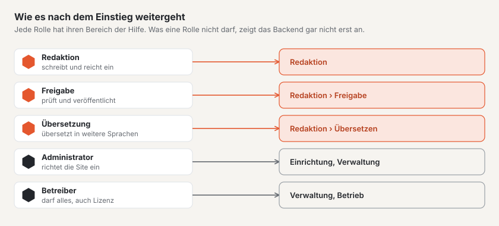

# Wie es weitergeht

Ihre Site läuft, die erste Seite ist live, das Team ist eingeladen. Ab hier vertieft jede Rolle ihren eigenen Teil
der Hilfe — diese Seite zeigt, wo.

## Für die Redaktion

- [Seiten und Seitenbaum](../redaktion/seiten.md) — Unterseiten, Umleitungen, Papierkorb.
- [Inhalte mit Blöcken bearbeiten](../redaktion/bloecke.md) — alle Blöcke, Fliesstext, Einfügen aus Word, ältere
  Fassungen zurückholen.
- [Medien](../redaktion/medien.md) — Ordner, Alt-Texte, Fokuspunkt, Ersetzen.
- [Formulare](../redaktion/formulare.md) — Kontaktformular anpassen, Eingänge lesen.

## Für Freigabe und Übersetzung

- [Freigabe und Veröffentlichung](../redaktion/freigabe.md) — prüfen, zurückweisen, planen, offline nehmen.
- [Übersetzen](../redaktion/uebersetzen.md) — nebeneinander übersetzen, veraltete Übersetzungen nachführen.

## Für die Einrichtung

- [Einrichtung](../einrichtung/README.md) — der Fahrplan in neun Stationen.
- [Aussehen](../einrichtung/aussehen.md) — Farben, Schriften, Logo und Theme wechseln.
- [Live gehen](../einrichtung/live-gehen.md) — eigene Domain, Prüfbericht, veröffentlichen.

## Für die Verwaltung

- [Verwaltung](../verwaltung/README.md) — Sites, Benutzer, Rollen, Einstellungen.
- [Updates](../verwaltung/updates.md) — Kern, Module und Themes aktuell halten.
- [Lizenz](../verwaltung/lizenz.md) — Stufen und Schlüssel.

## Für Technik und Betrieb

- [Betriebshandbuch](../betrieb/README.md) — Hosting, Sicherung, Monitoring und Befehle.
- [Entwickler-Dokumentation](../entwickler/README.md) — Themes in Lava, Module und die API.
- [Marktplatz](../marktplatz/README.md) — Themes und Plugins finden oder anbieten.

## Weiter

- [Einstieg in Basalto](README.md)
- [Hilfe für die Redaktion](../redaktion/index.md)
