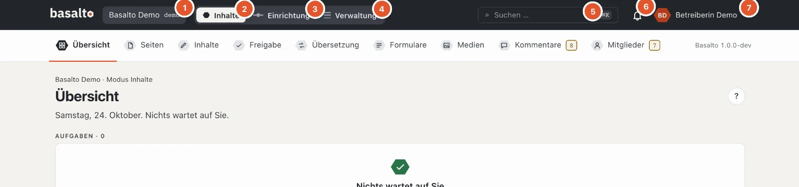
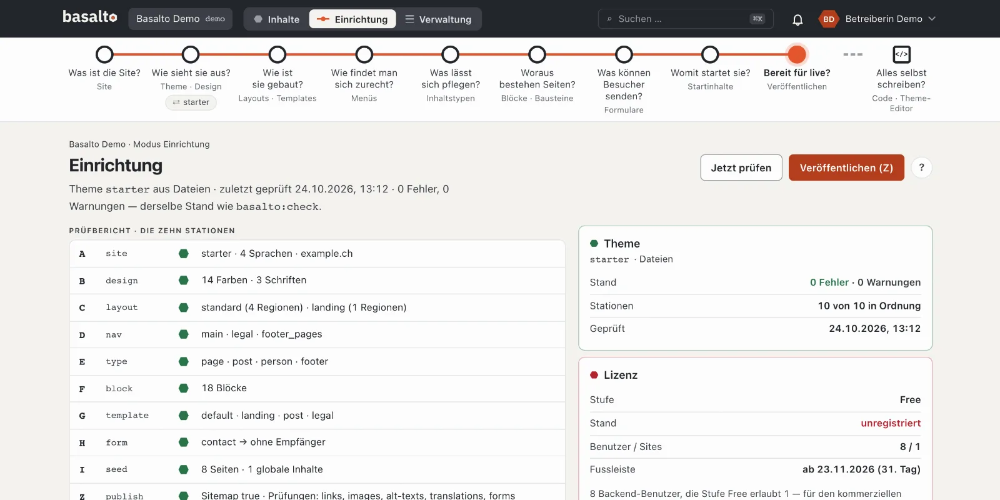
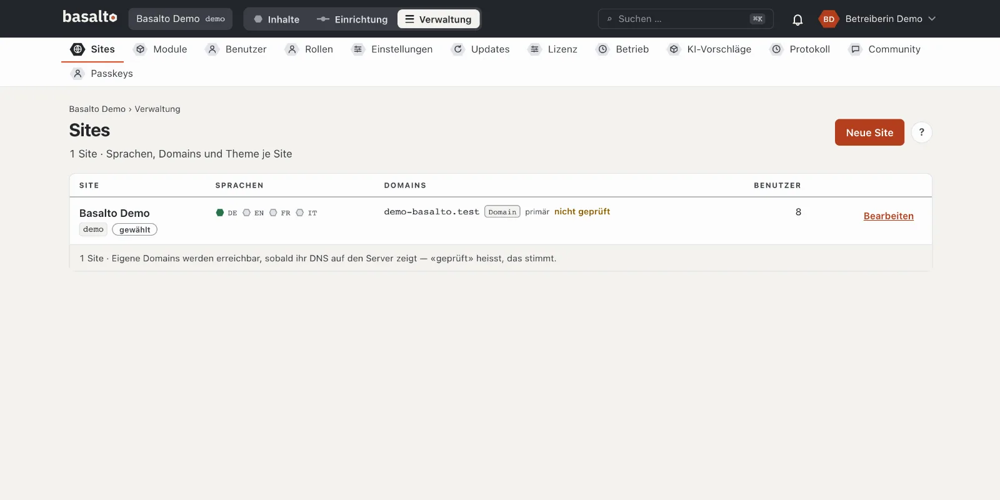
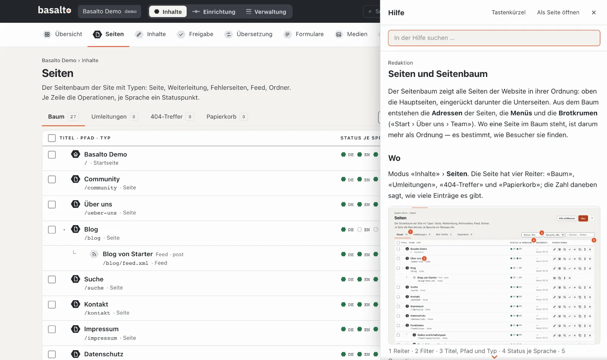

# Rundgang durchs Backend

Das Backend hat drei **Modi**: «Inhalte» für die tägliche Redaktionsarbeit, «Einrichtung» für Gestalt und Aufbau der
Site und «Verwaltung» für Sites, Benutzer und Betrieb. Dieser Rundgang zeigt, wo was steht und wie Sie sich
zurechtfinden.

## Die Kopfzeile

Die Kopfzeile ist in allen Modi gleich:

1. **Die Site** — arbeiten Sie in mehreren Sites, wechseln Sie hier.
2. **Inhalte** — Seiten, Blöcke, Medien, Übersetzung und Freigabe.
3. **Einrichtung** — Aussehen, Aufbau, Menüs und Inhaltstypen der Site.
4. **Verwaltung** — Sites, Benutzer, Rollen, Einstellungen, Updates und Lizenz.
5. **Suchen** — findet Seiten, Inhalte, Medien und Benutzer; schneller mit **⌘K** bzw. **Strg+K**.
6. **Die Glocke** — Ihre Benachrichtigungen, etwa wenn eine Fassung auf Ihre Prüfung wartet.
7. **Ihr Name** — das Menü mit Profil, Einstellungen, Dunkelmodus, Hilfe und «Abmelden».

Sie sehen nur die Modi, die Ihre Rolle braucht: Wer nur schreibt, sieht «Inhalte», aber weder «Einrichtung» noch
«Verwaltung».

## Modus «Inhalte»

Unter der Kopfzeile stehen die **Stationen** des Modus:

| Station | Wozu |
| --- | --- |
| **Übersicht** | Was auf Sie wartet: Fassungen zum Prüfen, Zurückgewiesenes, fehlende Übersetzungen, Hinweise. |
| **Seiten** | Der Seitenbaum der Website — Seiten anlegen, ordnen, bearbeiten. |
| **Inhalte** | Einträge ohne festen Platz im Baum, etwa Blogbeiträge. |
| **Freigabe** | Alles, was geprüft oder veröffentlicht werden soll. |
| **Übersetzung** | Was in anderen Sprachen fehlt oder veraltet ist. |
| **Formulare** | Formulare und ihre Eingänge. |
| **Medien** | Bilder und Dateien. |
| **Kommentare**, **Mitglieder** | Nur, wenn das Modul für die Site eingeschaltet ist. |

Eine Zahl in Bernstein neben einer Station heisst: Dort wartet etwas auf Sie. Eine graue Zahl dient nur zur
Information.

## Modus «Einrichtung»

Die Einrichtung führt mit einem **Fahrplan** durch die Site — neun Stationen, jede mit einer Frage: «Was ist die
Site?», «Wie sieht sie aus?», «Wie ist sie gebaut?» bis «Bereit für live?». Ein dunkler Ring heisst «in Ordnung», ein
rotes ✗ «hier fehlt etwas». Darunter steht der **Prüfbericht** mit zehn Prüfungen. Fürs Erste brauchen Sie die
Einrichtung nicht: Das Theme Starter ist fertig eingerichtet. Mehr unter
[Einrichtung](../einrichtung/README.md).

## Modus «Verwaltung»

Hier betreuen Sie die Installation: **Sites** mit Sprachen und Domains, **Module**, **Benutzer** und **Rollen**,
**Einstellungen**, **Updates**, **Lizenz**, **Betrieb** und das **Protokoll** aller Änderungen. Mehr unter
[Verwaltung](../verwaltung/README.md).

## Die Hilfe

- Das runde **«?»** oben rechts öffnet die Hilfe, die zur aktuellen Seite passt — als Leiste am rechten Rand. Die
  Seite dahinter bleibt bedienbar.
- Schneller geht es mit der Taste **?** oder **F1**.
- Oben in der Leiste suchen Sie in der ganzen Hilfe; **«Als Seite öffnen»** zeigt die Hilfe gross,
  **«Tastenkürzel»** listet alle Kürzel.

## Wenn etwas nicht klappt

| Sie sehen | Ursache | Lösung |
| --- | --- | --- |
| «Einrichtung» oder «Verwaltung» fehlt | Ihre Rolle erlaubt den Modus nicht. | Die Person fragen, die Ihre Site verwaltet. |
| Ein Knopf ist grau, daneben steht ein Grund | Ihre Rolle darf diesen Schritt nicht, zum Beispiel «Ihre Rolle gibt nicht frei». | Den Schritt der zuständigen Person überlassen oder die Rolle ändern lassen. |
| Die Anmeldung verlangt jedes Mal einen Code | Ihr Konto hat noch keinen Passkey. | In der Übersicht «Passkey einrichten» wählen. |

## Weiter

- [Die erste Seite](erste-seite.md)
- [Hilfe für die Redaktion](../redaktion/index.md)
