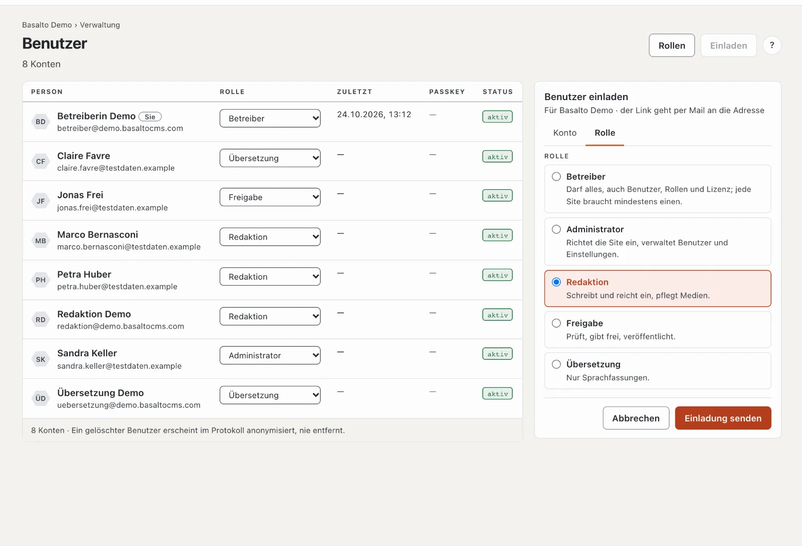

# Das Team einladen

Wer mitarbeitet, bekommt ein eigenes Konto mit einer **Rolle**: Sie bestimmt, was die Person in der Site darf. Eine
Einladung genügt — die Person meldet sich mit dem Link aus der Mail an, ganz ohne Passwort.

## Jemanden einladen

1. Modus «Verwaltung» › **Benutzer** › **«Einladen»**. Rechts öffnet sich die Karte «Benutzer einladen».
2. Reiter **«Konto»**: die **E-Mail-Adresse** der Person.
3. Reiter **«Rolle»**: die Rolle wählen — jede mit einem Satz, was sie darf.
4. **«Einladung senden»**.

Der Link in der Mail ist 72 Stunden gültig und nur einmal verwendbar. Bis die Person ihn öffnet, steht sie mit
«eingeladen» in der Liste; mit **«Erneut senden»** verschicken Sie einen neuen Link.

## Welche Rolle?

| Rolle | Darf | Passt für |
| --- | --- | --- |
| **Redaktion** | Seiten und Inhalte schreiben, Medien pflegen, Fassungen einreichen | wer Texte und Bilder liefert |
| **Freigabe** | Eingereichtes prüfen, freigeben, veröffentlichen, offline nehmen | wer für die Website geradesteht |
| **Übersetzung** | Inhalte in weitere Sprachen übersetzen | Übersetzerinnen und Übersetzer |
| **Administrator** | alles in der Site, auch Einrichtung, Benutzer und Einstellungen | wer die Site betreut |
| **Betreiber** | alles, auch Lizenz; jede Site hat mindestens einen | Sie selbst |

Sie vergeben nur Rollen, die nicht mehr dürfen als Ihre eigene. Die Rolle ändern Sie später in der Liste, Spalte
**«Rolle»** — die Änderung gilt sofort. Eigene Rollen mit genau abgestimmten Rechten legen Sie unter **«Rollen»** an;
mehr unter [Rollen](../verwaltung/rollen.md).

## Gut zu wissen

- **Vier Augen:** Soll niemand die eigene Arbeit freigeben, schalten Sie in den Einstellungen das
  Vier-Augen-Prinzip ein. Dann braucht jede Fassung eine zweite Person.
- **Eine Person, mehrere Sites:** Wer in einer anderen Site schon ein Konto hat, bekommt mit der Einladung zusätzlich
  eine Rolle in dieser — je Site genau eine.
- **Jemand verlässt das Team:** Das Konto in der Personenkarte **deaktivieren**. Seine Arbeit und das Protokoll
  bleiben erhalten.

## Wenn etwas nicht klappt

| Sie sehen | Ursache | Lösung |
| --- | --- | --- |
| Die Einladung kommt nicht an | Die Installation verschickt keine Mails, oder die Mail liegt im Spam. | Den Spam-Ordner prüfen; die Mail-Einstellungen richtet der Betrieb ein (siehe [Installation im Betriebshandbuch](../betrieb/installation.md)). |
| «eingeladen · abgelaufen» | Die 72 Stunden sind vorbei. | **«Erneut senden»**. |
| Die gewünschte Rolle fehlt in der Auswahl | Sie darf mehr als Ihre eigene Rolle. | Eine Person mit höherer Rolle die Einladung senden lassen. |

## Weiter

- [Wie es weitergeht](naechste-schritte.md)
- [Benutzer](../verwaltung/benutzer.md)
