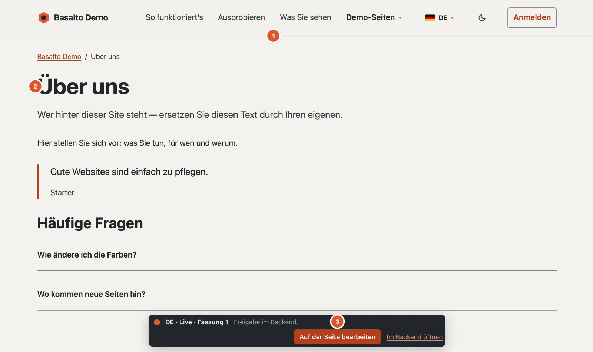
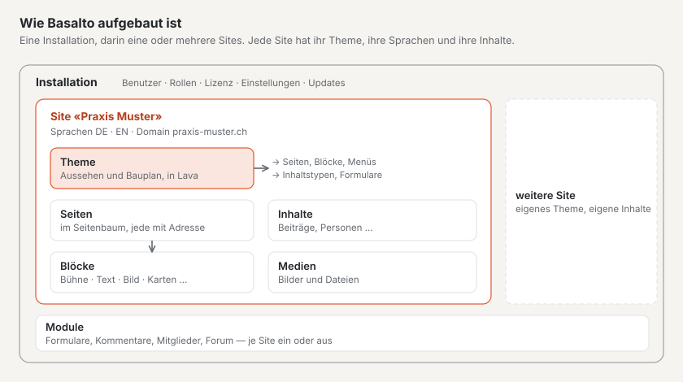

# Was ist Basalto?

Basalto ist ein Content-Management-System: Sie pflegen die Inhalte Ihrer Website im Browser, und Basalto liefert sie
schnell, barrierearm und in mehreren Sprachen aus. Gestaltung und Bauplan der Website stehen in einem **Theme**; die
Redaktion arbeitet nur mit Inhalten und muss nichts von Technik wissen.

1. **Das Menü** — entsteht aus dem Seitenbaum: Eine neue Seite erscheint darin, sobald sie veröffentlicht ist.
2. **Der Inhalt** — aus Blöcken zusammengesetzt, hier Titel, Text, Zitat und Fragen mit Antworten.
3. **Die Leiste** — nur für angemeldete Personen sichtbar: Sprache, Stand und Fassung der Seite, dazu **«Auf der Seite
   bearbeiten»** und **«Im Backend öffnen»**. Gäste sehen sie nie.

## Website und Backend

Jede Basalto-Site hat zwei Seiten:

- **Die Website** — das, was Ihre Besucherinnen und Besucher sehen. Sie zeigt immer nur **veröffentlichte** Inhalte.
- **Das Backend** unter `/admin` — dort legen Sie Seiten an, schreiben, laden Bilder hoch, übersetzen und geben frei.
  Jede Änderung entsteht zuerst als Entwurf und geht erst nach der Freigabe live.

## Wie Basalto aufgebaut ist

- Eine **Installation** ist Basalto auf einem Server. Sie kann eine oder mehrere **Sites** betreiben, jede mit eigener
  Adresse, eigenen Sprachen und eigenem Aussehen.
- Das **Theme** einer Site bestimmt Aussehen und Bauplan: welche Blöcke es gibt, welche Menüs, welche Inhaltstypen.
  Basalto bringt das Theme **Starter** mit; weitere gibt es im Marktplatz.
- **Module** ergänzen eine Site um Formulare, Kommentare, Mitglieder oder ein Forum. Sie schalten sie je Site ein
  oder aus.

## Was Basalto auszeichnet

| Eigenschaft | Was es für Sie heisst |
| --- | --- |
| **Fassungen und Freigabe** | Nichts geht aus Versehen live. Jede Änderung ist eine Fassung, ältere lassen sich zurückholen. |
| **Mehrsprachig von Anfang an** | Übersetzungen entstehen aus der Standardsprache; Basalto zeigt, was fehlt oder veraltet ist. |
| **Blöcke mit Vorschau** | Sie bauen Seiten aus fertigen Blöcken und sehen die Seite beim Schreiben in der Live-Vorschau. |
| **Anmelden ohne Passwort** | Mit einem Code per Mail oder einem Passkey — kein Passwort, das jemand vergessen oder erraten kann. |
| **Schnell und barrierearm** | Die Website kommt ohne schweres JavaScript aus; das Backend prüft Farbkontraste und verlangt Alt-Texte. |
| **Rollen** | Redaktion, Freigabe, Übersetzung, Administrator und Betreiber — jede sieht nur, was sie braucht. |

## Für wen

- **Redaktion:** Sie pflegen Texte und Bilder, ohne sich um Gestaltung oder Technik zu kümmern.
- **Agenturen und Webdesign:** Sie richten Sites ein, passen Themes an und übergeben sie an die Redaktion.
- **Entwicklerinnen und Entwickler:** Sie schreiben Themes in der Sprache Lava und erweitern Basalto mit Modulen.
- **Betrieb:** Sie installieren, sichern und aktualisieren Basalto auf eigenem Server oder bei einem Hoster.

## Weiter

- [Die wichtigsten Begriffe](begriffe.md)
- [Basalto installieren](installieren.md)
