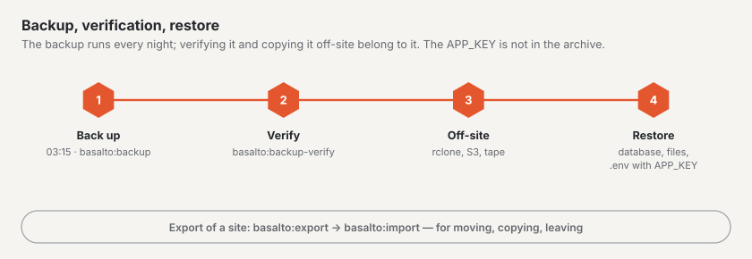

# Backup

Basalto backs up the whole installation every night, verifies the backup on request and restores it in an emergency.
For a single site there is also the export — for moving, copying or leaving.



Two tools with different purposes:

| | Backup | Export |
| --- | --- | --- |
| Command | `basalto:backup` | `basalto:export` |
| Scope | the whole installation: database dump and files of all sites | one site: content, media, settings as JSON and files |
| Purpose | emergency: server, database or storage lost | move, copy, exit |
| Back | restore the database, copy the files back | `basalto:import` |

## Backing up

```sh
php artisan basalto:backup                          # to storage/app/backups
php artisan basalto:backup --path=/srv/sicherung    # another folder
```

The archive `basalto-backup-JJJJMMTT-HHMMSS.zip` (time in UTC) contains the database dump, the media library of every
disk, the files from forms and a `manifest.json` with the SHA-256 and size of every file.

- **SQLite** is copied via `VACUUM INTO`, **MariaDB/MySQL** with `mariadb-dump` or `mysqldump`, **PostgreSQL**
  with `pg_dump`. The tool must match the server. If it is not in the search path, set
  `BASALTO_BACKUP_MYSQL_DUMP` or `BASALTO_BACKUP_PG_DUMP` in the `.env` to the path.
- **Not in the archive:** the `.env` and with it the `APP_KEY`. Keep it separately and securely (password manager),
  never next to the archive — without the same key, encrypted columns cannot be read.
- A backup on the same disk only protects against operating errors. Also copy the archive **off-site**,
  for example after 03:15 with `rclone copy storage/app/backups remote:basalto`.

### Schedule and retention

| What | When or where |
| --- | --- |
| `basalto:backup` | daily at **03:15 UTC** via the scheduler, only on one server (after `basalto:cleanup` at 03:00, before `basalto:media-purge` at 03:30) |
| “Back up now” | manually under **Administration › Operations**; triggers the same command in the queue |
| Retention | after every run the newest backups stay in the folder, default **7**; adjustable under **Administration › Settings › Retention › “Keep backups”** (`backup.keep`, 1 to 365) |

The schedule needs the cron entry from [Hosting](hosting.md). Administration › Operations shows the status of the last
backup and verification.

## Verification

```sh
php artisan basalto:backup-verify                                   # latest backup in the default folder
php artisan basalto:backup-verify --path=/srv/sicherung             # latest backup in this folder
php artisan basalto:backup-verify /srv/sicherung/basalto-backup-20261016-031500.zip
```

Names, manifest, size and SHA-256 of every file are checked. With SQLite the command restores the database into a
temporary file (`PRAGMA integrity_check`, count sample); with MariaDB/MySQL and PostgreSQL it reads the dump for
completeness. There, the real restore test into an empty database is a manual step — at least before every update
and quarterly.

## Restoring

Beforehand: maintenance mode (`php artisan down`), stop the scheduler and worker, and also back up the **current**
database and storage — in case the restore itself goes wrong.

1. **Verify the archive:** `php artisan basalto:backup-verify <archive>` — only continue with “restore verified”.
2. **Unpack** into an empty working folder: `mkdir /tmp/restore && cd /tmp/restore && unzip <archive>`.
3. **Restore the database:**
   - SQLite: stop the application, `cp database/database.sqlite <path from DB_DATABASE>`.
   - MariaDB/MySQL: create an empty database and import —
     `mariadb -h <host> -u <user> -p -e "CREATE DATABASE basalto_new CHARACTER SET utf8mb4 COLLATE utf8mb4_unicode_ci"`,
     then `mariadb -h <host> -u <user> -p basalto_new < database/database.sql`; switch `DB_DATABASE` to `basalto_new`
     (or empty the old database and import into it).
   - PostgreSQL: `createdb basalto_new`, then `psql -h <host> -U <user> -d basalto_new -f database/database.sql`.
4. **Copy the files back:** `files/<disk>/…` onto the disk of the same name — locally for example
   `rsync -a files/local/ storage/app/private/`; with S3 or R2 `aws s3 sync files/s3/ s3://<bucket>/` or `rclone copy`.
5. **`.env` and `APP_KEY`** of the backed-up installation — the same key as when backing up.
6. **Follow-up work:**

```sh
php artisan migrate --force                 # if Basalto is newer than the backup
php artisan optimize:clear
php artisan basalto:search-index
php artisan basalto:page-cache clear        # if the page cache is switched on
php artisan basalto:page-cache warm
php artisan up
```

7. **Check:** `/up` reports “bereit” (ready), signing in to the backend works, open a page with images and the media
   library. Then start the scheduler and worker again.

## Exporting and importing a site

```sh
php artisan basalto:export <handle>                         # to storage/app/exports
php artisan basalto:export <handle> --path=/tmp/site.zip    # file or folder
php artisan basalto:export <handle> --with-submissions      # with form submissions (personal data)
php artisan basalto:import /tmp/site.zip                    # under the handle from the export
php artisan basalto:import /tmp/site.zip --handle=kopie     # under a different handle
```

In the backend: **Administration › Sites** › open the site › **“Download export”** — for owners of the site and the
owner or administration of its account, without form submissions.

### What the export contains

The ZIP contains `site.json` (format version 1), `manifest.json` with SHA-256 per file, the media files under `media/`
and — with `--with-submissions` — the files of submissions under `submissions/`. `site.json` holds the site (handle,
name, languages, time zone, theme, settings), domains, members with their role (open invitations as “pending”),
settings, the theme from the database with drafts and versions, media folders and details, all entries with their
versions per language, redirects, menus and forms. References between entries, media and people are rewritten to the
new IDs on import.

**Deliberately not included:** the log, the 404 hits, the search index (it is rebuilt), API tokens, comments, the
webhook secret of forms (generate it anew in the backend after the import and tell the recipient) and the checksums of
submissions' IP addresses.

### What the import does

Basalto checks the archive completely (paths, manifest, checksums, format version) and then creates the site in **one**
step; if something goes wrong, the files written disappear again too. People with an account in the installation (same
e-mail) become members, for everyone else an invitation **without e-mail** is created — send it under “Users” with
“Resend”. Domains already in use are left out and reported.

## Laravel Cloud

On Laravel Cloud the platform's backup applies: automatic database backups and — if you switch it on — bucket
versioning. There `basalto:backup` writes to the instance's ephemeral disk; only use the command with `--path` pointing
to storage that persists. Do not restore a single site from the platform backup, use the export instead.

## Next

- [Updates](updates.md)
- [Monitoring](monitoring.md)
- [Sites](../verwaltung/sites.md)
