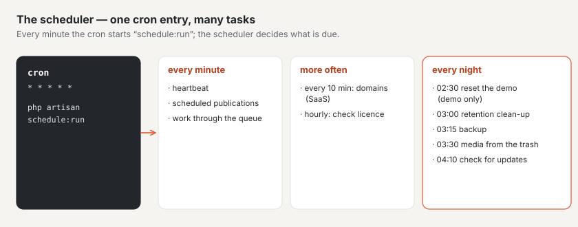

# Hosting

Basalto runs with a **simple hosting provider** with PHP, a database and one cron entry — or on **Laravel Cloud** with
managed services. Both without Redis and without a permanently running worker.

## Simple hosting



1. Bring Basalto onto the server and set it up as described under [Installation](installation.md).
2. Set the drivers in the `.env` to the database — this is already the default from `.env.example`:

   ```dotenv
   DB_CONNECTION=mariadb
   CACHE_STORE=database
   SESSION_DRIVER=database
   QUEUE_CONNECTION=database
   ```

3. Create **one** cron entry (adjust the path):

   ```cron
   * * * * * cd /path/to/basalto && php artisan schedule:run >> /dev/null 2>&1
   ```

4. Check in the backend under **Administration › Operations**: `/up` reports “bereit” (ready), the heartbeat is more
   recent than the heartbeat threshold (default 5 minutes, Administration › Settings › Operations), the queue runs via
   the cron.

### Queue without a worker

Mails, webhooks, image variants and warming up the page cache run via the queue. Without a worker the scheduler
works through it: every minute it starts

```sh
php artisan queue:work --stop-when-empty --max-time=50 --tries=3
```

without overlapping and only on one server. This happens as long as both conditions apply:

- `QUEUE_CONNECTION=database` and
- `BASALTO_QUEUE_VIA_SCHEDULER` is not set or `true`.

If you run your own worker (Supervisor, managed queue), set `BASALTO_QUEUE_VIA_SCHEDULER=false`. With a queue other
than `database`, Basalto does not schedule `queue:work` anyway. Which other tasks the scheduler runs is described under
[Commands](befehle.md#scheduler-timetable).

### What to look for with the hosting provider

- `schedule:run` starts each task as a separate PHP process; the hosting provider must allow `proc_open` and permit a
  cron every minute.
- For the daily backup the server needs the database's dump tool, see [Backup](backup.md).
- You do not need Node.js on the server: the release archive comes with the built frontend.

### Web hosting with LiteSpeed (e.g. cyon)

- **Cron with the full PHP path:** without a path, cron starts the server's default version, not your site's:

  ```cron
  * * * * * cd /home/<login>/basalto && /opt/alt/php85/usr/bin/php artisan schedule:run >> /dev/null 2>&1
  ```

- **PHP version per folder:** LiteSpeed inherits `.htaccess` only one level deep. If `public/` lies deeper
  (`public_html/basalto/public`), `public/.htaccess` needs the PHP version itself. The web installer copies it from the
  `.htaccess` above; updates leave `public/.htaccess` in place.
- **Existing `.htaccess`:** the web installer appends the redirect to `public/` instead of leaving it out.
- **Updates without `proc_open`:** if `proc_open` is disabled in the browser, Administration › Updates shows the command
  for SSH: `/opt/alt/php85/usr/bin/php artisan basalto:update --kern`. If PHP runs as `lsphp` in the browser, set
  `BASALTO_PHP_BINARY=/opt/alt/php85/usr/bin/php`.
- **SQLite:** Basalto sets SQLite to WAL with a 5-second wait (`DB_JOURNAL_MODE`, `DB_BUSY_TIMEOUT`); the file lies in
  `database/`, outside `public/`, and is backed up with `VACUUM INTO`.
- **Mail:** the sender is an address of a domain on the same hosting (SMTP via port 465 or 587); a new hosting sends at
  most 30 emails per hour during its first 30 days.

## Health: `/up` and `/up/live`

| Address | Checks | Response |
| --- | --- | --- |
| `/up` | database and heartbeat of the scheduler (readiness) | 200 “bereit” (ready) or 503 “gestört” (disrupted), JSON without secrets |
| `/up/live` | only the PHP process (liveness) | 200 |

A fresh installation without a first heartbeat only counts as disrupted after the threshold. More on monitoring is
under [Monitoring](monitoring.md).

## Laravel Cloud

These settings apply on Laravel Cloud:

| Topic | On Laravel Cloud |
| --- | --- |
| Files | media in the private bucket (`FILESYSTEM_DISK=s3`); nothing on the ephemeral disk |
| Cache, sessions | Valkey (`CACHE_STORE=redis`, `SESSION_DRIVER=redis`), own cache per environment |
| Queue | managed queue or `database`; with your own worker `BASALTO_QUEUE_VIA_SCHEDULER=false` |
| Build | `composer install --no-dev --no-interaction --prefer-dist --optimize-autoloader` · `php artisan vendor:publish --tag=basalto-assets --force` · `npm ci --audit false` · `npm run build` |
| Deploy command | `php artisan migrate --force` |
| Scheduler | switch it on in the app cluster; all tasks run `onOneServer` |
| Customers' own domains (SaaS only) | `basalto:domains-verify` every ten minutes via the Cloud CLI (`BASALTO_CLOUD_ENVIRONMENT`, `LARAVEL_CLOUD_TOKEN` as a secret) |

Laravel Cloud builds the new release and runs the migrations before switching over — for a while the old code serves
the new schema. Your own migrations (for example in modules) therefore follow the rule “expand first, clean up later”:
add a new column first and fill it, and remove the old one only in a later release.

Switch on platform backups of the database and bucket versioning in Laravel Cloud; Basalto's own backup comes on top,
see [Backup](backup.md).

## Public demo

An installation can run as a public demo: with `BASALTO_DEMO=true` — never together with data that should stay.

- **Setting it up:** with the web installer, under “Advanced” “Set up as a public demo” — the installer writes
  `BASALTO_DEMO=true` and leads straight to the feature tour.
- **Quick access:** the sign-in page shows three buttons “View as owner/editor/translator” that sign in without a
  password or code. Without the switch there are neither the buttons nor the address behind them.
- **Mails intercepted:** every mail is stopped before sending and only logged (mailer `log`, changeable with
  `BASALTO_DEMO_MAILER`); the backend shows the band “Demo — data is reset every night, emails are not sent”.
- **New every night:** the scheduler calls `basalto:demo-reset --force` at 02:30 — empty and freshly migrate the
  database, empty the media, import site `BASALTO_DEMO_SITE` (default `demo`) with the starter content of
  `BASALTO_DEMO_THEME` (default `starter`) and put it live, create three accounts.
- **Limited storage:** what visitors upload — media, form attachments, profile pictures, theme images, forum
  attachments — takes up at most `BASALTO_DEMO_QUOTA_MB` in total until the next reset (default 200, `0` for no limit).
  Once the storage is full, every further upload is refused with a note at the file field. The demo does not show the
  “Set up passkey” hint — its accounts are created anew every night.
- **Feature tour:** the demo includes the page `/funktionen` with a subpage per area — what it can do, what you can try,
  and a way into the backend via quick access straight to the right place.
- The demo site's domain is the host from `APP_URL`; `BASALTO_DEFAULT_SITE=demo` lets other hosts go there too.

## Next

- [Installation](installation.md)
- [Monitoring](monitoring.md)
- [Commands](befehle.md)
