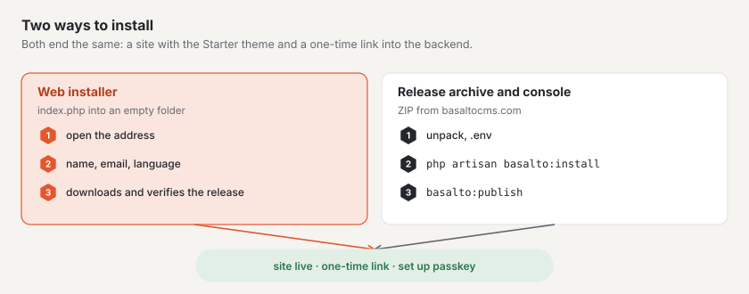

# Installation

Basalto runs on any web space with PHP 8.4 — without Redis, without a worker, and with SQLite even without a database
of its own. This page describes the requirements, the two ways to install and the `.env` keys.



## Requirements

| What | Value |
| --- | --- |
| PHP | 8.4 or later |
| PHP extensions | `pdo_sqlite`, `pdo_mysql` or `pdo_pgsql` depending on the database, `mbstring`, `intl`, `gd` (image variants), `zip` (export, backup, theme packages), `sodium` (licence and signatures) |
| Database | SQLite, MariaDB 11.4, MySQL 8.4 or PostgreSQL 18 |
| Web server | document root on `public/`, HTTPS |
| Cron | one entry for the scheduler, see [Hosting](hosting.md) |
| Not needed | Redis/Valkey, queue worker, Node.js, mail server for the first sign-in |

For backups you also need the database's dump tool (`mariadb-dump`, `mysqldump` or `pg_dump`), see [Backup](backup.md).

## Way 1: the web installer

For everyone who wants a website and needs no terminal. Step by step with pictures it is described under
[Installing Basalto](../einstieg/installieren.md); here is what matters for operations:

1. Get the installer from basaltocms.com under **Download** — a single file `index.php`.
2. Put it into an **empty** folder and open the address in the browser.
3. Enter **site name**, **email** and **language**, “Install”.

The installer checks PHP and the extensions, downloads the current release, verifies its **Ed25519 signature** and
checksum, unpacks, writes the `.env` (new application key, SQLite, address from the browser), migrates, creates the
site with the Starter theme and the domain from the address, publishes the starter content and signs you in to the
backend with a one-time link. Then it deletes itself.

- **Advanced:** MariaDB/MySQL or PostgreSQL instead of SQLite, a licence key straight away.
- **Only into an empty folder** (allowed are files that hosting providers create themselves: `.htaccess`, `.user.ini`,
  `.well-known`, `cgi-bin`, `error_log`).
- **First come:** the first browser gets the installation; a second one sees “already running”. To start over, delete
  the file `.basalto-install.json` in the folder.
- **Web server starts in the main folder instead of `public/`:** the installer creates an `.htaccess` that routes
  everything through `public/` (Apache). On nginx set the root to `public/`.

## Way 2: release archive and console

For servers with a console, for scripts and for Laravel Cloud. The archive contains everything Basalto needs —
including `vendor/` and the built frontend; Composer and Node are not needed on the server.

1. Get the current archive. Which file is current is in `https://basaltocms.com/_download/latest.json` (field `file`,
   plus `sha256` and the signature); the file is at `https://basaltocms.com/_download/<file>`.
2. Compare the checksum and unpack:

```sh
curl -fsSO https://basaltocms.com/_download/basalto-1.2.0.zip
sha256sum basalto-1.2.0.zip          # compare with "sha256" from latest.json
unzip basalto-1.2.0.zip -d my-site && cd my-site
cp .env.example .env
php artisan key:generate
# edit .env: APP_ENV, APP_DEBUG, APP_URL, database, mail (see below)
```

3. Install:

```sh
php artisan basalto:install
```

The installer migrates the database, asks for the handle and name of the site and for the email and name of the first
account, and prints a **one-time link** for the first sign-in (valid for 60 minutes, usable once) — without a password
and without a mail server. The first account becomes the site's owner. It can run several times safely; existing data
stays.

Without questions, for example in a script:

```sh
php artisan basalto:install --no-interaction --site=my-site --name="My Site" \
  --email=editor@example.com --locale=en --timezone=Europe/Zurich
```

Further options: `--user` (name of the account), `--minutes` (validity of the link, default 60).

After signing in, set up a passkey in the backend (Overview › “Set up passkey”). A new one-time link at any time:

```sh
php artisan basalto:login-link editor@example.com              # valid for 15 minutes
php artisan basalto:login-link editor@example.com --minutes=60
```

### Installer in the browser on a prepared server

Without a console, the installer in the browser leads through the same steps (database › site › account › done). It is
at `/<BASALTO_BACKEND_PATH>/installieren`, by default `/admin/installieren`, and shows the one-time link at the end.

- The installer only exists as long as nothing is set up; afterwards the address answers 404.
- If the server is publicly reachable before anyone installs, set **`BASALTO_INSTALL_TOKEN`** in the `.env` to a long
  random value and call the installer with `/admin/installieren?token=<value>`. Without a matching token it answers 404.

## Putting the first site live

In the `.env`:

```dotenv
BASALTO_DEFAULT_THEME=starter
BASALTO_DEFAULT_SITE=my-site
```

Then:

```sh
php artisan basalto:publish my-site --dry-run   # check only, write nothing
php artisan basalto:publish my-site             # import starter content, check, warm up, go live
```

`basalto:publish` imports the theme's starter content (`--ohne-seed` leaves it out), checks links, images, alt texts,
required languages, legal pages, forms and redirects, warms up the page cache and puts the site live — or refuses with
a reason. Create the legal notice and privacy policy from a template as drafts:

```sh
php artisan basalto:legal my-site impressum
php artisan basalto:legal my-site datenschutz
```

`BASALTO_DEFAULT_SITE` applies to every host without its own entry. Enter a site's domains in the backend under
**Administration › Sites**.

## Important `.env` keys

### Laravel

| Key | Default in `.env.example` | For production |
| --- | --- | --- |
| `APP_ENV` | `local` | `production` |
| `APP_DEBUG` | `true` | `false` |
| `APP_KEY` | empty | `php artisan key:generate`; keep separately (see [Backup](backup.md)) |
| `APP_URL` | `http://localhost:8000` | public address with HTTPS |
| `APP_LOCALE`, `APP_FALLBACK_LOCALE` | `de`, `en` | language of the interface |
| `DB_CONNECTION`, `DB_HOST`, `DB_PORT`, `DB_DATABASE`, `DB_USERNAME`, `DB_PASSWORD` | `sqlite` | `mariadb`, `mysql`, `pgsql` or `sqlite` |
| `DB_TIMEZONE` | not set, `+00:00` applies | time zone of the database session with MariaDB and MySQL; leave it at `+00:00`, see [Database time zone](#database-time-zone) |
| `CACHE_STORE`, `SESSION_DRIVER`, `QUEUE_CONNECTION` | `database` | `database` is enough; on Laravel Cloud Valkey (`redis`) |
| `FILESYSTEM_DISK` | `local` | `local` or `s3` (bucket, with `AWS_*`) |
| `MAIL_MAILER`, `MAIL_HOST`, `MAIL_PORT`, `MAIL_USERNAME`, `MAIL_PASSWORD`, `MAIL_FROM_ADDRESS` | `log` | real sending for login codes, invitations, forms and the error alarm |

Emails carry the header and footer of the site the recipient belongs to (without a site: the vendor’s site): the site
name at the top, at the bottom the provider lines from the theme’s global content “Footer” (fields `brand`, `owner`,
`street`, `city`, `country`, `vat`) and links to the legal pages from `publish.legal`. Colours and type are in the
mail theme `basalto` (`packages/core/resources/views/mail/html/themes/basalto.css`).

### Basalto

The keys are read by the core's `config/basalto.php` (`packages/core/config/basalto.php`). Not all of them
are in `.env.example`; you only set the others when needed.

| Key | Default | Purpose |
| --- | --- | --- |
| `BASALTO_BACKEND_PATH` | `admin` | path of the backend |
| `BASALTO_DEFAULT_SITE` | empty | site for hosts without an entry in the domains |
| `BASALTO_DEFAULT_THEME` | see text | theme folder under `themes/` if a site does not name one; set `starter` (not in `.env.example`) |
| `BASALTO_THEMES_PATH` | `themes/` of the installation | other folder for file themes (not in `.env.example`) |
| `BASALTO_INSTALL_TOKEN` | empty | protects the installer in the browser (not in `.env.example`) |
| `BASALTO_PAGE_CACHE` | on, except with `APP_ENV=local` | switch the page cache on or off (not in `.env.example`) |
| `BASALTO_PAGE_CACHE_STORE` | default store | separate cache store for the page cache (not in `.env.example`) |
| `BASALTO_MEDIA_QUOTA_MB` | unlimited | storage quota per site in MB (not in `.env.example`) |
| `BASALTO_PASSWORD_LOGIN` | `false` | login with a password for installations without mail (not in `.env.example`) |
| `BASALTO_PHP_BINARY` | PHP of this process | PHP for the steps of an update, e.g. `/opt/alt/php85/usr/bin/php` under LiteSpeed, see [Hosting](hosting.md) (not in `.env.example`) |
| `BASALTO_QUEUE_VIA_SCHEDULER` | `true` | the scheduler works through the database queue, see [Hosting](hosting.md) (not in `.env.example`) |
| `BASALTO_BACKUP_MYSQL_DUMP`, `BASALTO_BACKUP_PG_DUMP` | search path | path to the dump tool, see [Backup](backup.md) (not in `.env.example`) |
| `BASALTO_LICENSE_KEY` | empty | licence key, see [Licence](lizenz.md) |
| `BASALTO_LICENSE_BANNER_DAYS` | `30` | days “unregistered” until the footer bar appears in the frontend |
| `BASALTO_LICENSE_PUBLIC_KEY` | product key in the core | only for tests and issuing your own keys; remove the empty line from `.env.example`, see [Licence](lizenz.md) |
| `BASALTO_DEPLOYED_AT` | empty | time of the last deployment, shown under Administration › Operations |
| `BASALTO_ALIAS_DOMAIN` | `basaltocms.com` | alias zone of the SaaS (Laravel Cloud only) |
| `BASALTO_CLOUD_ENVIRONMENT`, `BASALTO_CLOUD_BINARY`, `LARAVEL_CLOUD_TOKEN` | empty, `vendor/bin/cloud`, empty | customer domains via the Cloud CLI (Laravel Cloud only); the token only as a secret, never in a file |

For Pulse and Nightwatch see [Monitoring](monitoring.md).

### Database time zone

Basalto stores all points in time in UTC. MariaDB and MySQL interpret points in time in the time zone of the
connection — if the database server runs in Europe/Zurich, for example, there is no time between 02:00 and 02:59 on the
last Sunday in March, and saving fails with “Incorrect datetime value”. That is why Basalto sets the connection to UTC
(`DB_TIMEZONE`, default `+00:00`). New installations need not do anything; SQLite and PostgreSQL are not affected.

If you ran Basalto before on a server that is not in UTC, the points in time stored so far appear shifted by the
server's offset after the update (in Zurich one hour in winter, two in summer). This is how you convert them once:

1. Look at the findings — the command names the server's time zone and the affected columns but changes nothing:

   ```sh
   php artisan basalto:db-zeitzone
   ```

2. Create a backup: `php artisan basalto:backup` ([Backup](backup.md)).
3. Convert:

   ```sh
   php artisan basalto:db-zeitzone --umrechnen
   ```

The command remembers the conversion; running it a second time changes nothing. If you know the time zone the data
was written in, give it with `--von=+01:00`; otherwise it takes the server's.

Good to know:

- Until you convert, `DB_TIMEZONE=SYSTEM` in `.env` keeps the previous behaviour. Remove the entry again for the
  conversion — the command refuses it as long as the connection is not in UTC.
- Backups keep their points in time regardless of the time zone. If you restore a backup from before the conversion,
  run `basalto:db-zeitzone` again afterwards.
- Points in time from the repeated hour when the clocks go back in autumn (in Zurich 02:00–02:59) were already stored
  ambiguously and may differ by one hour after the conversion.

## Next

- [Hosting](hosting.md)
- [Backup](backup.md)
- [Commands](befehle.md)
