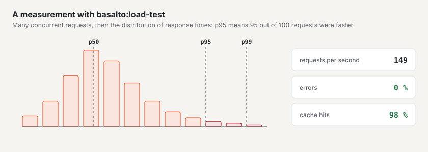

# Load test

`php artisan basalto:load-test` requests addresses concurrently and reports requests per second, p50/p95/p99, errors,
status codes and page cache hits (header `X-Basalto-Cache: HIT`). It needs no extra package and is meant for your own
instance — it refuses foreign hosts without `--remote`.

| Option | Meaning |
| --- | --- |
| `url…` | one or more addresses, requested in turn |
| `--concurrency` | concurrent requests (default 10) |
| `--duration` | duration in seconds (default 30) when `--requests` is 0 |
| `--requests` | a fixed number of requests instead of a duration |
| `--max-p95` | target for p95 in ms — exceeded means exit code 1 |
| `--max-errors` | highest error rate in per cent (default 1) — exceeded means exit code 1 |
| `--remote` | hosts outside `localhost`, `*.test`, `*.localhost` — your own instances only |
| `--json` | result as JSON (for logs) |

## Measuring an instance

This is how to check whether an installation carries the expected peaks — preferably on a copy, never on an instance
with customer data:

1. Fill it with test data: `php artisan basalto:benchmark --sites=100 --entries=1000` creates sites `bench-n`;
   `--clean` removes them again.
2. **Cold** (after a pause, for example when the instance sleeps between requests) measure once with `--requests=1`
   and note the time.
3. **Warm, with page cache:**
   `php artisan basalto:load-test https://bench-1.your-domain.com/ https://bench-2.your-domain.com/ --remote --concurrency=30 --duration=300 --max-p95=300 --json`
4. **Without cache:** the same measurement with pages the cache does not hold — with a form or search, such as
   `/kontakt` and `/suche?q=…`.
5. Record the result with date, instance size and version; finally `--clean`.

**Guide values:** p95 below 300 ms at 30 concurrent requests with page cache, below 800 ms without; error rate below
1 %.

## Next

- [Hosting](hosting.md)
- [Monitoring](monitoring.md)
- [Commands](befehle.md)
