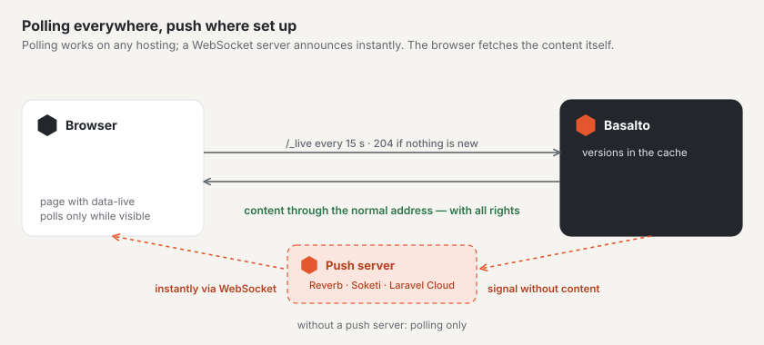

# Setting up live updates

Basalto reports new activity without reloading — in the forum (posts, thread lists, conversations, counters) and at the
bell in the backend. The basis is economical **polling**, which runs on any hosting and needs nothing. Where a
**WebSocket server** speaking the Pusher protocol is running, the same signal arrives immediately by **push**; if it
fails, polling takes over.

## Polling

Pages that expect new content ask at `/_live` every 15 seconds whether anything has changed — only while their tab is
visible, immediately on returning to the tab, and with longer pauses after errors.

- If nothing has changed, Basalto answers with `204` and no content; only versions from the cache are read. Polling
  starts no session and sets no cookies.
- Forum pages are still served to guests from the page cache; polling has an address of its own.
- What a page may observe is stated, with a signature, in the page itself; personal counters exist only in personal
  pages.

| Setting | Meaning | Default |
| --- | --- | --- |
| `BASALTO_LIVE_INTERVAL` | Polling interval in seconds (at least 5) | `15` |
| `BASALTO_LIVE_RATE` | Requests per minute and address — also for many tabs behind a shared address | `600` |

The cache should be a shared store (Redis, Valkey or database) if several servers deliver the site — otherwise each
server only sees its own versions.

## Push

Push needs a WebSocket server that speaks the Pusher protocol: **Laravel Reverb** (on Laravel Cloud as a managed
service, or as a small application of its own on your server) or **Soketi**. Basalto sends a signal without content to
the server; the browser subscribes to the channel through `/_live/auth`, without a session — guests too.

| Variable | Meaning |
| --- | --- |
| `REVERB_APP_ID`, `REVERB_APP_KEY`, `REVERB_APP_SECRET` | Application, public key and secret on the server |
| `REVERB_HOST`, `REVERB_PORT`, `REVERB_SCHEME` | where the browser reaches the server (for example `ws.example.ch`, `443`, `https`) |
| `BASALTO_LIVE_PUSH_SERVER_HOST`, `…_PORT`, `…_SCHEME` | where Basalto reaches the server if that differs (for example internally without TLS) — empty means the same |
| `BASALTO_LIVE_PUSH` | `false` switches push off, even if everything is set |

Once application, key, secret and host are set, push is switched on. Only then does the browser load Echo and
`pusher-js`; the secret never leaves the server.

### Laravel Cloud

Attach a **WebSocket cluster** to the environment. Laravel Cloud sets the `REVERB_…` variables itself; after the next
deploy, push is switched on.

### Your own server

Run Reverb or Soketi as a separate service next to Basalto (under a process manager such as Supervisor), forward
`wss://` to it through your web server and enter the same credentials on both sides. Basalto needs no additional package
for this — it speaks the protocol itself.

### Simple hosting

Without a process of your own there is no WebSocket server. Polling then carries everything; new content appears after
one interval at most.

## Checking

Under **Administration › Operations**, the card **“Live updates”** shows the interval, the limit per address and whether
push is set up and reachable. If the server cannot be reached, this is shown there in red — the forum keeps working
through polling.

## Next

- [Live updates](../community/live.md)
- [Monitoring](monitoring.md)
- [Hosting](hosting.md)
