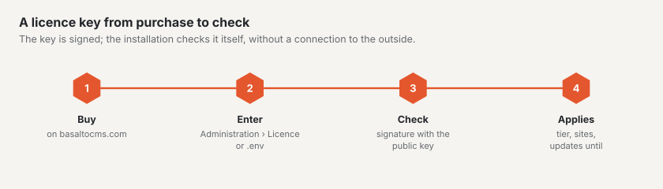

# Licence

Basalto is **source-available**: the code is public, its use is governed by the Basalto licence agreement. You can
read it in the backend under `/admin/recht/lizenzvertrag` and publicly under `/_recht/en/lizenzvertrag`. This page shows
the tiers and how to enter and check a key.



## Levels

| Level | In short |
| --- | --- |
| **Free** | without a key: one site, one backend user, all modules; for development, tests and private use |
| **Site** | one production domain, up to three sites in one installation; new versions for one year from purchase |
| **Agency** | all sites and installations for you and your customers; sub-licence key per customer, on request without the Basalto brand in the backend |

§§ 3 to 5 of the licence agreement are authoritative.

## How Basalto checks the licence

- **Offline.** The key is signed with Ed25519 and checked against the public product key in the core —
  without phoning home.
- **Never locked.** If an installation exceeds its level (more users, more sites, domain not in the key),
  it counts as “unregistered”. Basalto then shows notices but does not lock any function.
- **Footer bar after 30 days.** If an installation has been unregistered for longer than `BASALTO_LICENSE_BANNER_DAYS`
  days (default 30), the frontend shows a footer bar. From when, is shown under Administration › Licence.
- **Update entitlement.** If it has expired, the software keeps running; new versions need a renewal.
- The scheduler updates the status hourly with `basalto:license`.

## Entering the key

Two ways — the entry in the backend takes precedence over the `.env`:

1. **Administration › Licence:** paste the key, check it, enter it. An invalid key is not saved.
   The page shows level, status, limits and notices.
2. **`.env`:**

   ```dotenv
   BASALTO_LICENSE_KEY=<key>
   ```

> **Caution:** `.env.example` contains the empty line `BASALTO_LICENSE_PUBLIC_KEY=`. An empty value overrides the
> product key in the core, and Basalto then cannot check any key (“Kein öffentlicher Lizenzschlüssel
> konfiguriert” — no public licence key configured). Remove the line or comment it out; you only need to set it for
> tests and issuing your own keys.

## Connecting to the customer account

If you bought a licence on basaltocms.com, you see keys, invoices and marketplace purchases right in your own
backend — only the purchase itself stays on basaltocms.com. Under **Administration › Licence › Customer account with
the vendor** (owners only):

1. Enter the **email address** of the customer account → **Request code**. basaltocms.com sends a six-digit code to
   this address — only if a customer account exists there; the backend shows the same answer in both cases. The
   email names the host of this installation.
2. Enter the **code** → **Connect**. The installation receives a token and stores it encrypted (with the `APP_KEY`);
   it never appears in the interface or in the log. The log only records “connected” and “disconnected” with the
   vendor’s host.
3. Once connected, the page shows:
   - **Licences** with level, domains, update entitlement and status (active, blocked, in progress). **Use this key**
     enters a key just like the form next to it — the same check, the same storage location.
   - **Invoices** with number, date, amount, status and **PDF**. The PDF link is a signed address on basaltocms.com,
     valid for one hour and only while the installation is connected.
   - **Marketplace purchases** with receipt, if there are any.

The data is cached for ten minutes; **Refresh** fetches it again immediately. The page never waits for the vendor:
the data loads afterwards, and if basaltocms.com cannot be reached (time limit of a few seconds), a message appears
instead of a hanging page.

**Signature.** basaltocms.com signs every response with the marketplace key; the installation verifies it with the
public key in the core (`basalto.marketplace.public_key`). If the signature is wrong or the response belongs to a
different installation, the page shows an error and no data. If the signature is missing, the data appears marked
“unsigned”. Links from the response only appear if they point to the vendor.

**Disconnect** revokes the token on basaltocms.com and deletes it here. If basaltocms.com cannot be reached at that
moment, it is still deleted here and therefore unusable.

The **customer account** on basaltocms.com also lists the connected installations with host and last fetch; **Disconnect** there revokes the token as well.

The licence check itself stays **offline** — the connection is only used for this overview. The vendor’s address comes
from `BASALTO_VENDOR_URL` (default `https://basaltocms.com`, locally `https://basalto.test`); if it changes, the
installation counts as not connected.

## `basalto:license`

```sh
php artisan basalto:license                     # show and record the licence status
php artisan basalto:license --check=<key>       # check a key without entering it
php artisan basalto:license --help              # all options
```

The other options (`--keypair`, `--issue` with `--plan`, `--licensee`, `--domains`, `--seats`, `--sites`,
`--updates-until`, `--agency`, `--customer`, `--white-label`, `--secret-file`, as well as `--revoke`) are for issuing
and revoking keys. They need the private product key, which is held only by basaltocms.com, and are not needed
for running an installation.


Questions about the licence: email@basaltocms.com.

## Next

- [Licence](../verwaltung/lizenz.md)
- [Installation](installation.md)
