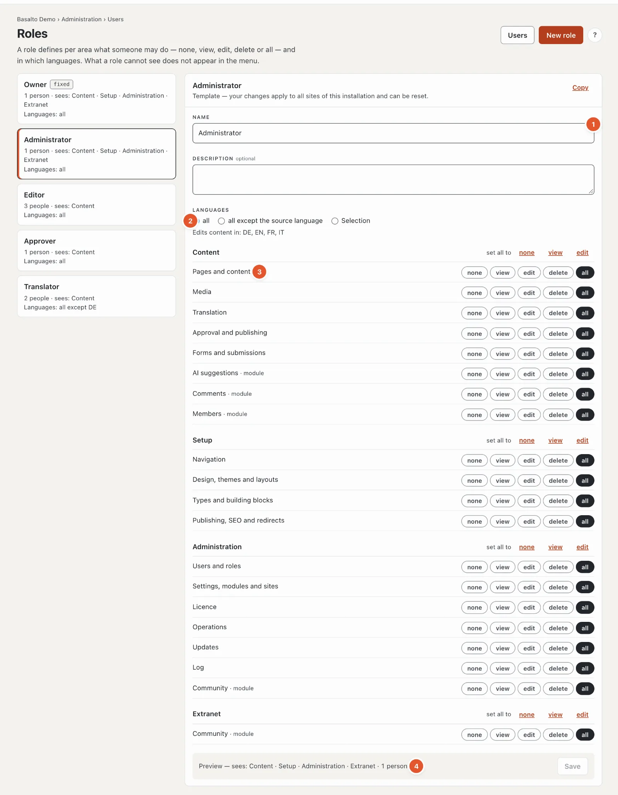

# Roles and rights

What someone may do in the backend is defined by their **role**. A person has exactly one role per site; the roles
themselves apply to all sites of the installation (or of the SaaS account). You maintain them under
**Administration › Roles**.

## Areas and levels

A role has one **level** per **area**. The levels build on each other:

| Level | Means |
| --- | --- |
| **none** | The area does not appear in the menu; its addresses answer with 403. |
| **view** | Read without changing anything. |
| **edit** | Create and change. |
| **delete** | Delete as well. |
| **all** | The area’s sensitive settings as well — such as a form’s webhook, the members’ settings and export, or the key for AI suggestions. |

The areas are arranged in three groups. If a role sees no area at all in a group, the mode switch to that group is
hidden as well.

| Group | Areas |
| --- | --- |
| **Content** | Pages and content · Media · Translation · Approval and publishing · Forms and submissions · from modules: Comments, Members, AI suggestions |
| **Setup** | Navigation · Design, themes and layouts · Types and building blocks · Publishing, SEO and redirects |
| **Administration** | Users and roles · Settings, modules and sites · Licence · Operations · Activity log · from modules: Licence sales, Marketplace, Test management |

Modules register their own areas; a newly installed module appears in the matrix right away.

## Templates

Five roles come predefined. You can adapt them and **reset** them to the state from the code at any time — except
“Owner”.

| Template | May |
| --- | --- |
| **Owner** | Everything. Cannot be changed, so no site can lock itself out. Every site keeps at least one owner. |
| **Administrator** | Everything except assigning the owner role. |
| **Editor** | Pages, media and forms up to “delete”; translation, comments, members and AI suggestions “edit”. No setup, no administration, no approving. |
| **Approver** | Approval and publishing “all”; pages, media, translation, forms and comments “view”. |
| **Translator** | Pages and translation “edit”, media “view”, AI suggestions “edit” — in all languages **except the source language**. |

The owner and administrators of a SaaS account may do everything on all sites of the account, like an owner.

## Your own roles

**New role** creates an empty role (may do nothing) or a copy of an existing one (“Based on” or **Copy**). In the
matrix you choose the level for each area; “set all to” sets a whole group at once. Below, the preview shows what the
role sees (“Content · Setup · Administration”) and how many people have it. Every change saves itself (a series of them is one
line in the log) and applies from the next request.

A role is assigned as before under **Users** (selection in the list or when inviting). A custom role can be
**deleted** as long as nobody has it and no open invitation refers to it.

## Languages

For each role you decide in which languages it may edit content: **all**, **all except the source language** or a
**selection**. The source language (the site’s default language) is only included if you choose it. Creating,
deleting and moving pages and changing their settings requires the source language. The restriction applies in the
editor, in the “Translation” overview, to AI suggestions, on the page itself (front-end editor) and via the API.

## Rules nobody gets around

- **The owner role cannot be changed.** It can be neither changed nor deleted; nobody can demote or deactivate a
  site’s last owner.
- **No giving away rights.** Whoever assigns, withdraws or changes a role needs at least the same level in every area
  and each of its languages. Only an owner assigns the owner role.
- **Changing roles requires “Users and roles · all”.** Viewing requires “view”.
- **API tokens** act with the rights of their user — a translator’s token does not change the source language.
- **Everything is in the activity log:** role created, changed (before/after), reset, deleted, and every new
  assignment.

## For developers

A module registers its areas in its service provider and maps its routes; routes without a mapping require
“Settings · all” (better too strict than too open), and a test finds them. A right can be checked with
`Gate::allows('area', [$site, 'area', Level::Edit])`. Details under [Extensions](../entwickler/erweiterungen.md).

## Next

- [Roles](../verwaltung/rollen.md)
- [Users](../verwaltung/benutzer.md)
