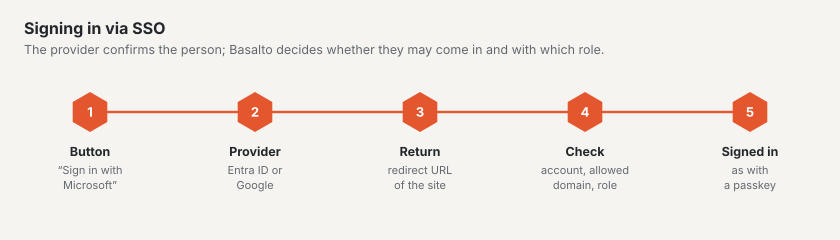

# SSO for backend users

Backend users of a site sign in with their company account: “Sign in with Microsoft” (Microsoft Entra ID) or “Sign in
with Google” (Google Workspace or a Google account). Passkey and email code stay available alongside — if the provider
is down, people still get in.

This works the same on your own installations and on the SaaS.

## Principles

- **Set up per site**, not per account: roles belong to the site, and an agency runs sites of different companies with
  different tenants in one account. Two sites of the same company need two entries (the same app registration may be
  used for both, with both redirect URLs).
- **Existing users only.** A person is signed in if Basalto has a user with the verified email **and** a role on the
  site. The first time, Basalto links the user to their ID at the provider; from then on the ID counts (a changed address
  at the provider does not break sign-in).
- **Automatic creation is off by default.** Whoever turns it on picks a role (editor, approver or translator — never
  owner or administrator). With Google this requires an **allowed domain**, otherwise every Google account in the world
  would get access. New users appear in the log (“User created via SSO”).
- **Deactivated accounts** stay locked out, also via SSO.
- **The client secret** is stored encrypted with `APP_KEY`, never sent to the browser, never logged and not part of a
  site export. After a move, set up SSO again.
- **Who may set it up:** the site owner and the account’s owner and administrators — not the site administrator: whoever
  chooses the provider decides whose accounts can sign in.

## Where in the backend

**Administration › Sites › (site) › Sign-in via SSO** (`/admin/sites/<id>/anmeldung`). It shows

- the site’s **sign-in address** (`/admin/login?site=<handle>`) — on a domain of the site the buttons appear without the
  addition; on an installation with a single site always. The sign-in page never lists all sites.
- per provider the fields, a switch (off = no button), the **redirect URLs to copy** (one per address at which the
  backend can be reached) and **“Test connection”**.

“Test connection” is a hint, not a guarantee: for Entra Basalto requests a token for the app itself and translates the
error codes (unknown tenant, client ID not in tenant, secret wrong or expired); for Google it checks whether client ID and
secret are known. Whether the redirect URL is right and users may consent only shows with a real sign-in — best once in
a private window.

## Microsoft Entra ID: register an app

1. [Microsoft Entra admin center](https://entra.microsoft.com) › **Identity › Applications › App registrations › New
   registration**.
2. Name, e.g. “Basalto – Muster AG”. **Supported account types: “Accounts in this organizational directory only”**
   (single tenant). Basalto only accepts the configured tenant anyway.
3. **Redirect URI:** platform **Web**, the redirect URL from Basalto, e.g.
   `https://muster.ch/admin/login/sso/entra/callback`. Further addresses (alias, `APP_URL`) under **Authentication › Add
   URI**.
4. The **Overview** shows **Application (client) ID** and **Directory (tenant) ID** — copy both GUIDs into Basalto.
   `common`, `organizations` or a domain name are not accepted.
5. **Certificates & secrets › New client secret**, choose an expiry (at most 24 months), copy the **value** (not the
   “secret ID”) right away and enter it in Basalto. Create and enter a new one before it expires.
6. **API permissions:** Microsoft Graph, delegated: `openid`, `profile`, `email`, `User.Read` (usually already there).
   Depending on tenant settings **“Grant admin consent”** — otherwise users see a consent prompt or a refusal the first
   time.
7. Optional: under **Enterprise applications › (app) › Properties** turn on “Assignment required” and assign only certain
   groups.

**Which address counts:** the user principal name (UPN) — its domain is always a verified domain of the tenant. The
`mail` field only counts if it has the same domain. **Guest accounts** (`…#EXT#@…`) are refused: their address belongs to
another directory. The account’s tenant is checked against the configured one on return.

## Google: create an OAuth client

1. [Google Cloud Console](https://console.cloud.google.com) › choose or create a project.
2. **APIs & Services › OAuth consent screen** (or “Google Auth Platform”): user type **Internal** if only accounts of
   your Workspace organisation are allowed, otherwise **External**. App name, support address, logo as you like. Scopes:
   `openid`, `email`, `profile` — no sensitive scopes, no verification by Google needed.
3. **Credentials › Create credentials › OAuth client ID**, application type **Web application**.
4. **Authorised redirect URIs:** the redirect URL(s) from Basalto, e.g.
   `https://muster.ch/admin/login/sso/google/callback`.
5. Copy the **client ID** (ends in `.apps.googleusercontent.com`) and the **client secret** into Basalto.
6. Set an **allowed domain** in Basalto (e.g. `muster.ch`) if only Workspace accounts of that domain should get in.
   Basalto then checks `hd` and the email’s domain on return; without a domain any Google account with a verified email
   that matches a Basalto user with a role is accepted.

## Flow and security

- **Redirect** with `state` and PKCE (both in the session), for Entra always to the configured tenant, with
  `prompt=select_account`. **Return** only with a matching session; an expired or foreign return → “The sign-in has
  expired”.
- **Entra:** Socialite validates the ID token (signature, issuer, audience, expiry); Basalto compares the tenant.
  **Google:** `email_verified` must be true; with an allowed domain also `hd` and the email’s domain.
- **Errors** reach the sign-in page friendly and without details. The log records the reason (“SSO refused”: foreign
  tenant, guest, not verified, wrong domain, unknown, no role, deactivated) — for strangers only the email’s domain,
  never the full address.
- **Limits:** redirect and return share the limit of the code check (20 requests per minute and IP), “Test connection”
  ten per minute.
- **Log:** “Sign-in” with method `sso-entra` or `sso-google` and the site, “SSO linked” the first time, “SSO set up” /
  “SSO removed” on changes (with “secret changed: yes/no”, never the value).
- **Data access and erasure** (privacy) list or remove a user’s links.

## Behind a proxy

Basalto builds the redirect URL from the request’s scheme and host. Behind a proxy or load balancer `TrustProxies` and
`X-Forwarded-Proto` must be right, otherwise `http://…` appears instead of `https://…` and the provider refuses the
return (Entra: AADSTS50011, Google: `redirect_uri_mismatch`). So check the redirect URLs shown on the target
environment itself, not locally.

## Troubleshooting

| Message / code | Cause | Fix |
| --- | --- | --- |
| AADSTS50011 / `redirect_uri_mismatch` | redirect URL missing at the provider or different (scheme, host, slash) | enter the URL exactly as Basalto shows it |
| AADSTS700016 | client ID not in the configured tenant | use tenant ID and client ID of the same registration |
| AADSTS7000215 / 7000222 | secret wrong or expired | create and enter a new value |
| AADSTS65001 | consent missing | grant admin consent |
| “This account cannot sign in to this site” | account without user/role, guest, foreign tenant, wrong domain | read the reason under “SSO refused” in the log; invite the user or give a role |
| “The sign-in has expired” | return without a matching session (other host, cookie blocked, waited too long) | start again from the site’s sign-in address; host of the redirect URL = host of the sign-in |

## Next

- [Sites](../verwaltung/sites.md)
- [Roles and rights](rollen.md)
