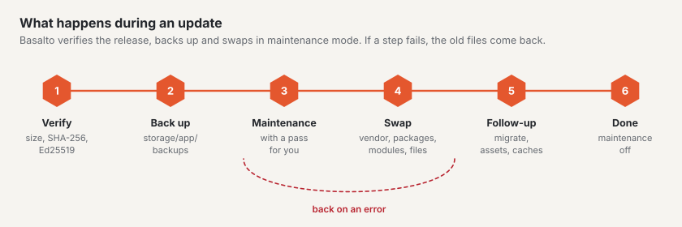

# Updates

Install new versions of Basalto, the bundled modules, plugins and themes in the backend under
**Administration › Updates** or on the console. Basalto downloads the signed release, backs up first, swaps the files
and brings back the old state if something fails.



## In the backend or on the console

In the browser: [Updates](../verwaltung/updates.md). On the console:

```sh
php artisan basalto:update                   # check: core, plugins, themes — with source
php artisan basalto:update --kern            # install the core from the signed release
php artisan basalto:update --plugin=vendor/package
```

- **What happens:** download the archive (`/_download/latest.json` of the source), check size, SHA-256 and Ed25519,
  back up to `storage/app/backups`, maintenance mode. Then swap: `vendor`, `packages` and `modules` as a whole,
  everything else file by file. Afterwards `package:discover`, `migrate --force`, assets and `optimize:clear`, each in a
  fresh PHP process. If a step fails, the old files come back.
- **What stays:** `.env`, `storage`, `auth.json`, `public/storage`, `public/hot`, every `*.sqlite` and everything that
  is not in the archive.
- **Restoring by hand:** after the run the replaced files are in `storage/app/updates/lauf-<time>/vorher/` (only the
  last run is kept). Copy them back, then `php artisan optimize:clear`.
- **Status and log:** `storage/app/updates/status.json` (the backend page reads it) and `storage/logs/update.log`.
- **Source:** `BASALTO_UPDATES_URL`, otherwise basaltocms.com.
- **Daily check:** the scheduler calls `basalto:update --benachrichtigen` at 04:10 (switch off with
  `BASALTO_UPDATES_CHECK=false`).
- **Plugins:** these need the e-mail and token of the customer account (`auth.json` or `BASALTO_MARKETPLACE_EMAIL` and
  `BASALTO_MARKETPLACE_TOKEN`).

Before a big jump, your own backup with a restore test is still worth it ([Backup](backup.md)).

## Installations with Composer

If your installation runs Basalto as Composer packages, the “Updates” page shows the state and the commands; you then
install with Composer:

1. Back up and verify, switch on maintenance mode:

   ```sh
   php artisan basalto:backup
   php artisan basalto:backup-verify
   php artisan down
   ```

2. Get new versions — in development, not on the server:

   ```sh
   composer update "basalto/*"     # core, Lava and modules only
   composer update                 # everything
   ```

3. Bring the new state (`composer.json`, `composer.lock`) to the server and install it there:

   ```sh
   composer install --no-dev --optimize-autoloader
   php artisan migrate --force
   php artisan vendor:publish --tag=basalto-assets --force
   php artisan optimize
   ```

## Caches after the update

| What | Command | When |
| --- | --- | --- |
| Laravel caches | `php artisan optimize` | after every update; if there are problems first `php artisan optimize:clear` |
| Page cache | `php artisan basalto:page-cache clear`, then `php artisan basalto:page-cache warm` | if the page cache is switched on; `--site=<handle>` for a single site |
| Search index | `php artisan basalto:search-index` | if the update affects search or after a driver change; `--site=<handle>` for a single site |
| Queue | `php artisan queue:restart` | only with your own worker; via the scheduler `queue:work` restarts every minute |

The page cache depends on the fingerprint of the theme source and on the generation of the site, not on the release.
If an update changes the output of the core, you therefore clear it manually.

## Checking after the update

```sh
php artisan up
```

1. **`/up`** reports “bereit” (ready) (database and heartbeat).
2. **Administration › Operations:** heartbeat current, queue empty or in progress, no new failed jobs,
   last run of the tasks without errors.
3. **Check the theme** if Lava has changed:

   ```sh
   php artisan basalto:check --site=<handle>          # Theme aus der Datenbank
   php artisan basalto:check --theme=themes/<name>    # Theme aus Dateien
   php artisan basalto:publish <handle> --dry-run     # Prüfung vor dem Livegang, ohne zu schreiben
   ```

4. In the frontend open a page with images and a form, in the backend edit a page.
5. **Administration › Licence:** If the update entitlement has expired, a notice appears there ([Licence](lizenz.md)).
6. **MariaDB or MySQL:** `php artisan basalto:db-zeitzone` reports whether older points in time need converting
   ([Database time zone](installation.md#database-time-zone)).

If something goes wrong: maintenance mode stays on, restore the state from the backup ([Backup](backup.md#restoring)).

## Next

- [Updates](../verwaltung/updates.md)
- [Backup](backup.md)
- [Commands](befehle.md)
