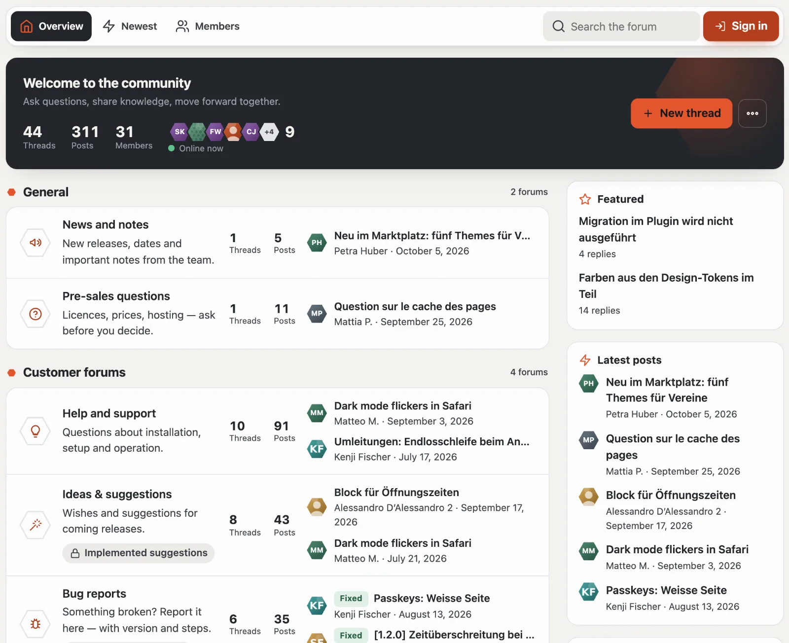
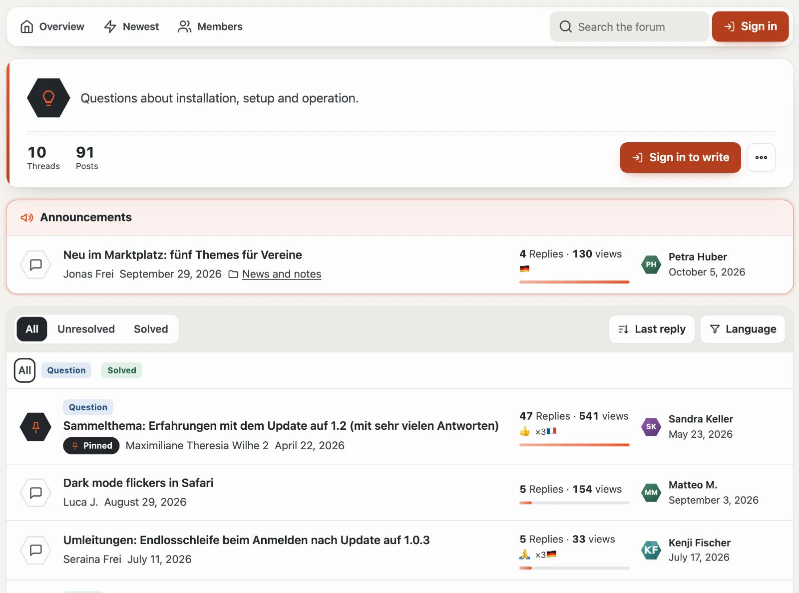
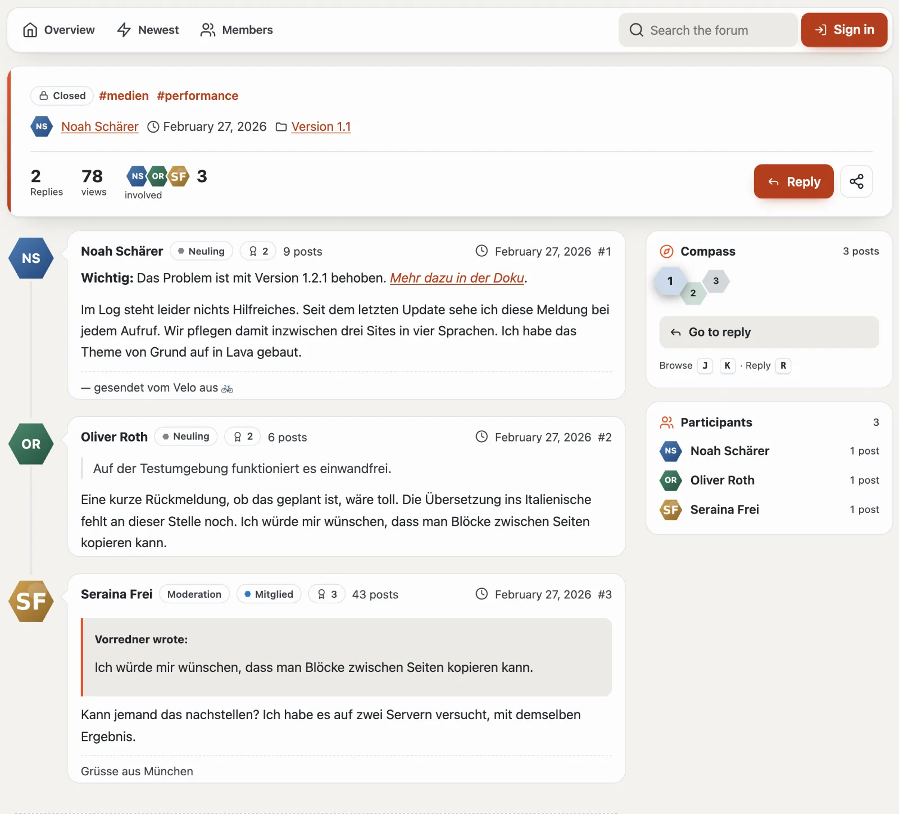
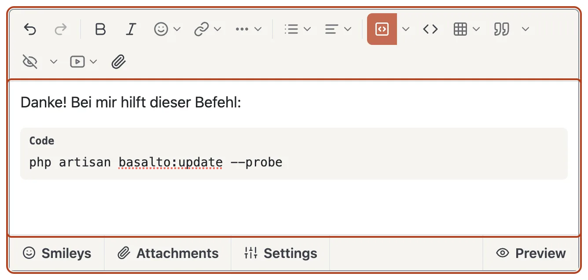
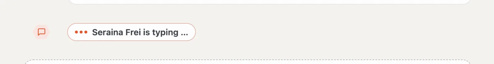
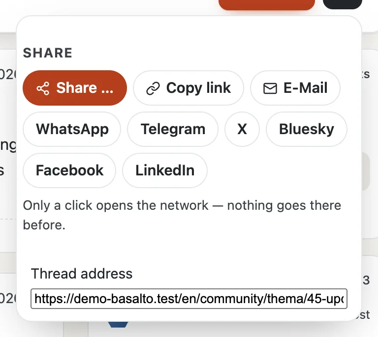

# Forum

The overview at `/community` starts with the **pulse**: a greeting, what is new since your last visit, threads, posts, members and who is online right now, plus **“+ New thread”** and the **“…”** menu (mark everything as read, RSS, search, members). Below it are the categories with their forums. For each forum the hexagon shows an icon — in lava when there is something new — next to the number of threads and posts, the sub-forums and the two latest threads with picture, prefix, name and time. Boxes sit on the right: featured, latest posts, from the blog, hot threads and tags. At the very bottom is a band with statistics (posts per day, newest member) and “members online” with the record.

Every page of the forum starts with the **navigator**: **Overview**, **Newest**, **Unread** (with a count), **Subscribed**, **Following**, **Members**, the search, messages, the bell, for moderators the shield with open cases, and your profile. On a phone the ways become a bar of icons.

The boxes are also available as Lava parts for every region of a layout (`forum.latest`, `forum.hot`, `forum.featured`, `forum.online`, `forum.stats`, `forum.members`, `forum.team`).

## Reading

- **Thread list:** the header shows the forum’s icon, description and figures, **“+ New thread”**, **Subscribe** (bell) and the “…” menu. Announcements sit above, pinned threads first. The hexagon in front of each thread shows its state: lava = new, green = solved, striped = awaiting moderation, dark = pinned. The bar below the figures shows how lively a thread is. **All**, **Unresolved** and **Solved** filter; **sort** by last reply, creation date, replies or title; prefixes as chips, the language in the menu. Unread threads are bold and jump to the first new post.
- **Thread:** the header shows prefix, state and tags, who started it when and in which forum, replies, views, the people involved and — if you have been here before — **“new for you”**. Jumps lead to the most helpful answer and to official posts of the team. Posts hang on a line with the profile pictures; new ones colour it lava and carry **“New”**. Each post’s header shows name, group, rank, trophies, post count, time and number. The most helpful answer carries a green band.
- **Compass:** on the right it shows the posts of the page as honeycomb cells in the colour of the person who wrote them — so you see who carries the conversation. New, solution, pending and team are highlighted; the post you are reading is larger. A click jumps there; on the keyboard **J** and **K** move from post to post, **R** jumps to the reply form.

- **Lists:** Newest, Unread, Subscribed, Following (news from people you follow).

## Writing

- **Start a thread:** while you type the title, the forum shows **similar threads** — perhaps the question has already been answered. Then title, prefix, the forum’s thread fields, tags (at most five, separated by commas), text, attachments and an optional poll.
- **Editor:** The toolbar at the top has everything for a good post:
  - **Undo** and **Redo**, **Bold**, **Italic**, **Emoji** and **Link** (address and text in a small form);
  - **“…”** for the block format (paragraph, heading 1 to 3), underline, strikethrough, subscript and superscript, clear formatting and the **highlighter** in five colours;
  - **Lists** (bulleted, numbered, decrease and increase indent) and **Alignment** (left, centre, right, justify);
  - **Code block:** one click inserts it; the arrow next to it chooses the language (or automatic detection), the first line number and a file name. When reading, the code is highlighted in colour, with line numbers and a **“Copy”** button;
  - **Inline code**, **Table** (choose the size in the grid; with the cursor inside a table, the menu inserts or removes rows and columns), **Quote** (with your remembered quotes), **Spoiler** (with a title if you like), **Video** and **File**.

  You mention someone with `@` and the first letters. The team and moderators (or whoever the administration gives the “Mention groups” permission) can also mention whole groups, such as `@Moderation` — all their members get a notification. The toolbar also works with the keyboard: Tab jumps in, the arrow keys move along, Escape closes a menu. Without JavaScript you get a plain text field.
- **Tabs below the text:** **Smileys**, **Attachments** (upload, allowed types, size per file, free space), **Settings** (such as “official post by the team”), when starting a thread **Poll**, and on the right the **Preview** — it shows the post exactly as it will appear after sending.
- **Who is typing:** When someone else is typing a reply in the same thread, **“Anna is typing …”** appears at the end of the posts and in the corner of your reply field — so two people don’t answer the same thing at once. More under [Live updates](live.md).
- **Editing:** within the site’s time window, with a reason; the history stays visible.
- Some forums approve new posts first — your post then appears once moderation has approved it. There is a short minimum interval between two posts.

## Taking part

- **Reactions:** below each post they appear as counts, your own highlighted. The button with the smiley opens the choice 👍 ❤️ 😂 😮 😢 🙏; choosing it again removes it.
- **Reply, Quote, Remember** sit below each post. **Edit**, **History**, **Most helpful answer** and **Report** are in the post’s “…” menu.
- **Subscribe** is the bell in the header of a thread or forum, **Ignore** is in the “…” menu. The bell in the navigator shows what is new; emails arrive immediately, daily or never (in your profile).
- **Most helpful answer** is chosen by whoever started the thread.
- **Report:** in the “…” menu of someone else’s post — the author won’t learn who reported it.
- **Share:** In the header of a thread, **“Share”** opens email, WhatsApp, Telegram, X, Bluesky, Facebook and LinkedIn — as ordinary links: only your click opens the network; before that it learns nothing. There is also **“Copy link”** and, on phones, the device’s own sharing. As preview image the networks show the first image of the opening post.

## Finding

- **Forum search** at `/community/suche`; threads also appear in the search of the whole site, with the filter “Forum”.
- **Tags:** `#Theme` leads to all threads with that tag.
- **RSS:** `/community/feed` for the whole forum, `/community/<forum>/feed` per forum.

## Next

- [Profiles and conversations](profile.md)
- [Moderation](moderation.md)
- [Community](README.md)
