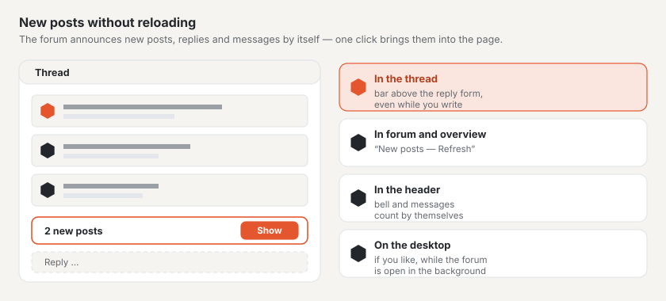

# Live updates

The forum reports new activity by itself: new posts in the open thread, new threads and replies in the thread list, new
messages in a conversation and unread notifications in the header. Nobody has to reload the page — one click brings the
new content into the page. This works on any hosting; where a WebSocket server is set up, it appears immediately,
otherwise after about 15 seconds at most.

## In a thread

If a reply arrives while you are reading a thread, the bar **“1 new post”** with the button **“Show”** appears at the
bottom of the window. One click inserts the post at the end of the page — with number, reactions and all buttons, as if
the page had been reloaded. The bar sits directly above the reply form and sticks to the bottom edge of the window: you
see it even while you are writing yourself, and can read what has been replied in the meantime before you send.

- On an earlier page of the thread, the bar offers **“Go to the last page”**.
- If there are more new posts than fit on one page, the button also leads to the last page.
- Only what you would be allowed to see anyway appears: posts awaiting approval only once they are approved; posts by
  people you have blocked collapsed, as on the page.
- Posts loaded this way count as read.

## In forums and the overview

When a thread or a reply is added in a forum, **“New posts in this forum”** with **“Refresh”** appears above the thread
list. This also applies to the forums above it (a reply in a subforum changes the overview of the category) and to the
forum overview.

## Conversations

In an open conversation, **“New message in this conversation”** appears as soon as someone else writes. **“Show”** loads
the conversation and jumps to the reply form.

## Who is typing

When someone starts typing a reply in a thread, **“Anna is typing …”** appears at the end of the posts with three
pulsing dots — for everyone reading the thread, guests included. Whoever is writing also sees it in the corner of
their own reply field. With two people it says “Anna and Ben are typing …”, with more the number.

- It disappears a few seconds after the last keystroke, on sending, or when the person leaves the page.
- In conversations only the participants see it.
- You don’t see yourself; people who are muted don’t appear.

## Bell and messages

When you are signed in, the forum header shows the number of unread notifications (bell) and messages. Both numbers
count along by themselves, without loading the page.

## Desktop notifications

On the **Notifications** page you can switch on desktop notifications. The browser asks for permission once; after that
it shows the latest notification as a system notice when the forum is open in a background tab. Clicking it opens the
notification. When the forum is in the foreground, the bell and the counters are enough. The choice applies to this
browser and can be switched off there again.

## Good to know

- The page only checks for news while its tab is visible — in the background only with desktop notifications switched
  on, and then less often.
- Without JavaScript the forum works as before; new content then appears on the next page load.
- What the forum transmits is only a signal “there is something new”. The browser loads the content through the regular
  address, with the same rights as the page.

## Next

- [Forum](forum.md)
- [Profiles and conversations](profile.md)
- [Setting up live updates](../betrieb/live.md)
