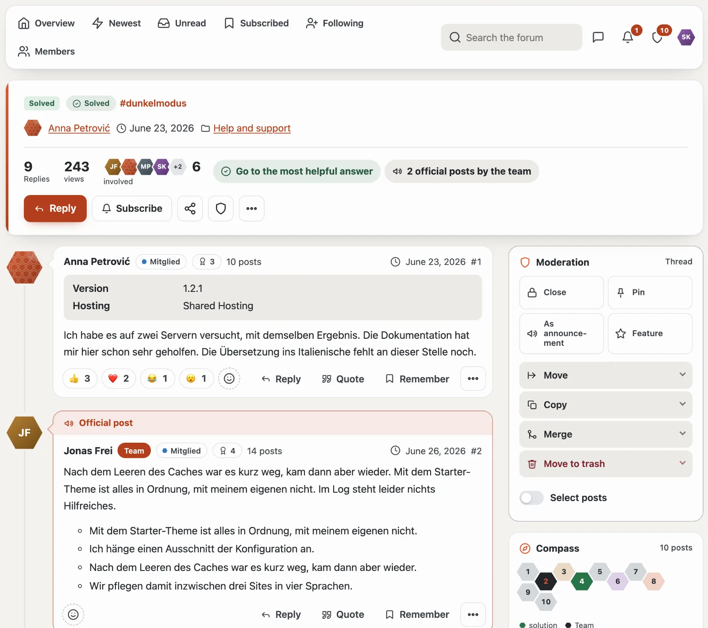
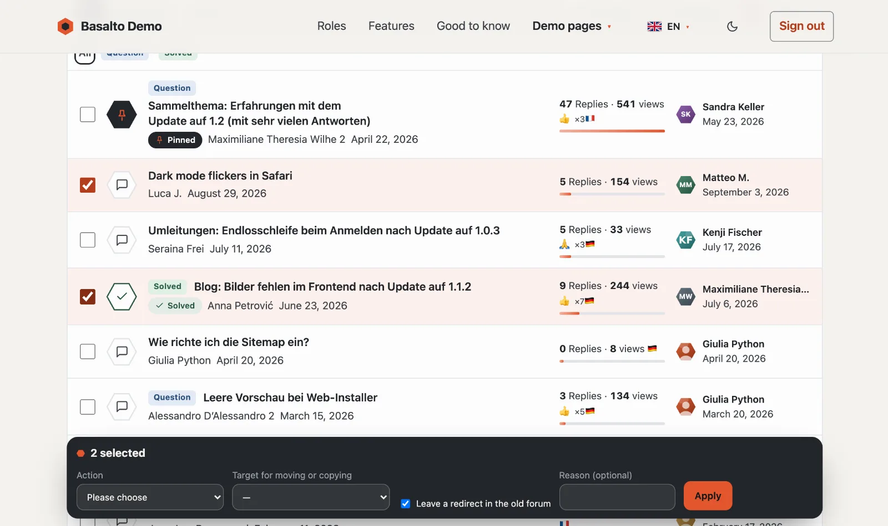
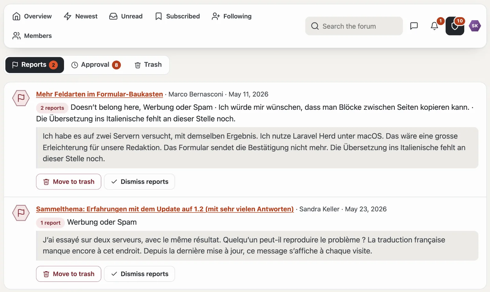
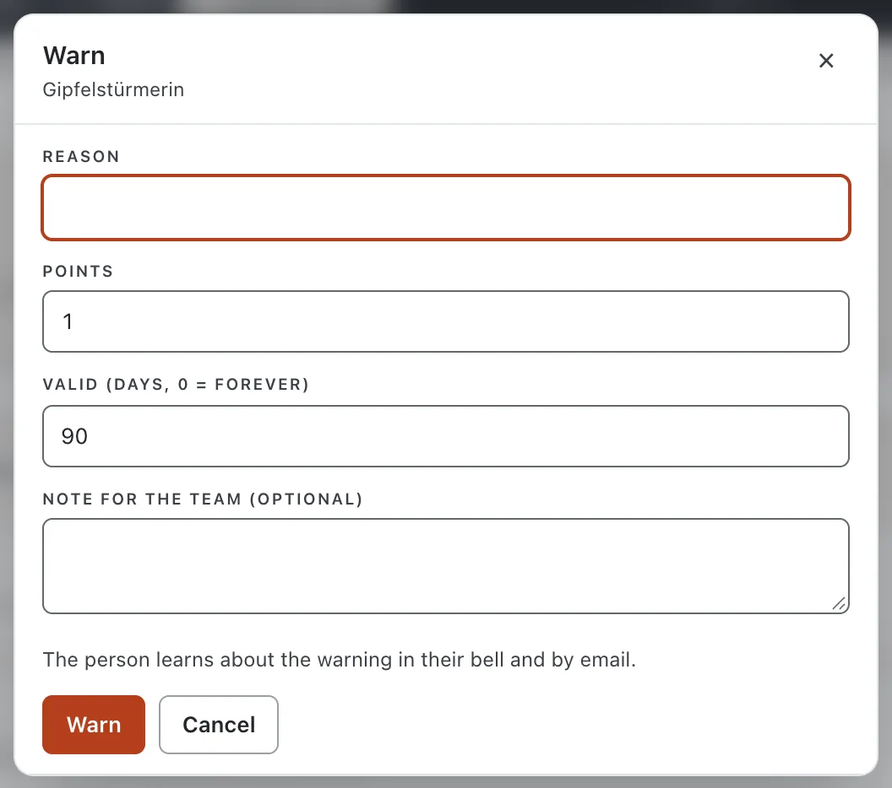
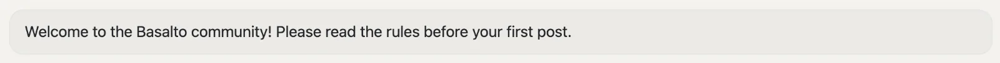

# Moderation

Whoever has the **“Moderate”** permission in a forum may moderate (by default the Moderation and Team groups). Every action exists in two places — in place in the forum and in the administration (extranet or backend) — with the same effects and the same line in the **moderation log**.

## In place

- **Moderation card on a thread:** next to the posts are tiles for **Close**, **Pin**, **As announcement** and **Feature**. When something is active, the tile is dark and names the way back (such as “Pinned · unpin”). Below them **Move** (optionally leaving a redirect in the old forum that disappears after a few days), **Copy** (with all visible posts, tags and the poll without votes), **Merge** and **Move to trash** fold open. On a phone the card sits at the end of the thread; the shield in the header jumps there.
- **Select:** the switch **“Select”** above the thread list and **“Select posts”** in the card show checkboxes. The dark bar “n selected” applies the action to all of them.

- **On a post:** if a post is pending or reported, a strip at the top offers the decision (**Approve**, **Move to trash**, **Dismiss reports**) as well as **Warn** and **Remove as spammer**. For all other posts, Warn and Remove as spammer are in the “…” menu.
- **Posts:** approve, hide, trash, split into a new thread.
- **Lock editing:** in the “…” menu of a post, moderators lock editing for its author (for instance during a dispute about the content); the author sees “Editing locked (moderation)”. “Allow editing” lifts it; moderators themselves may always edit.
- The list `/community/moderation` collects reports, pending items and the trash; the tabs show the number of open cases, the shield in the navigator their total.

## Reports

Members report posts with a reason. From the configured number of open reports (three by default) a post is hidden provisionally until moderation decides. Reports about marketplace ratings and about messages share the same list in the administration.

## Warnings and bans

- A **warning** has a reason, points and a validity. The warned person learns about it in the bell and by email.
- From the configured points a **posting ban** follows automatically (reading yes; writing, reacting, voting and messages no) or a **ban** (the person counts as a guest).
- **Remove as spammer:** bans indefinitely, moves all threads and posts to the trash and resolves open reports — the counters are right afterwards.
- Under **Members** you set and lift bans by hand and revoke warnings.

## Protection against abuse

- **Approval:** if “Post without approval” is set to “No” for a group (globally or per forum), every new post waits for moderation.
- **Minimum interval** between two posts (flood control); moderators and team never wait.
- **Censorship:** a word list (`*` for any number of letters) blocks sending with a hint — nothing is changed silently.

## Notices

Under **Notices** you create banners — for the whole community, the overview or a forum, for everyone, guests only, signed-in members only or certain groups, with a time span. Signed-in members dismiss dismissible notices for themselves; so can guests — their browser remembers it.

## Next

- [Community administration](verwaltung.md)
- [Forum](forum.md)
