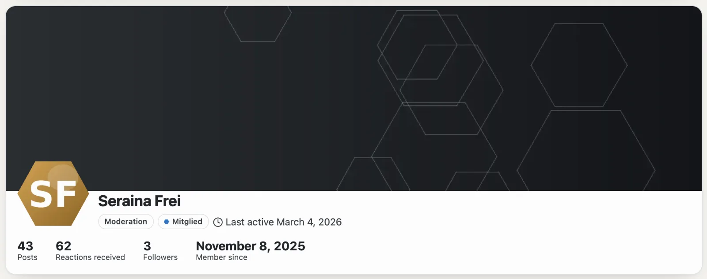
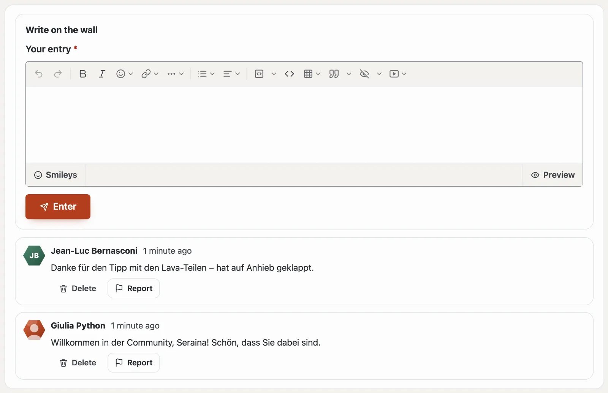
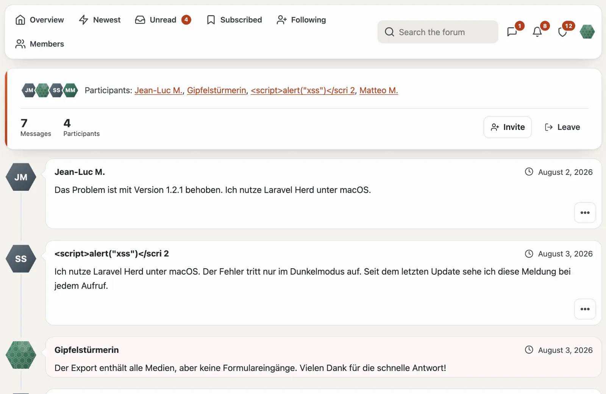

# Profiles and conversations

## Your profile

Under “Your profile” (`/community/konto`) you set:

- **display name** (unique in the community), **profile picture** and **signature**,
- **About me**, a **cover photo** and the site’s **custom fields** (such as website or location) — each field shows who sees it: everyone, signed-in members or only the team,
- emails about replies and mentions (immediately, daily, never) and whether threads you post in are subscribed automatically.

The public profile at `/community/mitglied/<number>-<name>` shows rank, trophies, posts, reactions received, followers and tabs from all modules: posts and threads from the forum, entries and ratings from the marketplace.

## Wall

Profiles have a **Wall** tab: members leave each other a greeting, a thank-you or a question there — public like the
profile. Under “Your profile” you decide **who may write on your wall**: all members, only people you follow, or
nobody.

- The bell (and email) tells you when someone writes on your wall.
- The author, you yourself and the team may delete an entry; every entry by someone else can be **reported**.
- People who are blocked don’t write on your wall — and you don’t write on theirs.

## Following and blocking

- **Follow:** the bell tells you when the person starts a thread; “Following” lists their new posts.
- **Block:** the person’s posts are collapsed for you, their replies, mentions, quotes and reactions don’t notify you, and they cannot write to you. Blocking is private; the team cannot be blocked.

## Conversations

- “Send message” on a profile or “New conversation” under **Messages** — to one or more people (display names separated by commas).
- Only participants read along. You can invite more people or leave the conversation.
- New messages count in the bar and arrive in the bell and by email.
- **Reporting** a message shows the team only that one message, never the whole conversation.

## Ranks and trophies

- **Ranks** depend on the number of your posts (some only for a group) and appear next to your name — with a symbol such as ⭐ if the community chose one.
- **Trophies** are awarded by rules — first post, many reactions, most helpful answers, licence purchased — or by the team by hand. Once awarded, they stay.

## Next

- [Forum](forum.md)
- [Community](README.md)
