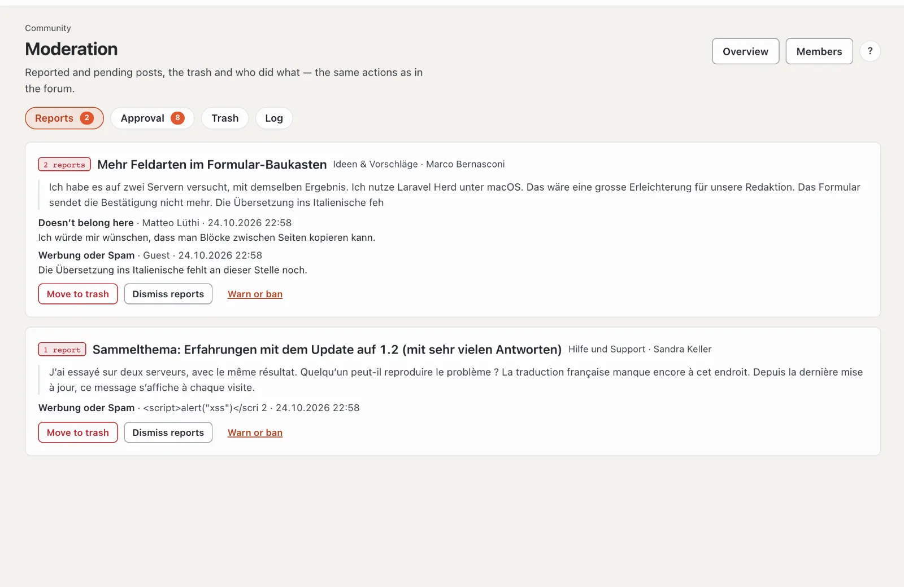
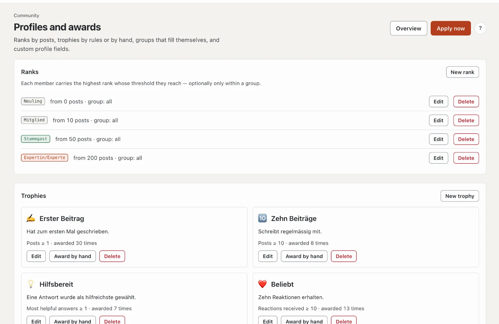

# Community administration

On basaltocms.com the administration lives in the **extranet** under “Community”, on every other site in the backend under **Administration › Community** — the same pages with the same actions.

| Page | Purpose |
| --- | --- |
| **Overview** | numbers, open moderation, page in the frontend, your team account, settings |
| **Forums** | tree of categories, forums, subforums and links; prefixes and thread fields per forum |
| **Groups and permissions** | visitor groups and the permission matrix, globally and per forum (Yes, No, Never) |
| **Moderation** | reports, approval, trash, log with filter |
| **Members** | search and filters (banned, posting ban, warned); warn, ban, remove spammers |
| **Notices** | banners with area, audience and time span, with preview |
| **Profiles and awards** | ranks, trophies, automatic groups, custom profile fields |

## Profiles and awards

- **Ranks:** title, colour and optionally a symbol (such as ⭐, shown instead of the coloured dot) from a number of posts, optionally only for a group.
- **Trophies:** by rule or by hand. The modules bring the rules: posts, reactions received, member for, followers (core), threads started and most helpful answers (forum), “has a licence” (licence sales), “marketplace author” (marketplace). The preview shows how many members a rule matches today.
- **Custom profile fields:** text, multi-line, address or **choice** with fixed options (one per line), each with visibility (everyone, signed-in members, team only) and optionally required.
- **Automatic groups:** a rule fills a custom group and only removes the memberships it set itself.
- The run happens daily at 03:30 (`basalto:community-rules`) or immediately with “Apply now”.

## Settings

On the overview: editing window, attachments (types, size, storage per account, **attachments per post**), which **reactions** are offered, redirect after moving, minimum interval, report threshold, validity of warnings and the points for posting ban and ban with their duration, censorship and what happens to posts when an account is deleted.

### Community terms

By default, anyone opening the forum agrees first: a window names the terms of use and the community guidelines (pages
of the theme, otherwise imprint and privacy policy) and requires the tick. Without consent an account counts as a guest
— reading yes, posting, reacting, messages and moderation no; the forum behind it is locked. Guests agree in the
browser (cookie `basalto_community_terms`). The customer account shows the date, time and version of the consent, with
“Withdraw consent” — after that the window appears again.

In the settings: **Require consent** (on/off) and **Version** — a new version (e.g. the date of the change) asks
everyone again.

## Privacy

Access requests and deletion (`basalto:privacy`) cover profile, pictures, posts, attachments, reactions, subscriptions, follows, blocks, messages, trophies, warnings and reports. By default posts stay **anonymised** (the discussion remains readable); the settings offer “delete” instead — threads without posts by others then disappear completely. Messages in conversations stay anonymised for the other participants.

## Search, sitemap and feeds

Threads from forums that guests may read appear in the site search (filter “Forum”), in the sitemap and in the RSS feeds; every thread carries structured data (`DiscussionForumPosting`). When permissions change, the index is rebuilt; by hand: `php artisan basalto:search-index`.

## Commands

| Command | Purpose |
| --- | --- |
| `php artisan basalto:forum-seed <site>` | starting structure of the Basalto community like WoltLab: General (news and notes, pre-sales questions), customer forums (help and support, ideas & suggestions, bug reports — each with a sub-forum for resolved items), customisation (themes and Lava, modules and plugins, link to the developer docs), miscellaneous (off-topic); with icons, prefixes and thread fields — creates nothing twice |
| `php artisan basalto:testdaten <site>` | fills the forum (and everything else) with plenty of test data to try things out; `--entfernen` removes it again |
| `php artisan basalto:forum-recount [site]` | recount forums, threads and profiles |
| `php artisan basalto:community-rules [site]` | award trophies and assign groups by rules |
| `php artisan basalto:community-digest` | daily summary by email |
| `php artisan basalto:forum-benchmark` | load test with 100,000 posts on a throwaway site: thread list and thread under 300 ms |

## Next

- [Moderation](moderation.md)
- [Settings](../verwaltung/einstellungen.md)
