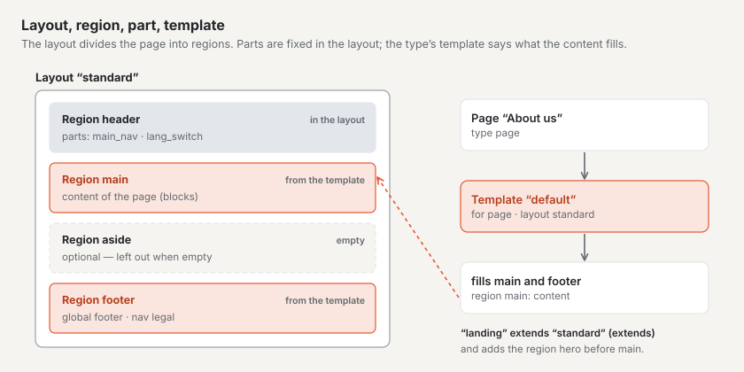
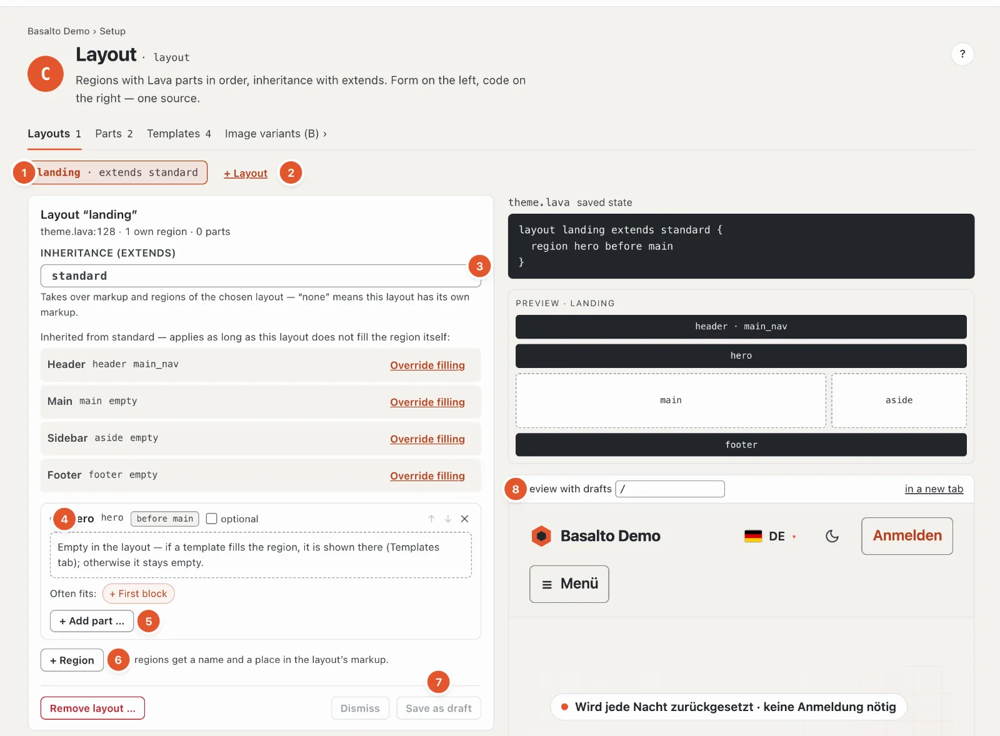
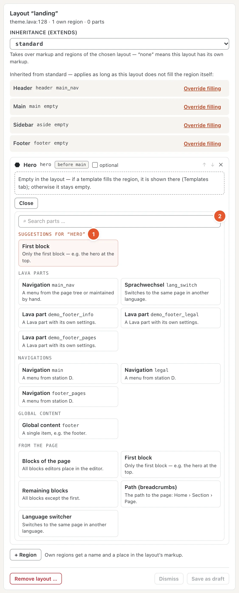
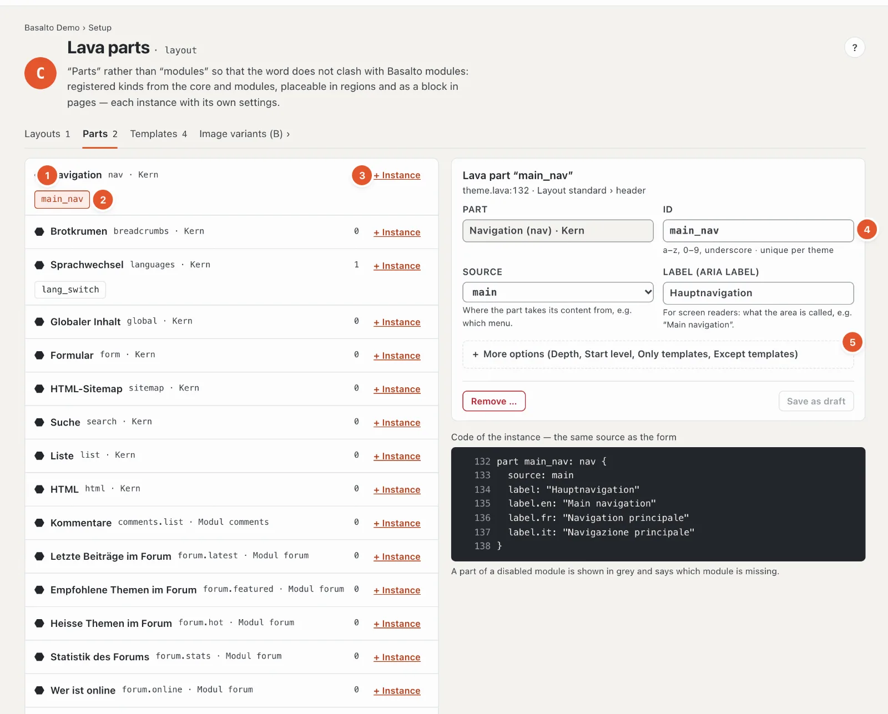
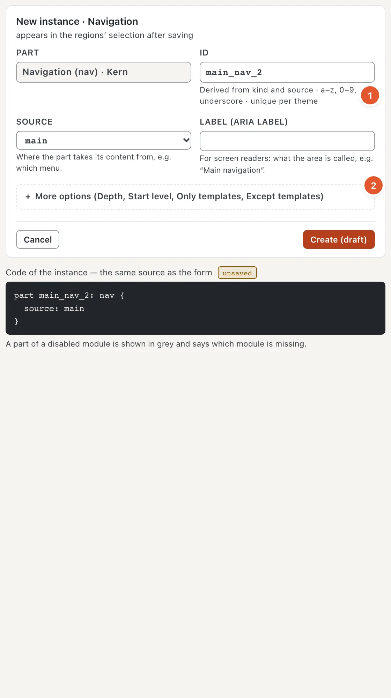
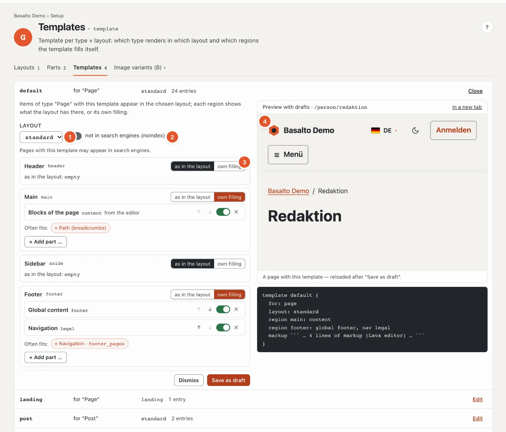

# Structure: layouts, parts and templates

The station **“How is it built?”** determines which areas a page consists of and what goes into which area. It combines two checks: layout (C) and template (G).

- A **layout** is the frame of a page: header, main part, footer. It divides the page into **regions**.
- A **part** (Lava part) is a finished piece that sits in a region — for example the main navigation or the language switch. Parts come from the core and from modules; you set them up with your own settings.
- A **template** says how a content type appears in a layout and which regions the content fills itself.
- A layout can **extend** another one (“extends”): it takes over everything and adds regions — in Starter, “landing” adds a stage before the main part.

## Where

“Setup” mode › “How is it built?” › **“Open layouts”**. The page has the tabs **Layouts**, **Parts** and **Templates**, plus a jump to the [image variants](aussehen.md#image-variants).

While the theme still lies in the installation’s folder, the page says “This theme is in the folder” at the top and can only be viewed; it can be changed after **“Take into database”**. All changes are then made as a **draft** and go live through approval — see [Drafts and approval](entwuerfe.md).

## “Layouts” tab

1. **Choose the layout** — one button per layout, with “extends …” if it extends another one.
2. **“+ Layout”** — a new layout: name (suggestions such as “schmal” or “landing” with one click) and **“Inherits from”** — below it you see which regions it takes over. The markup (HTML) of a layout stays code; a layout without a template is created in the theme editor.
3. **Inheritance (extends)** — which layout this one takes markup and regions from; “— none: own markup” for layouts with their own HTML.
4. **The regions** — one card per region with name, identifier and position (“before main”). **“optional”** means: if the region stays empty, it is left out entirely. ↑ and ↓ change the order, ✕ removes the region. Inherited regions carry “Inherited from …”; **“Override filling”** gives this layout its own filling. An empty region is filled by the template — if it is not there either, it stays empty.
5. **Add part** — see below. A region’s parts are in order and can be moved, switched off and on, and removed.
6. **“+ Region”** — an own region: name and position in the layout’s markup (before or after an existing region). Common regions — hero, sidebar, notice bar, call to action — set name and position with one click. If the markup already places the region, no position is needed.
7. **“Save as draft”** and **“Discard”**; **“Remove layout …”** deletes a layout after a confirmation. If something is wrong, it says “Nothing saved — a theme with an error never goes live”, and the code shows the spot.
8. **Preview with drafts** — the website with your saved drafts, for a path of your choice (“/” is the start page); “in a new tab” opens it large.

On the right are the layout’s **code** (saved state), **“Show markup”** for the HTML, the **findings** with E (error) and W (warning) and a **schematic preview** of the regions. At the bottom, “Template per type × layout” shows which templates use this layout and how much content depends on them.

### What goes into a region

Below each region Basalto suggests what often belongs there — as buttons “Often fits: + Navigation · main …”: in the
**header** the main navigation and the language switch, in the **footer** the footer and the legal menus, in the
**hero** the first block, in the **main** area the page’s blocks, in the **sidebar** search and lists.
**“+ Add part …”** opens the full choice:

1. **Suggestions for the region** — at the top, without what is already there.
2. **Search** and the groups **Lava parts**, **Navigations**, **Global content** and **From the page** (all blocks,
   only the first, the rest, path, language switch) — with a sentence per entry on what it is for. Enter takes the
   first match.

## “Parts” tab

1. **The kinds of parts** — from the core (navigation, breadcrumbs, language switch, global content, form, HTML sitemap, search, list, HTML) and from modules (for example comments, member sign-in). On the right the number of instances.
2. **An instance** — a part that has been set up, with its own name, for example “main_nav”. A click opens its settings.
3. **“+ Instance”** — create a new part of this kind.
4. **Identifier** — lowercase letters, digits and underscore, unique within the theme. Below it the **settings of the kind** with a sentence per setting — for a navigation for example source (which menu) and the label for screen readers.
5. **More options** — depth, start level, **Only templates / Without templates** (the part appears only in certain templates or in all but these) and the label per further language.

For a **new instance** the first source is already selected, and the **identifier** is derived from source and kind
(1) — “main” and “nav” give “main_nav” — until you change it yourself. Rarely used settings are under **“More
options”** (2).

Instances sit in a layout’s regions — and as a block on individual pages (“+ Lava part” in the editor). An instance can only be removed once it is in no region; otherwise it says “It is in: … — take it out there first”. If a part belongs to a module that is off for the site, it is greyed out: the instance stays, nothing is output.

## “Templates” tab

One row per template: name, for which type (“for “Page””), in which layout and how many items use it. “Edit” opens
it; at the top a sentence says what a template does:

1. **Layout** — in which layout items with this template appear.
2. **Not in search engines (noindex)** — pages with this template do not appear on Google & co. and are left out of
   the sitemap. If the template is named like a legal, thank-you or error page (“legal”, “danke”, “404”), Basalto
   suggests switching noindex on.
3. **Per region: “as in the layout” or “own filling”** — all regions of the layout are listed, including those only
   the markup places. “Own filling” first takes over what the layout has there; then you change it with the same
   suggestions and the same choice as in the layout (“Often fits”, “+ Add part …”).
4. **Preview with drafts** — a page that uses this template, with your saved drafts; it reloads after “Save as draft”.

Below is the **code** — the template as Lava. Its markup (the content’s HTML) stays code and is changed in the theme
editor. A type can have several templates; which one a page uses is chosen in the page’s settings, “Layout” tab (see
[Pages](../redaktion/seiten.md)).

## Frequently asked questions

**Why can’t I change anything?**
The theme lies in the installation’s folder — take it into the database. Or your role only allows viewing the area “Design, themes and layouts”.

**I saved, but the website does not show it.**
It was saved as a draft. The “Preview with drafts” shows it; it goes live only after approval (see [Drafts and approval](entwuerfe.md)).

## Next

- [Menus](menues.md)
- [Building blocks](bausteine.md)
- [Drafts and approval in setup](entwuerfe.md)
