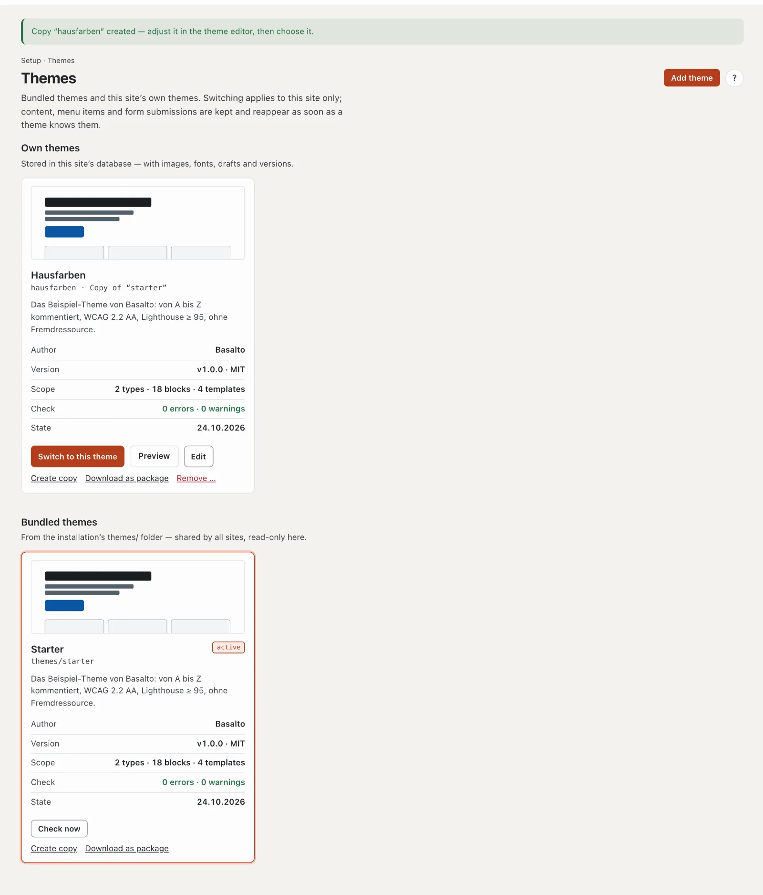
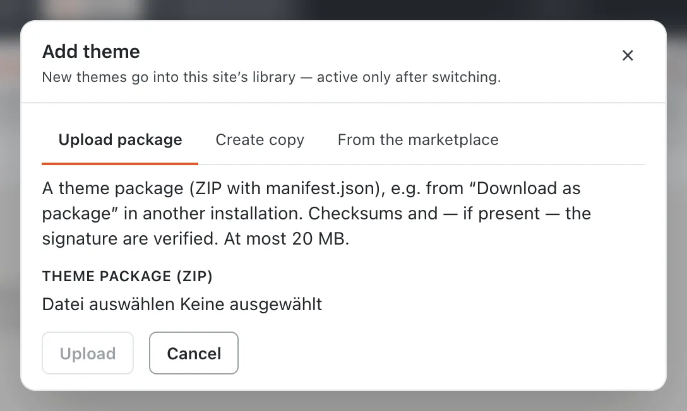
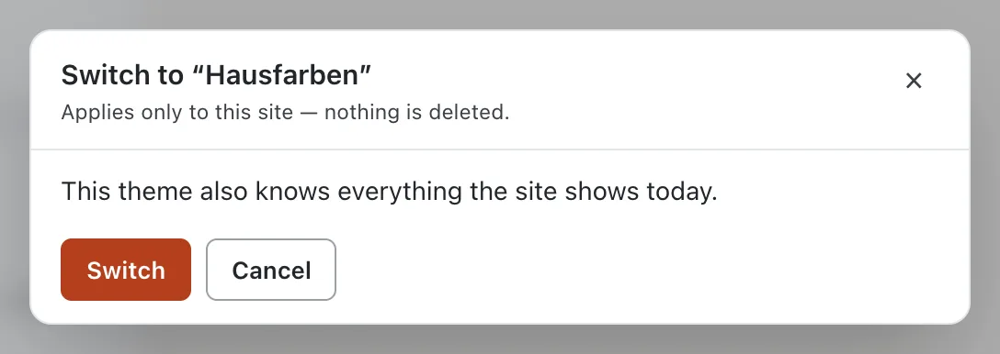
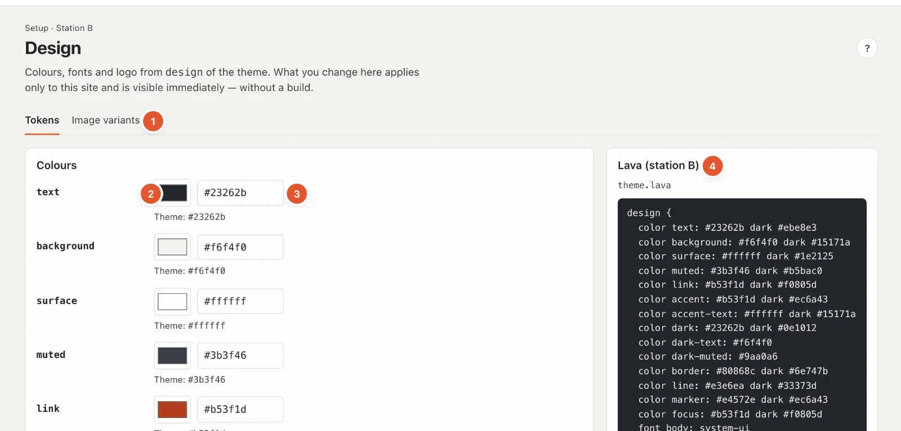
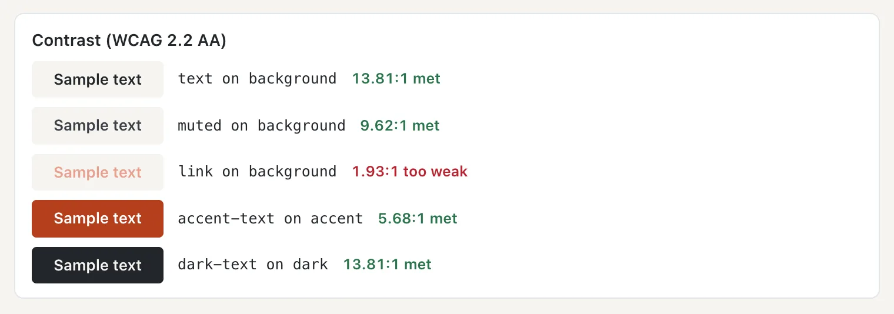
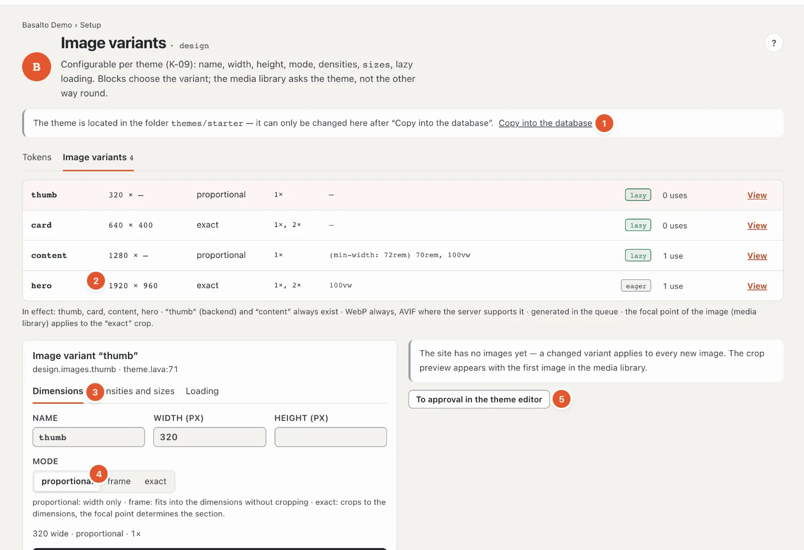
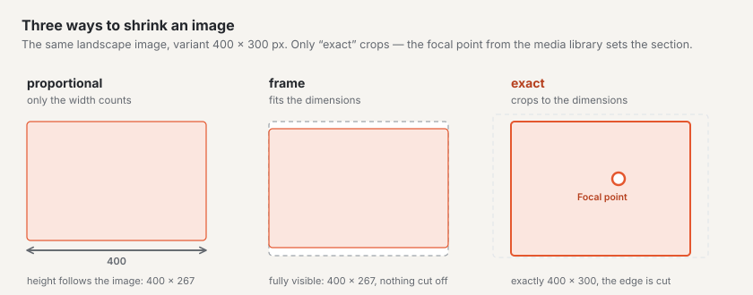

# Appearance: themes, design and image variants

The station **“What does it look like?”** determines the site’s form. The **theme** sets it; in **Design** you adjust colours, fonts and logo, in **Image variants** the sizes in which images are delivered — all without code.

## Themes

“Setup” mode › “What does it look like?” › **Themes** (in the route, the box with the name of the active theme).

The page shows two groups:

- **Own themes** — stored in this site’s database, with images, fonts, drafts and versions. They can be changed.
- **Bundled themes** — come from the installation’s `themes/` folder, apply to all sites and are read-only here.

Each card shows a preview image, name and origin (for example “Copy of “starter””, “from the marketplace”, “from package (signed)”), the description, **author**, **version**, **scope** (types, blocks, templates), the result of the **check** and the **date**. The active theme carries the label “active”.

The buttons of a card:

- **“Switch to this theme”** — see below.
- **“Preview”** — shows the website with this theme, in your session only. At the top it then says “Preview with theme … running in your session — the site itself is unchanged”; **“End preview”** returns. The preview is open to everyone who sees the page.
- **“Edit”** — opens your own theme in the theme editor (code).
- **“Check now”** — checks the theme again; with errors, **“View findings”** leads to the messages. A theme with errors cannot be chosen.
- **“Create copy”** — a copy with all files, images and fonts, the best start for your own theme. The original stays unchanged.
- **“Download as package”** — downloads the theme as a ZIP, for example for another installation.
- **“Remove …”** (own themes only) — deletes the theme’s files, images, fonts, drafts and all versions; the site’s content stays. If the theme is active, the site immediately shows the bundled theme of the same name again. Whoever still needs it chooses **“Download as package first”**.
- **“Hide”** (bundled, inactive themes only) — takes a theme out of the list; **“Show again”** at the bottom brings it back.

### Adding a theme

**“Add theme”** offers three ways. New themes go into this site’s library — active only after switching.

- **Upload package** — a theme package (ZIP with `manifest.json`), for example from “Download as package” of another installation, up to 20 MB. Checksums and, if present, the signature are verified.
- **Create copy** — choose a **template**, a **label** (what the theme is called in the backend) and a **name** (lowercase letters, digits and hyphens — what the theme is called in Lava and in the package).
- **From the marketplace** — marketplace themes are signed by the vendor. Once installed, they go into the library as an own theme; a later update appears in the theme editor as a draft.

### Switching to another theme

**“Switch to this theme”** first checks what the site might no longer show with the new theme and lists it in a report:

- content types the theme does not know,
- blocks that will no longer be displayed,
- templates that pages refer to,
- menus with own entries,
- forms with submissions.

A switch applies to this site only, and **nothing is deleted**: whatever the new theme does not know stays in the database and reappears as soon as a theme knows it. If the report is empty (“Everything the site shows today is known to this theme as well”), the button is called “Switch”; otherwise **“Switch anyway”**.

Switching, adding and removing is allowed for roles that may edit the area “Design, themes and layouts”; otherwise the top reads “Your role does not allow switching, adding or removing themes”.

## Design

“Setup” mode › “What does it look like?” › **“Adjust design”**, tab **Tokens**. What you change here applies to this site only and is visible at once — no build. The theme itself stays unchanged.

1. **Tokens · Image variants** — the station’s two tabs.
2. **Colour picker** — a click opens the system’s colour selection.
3. **Colour as code** — `#rgb` or `#rrggbb`. Below it is the theme’s value (“Theme: #23262b”); if your colour differs, **“reset”** restores it.
4. **Lava (station B)** — the theme’s `design` part, read-only. Below it the theme’s **stylesheets** and the same values **for Tailwind 4**, in case someone builds the site further with Tailwind.

Which colours exist is set by the theme — in Starter for example `text`, `background`, `surface`, `muted`, `link`, `accent`, `accent-text`, `dark`, `dark-text`, `dark-muted`, `border`, `line`, `marker` and `focus`.

### Colour variant

If the theme comes with colour variants, the card **Colour variant** appears above the colours: **Default** (the theme’s colours) and one card per variant with its name, a light and dark preview and three colour dots. A click chooses the variant; it applies immediately across the whole site, including the dark appearance.

- The colour fields follow the variant; below each one is its value (“Sage: #23402f”).
- A colour you have set yourself stays when you change the variant and applies on top. “reset” at the field returns to the variant’s value.
- Themes without colour variants do not show the card.

### Contrast

Below the colours, Basalto checks every pair of text and background colour against the accessibility rule (WCAG 2.2 AA): **at least 4.5:1**. The pairs follow from the names — `text` on `background`, `link` on `background`, `accent-text` on `accent` and so on. For each pair you see a sample text, the ratio and “met” or **“too weak”**.

If a pair is too weak, the colour is **not saved**; the field says for example “Contrast “link” on “background” is 1.93:1 — at least 4.5:1”. Choose a darker or lighter colour.

### Fonts

One field per role of the font (for example **body**, **heading**, **code**) with the font’s name; below it the theme’s value and the weight. The font must be in the theme or installed on the device — otherwise the fallback font applies. “reset” restores the theme’s value.

### Logo

The theme shows the logo where it places `{{ site.logo }}`. You choose:

- **from the theme** — the logo the theme brings (default),
- **image from the media library** — your own image,
- **no logo**.

As soon as something differs from the theme, **“Everything as in the theme”** appears at the top right: it resets the colour variant, all colours, fonts and the logo to the theme.

## Image variants

Tab **Image variants** next to “Tokens”. An **image variant** is a size in which Basalto keeps every image of the media library ready — for example “thumb” for thumbnails, “card” for cards, “hero” for the stage. Blocks choose the variant; editors only upload the original.

1. **Theme in the folder** — while the theme still lies in the installation’s folder, the variants can only be changed after **“Take into database”** (see [Drafts and approval](entwuerfe.md)).
2. **The variants** — per row name, dimensions (width × height, “—” means free), mode, densities, `sizes`, “lazy” or “eager”, how often the variant is used, and “View” or “Edit”. **“+ Variant”** creates a new one.
3. **The selected variant** in three tabs: **Dimensions** (name, width, height, mode), **Densities and sizes**, **Loading**. Below it the variant’s code.
4. **Mode** — how the image gets to the size (see the diagram).
5. **Saving** — happens by itself, into the draft (the name when you leave the field); **“To approval in the theme editor”** submits the change.

The settings in detail:

- **Mode**: **proportional** — only the width counts, the height follows the image; **frame** — fits entirely into the size, without cropping; **exact** — crops to the size, the image’s **focal point** (set in the media library) determines the section.
- **Densities** — 1× for normal, 2× for high-resolution screens. Higher densities are only created if the original is large enough; otherwise it says “2× would need … px width — stays 1×”.
- **sizes** — tells the browser how wide the image appears on the page, for example “100vw” for full width.
- **Lazy loading** — images load only when they scroll into view. Off for images at the top of the page (stage), otherwise on.

Important:

- “thumb” (for the backend) and “content” always exist.
- Basalto always delivers WebP, plus AVIF where the server can. Variants are created in the background (queue).
- If a variant changes, all of the site’s images are cut again **after publication**; until then the cache delivers the old ones. If the site already has images, a preview shows the new crop on the first image.

## Frequently asked questions

**The colour cannot be saved.**
The contrast is too weak. The message at the field names the pair and the ratio — at least 4.5:1.

**I chose a colour variant, but one colour does not match it.**
You set this colour yourself earlier; your own colours apply on top of the variant. “reset” at the field takes over the variant’s value.

**I switched the theme, and some pages look empty.**
The new theme does not know their blocks or templates. Nothing is lost: switch back, or extend the new theme.

**What is the difference between design and theme editor?**
In Design you change values the theme exposes (colours, fonts, logo). In the theme editor you change the theme itself, in Lava.

## Next

- [Structure: layouts, parts and templates](aufbau.md)
- [Themes](../entwickler/themes.md)
- [Marketplace for installations](../marktplatz/installieren.md)
