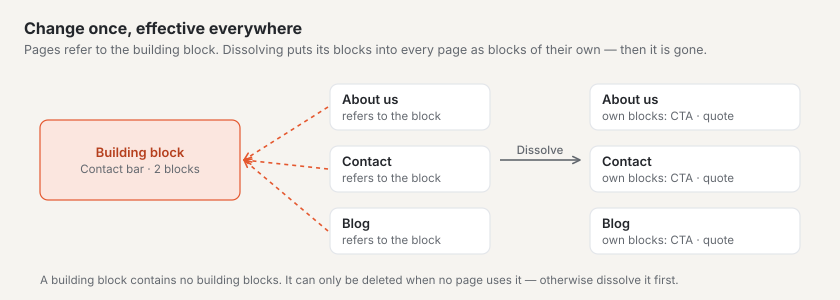
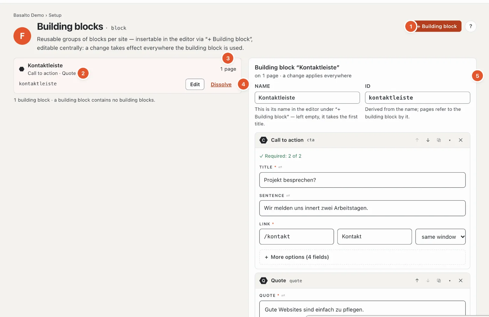

# Building blocks

The station **“What are pages made of?”** has two sides: the **blocks** — text, image, call to action, cards and so on — come with the theme; what exists is shown in the editor’s block palette (see [Editing content with blocks](../redaktion/bloecke.md)). **Building blocks**, on the other hand, are created by you: a group of blocks that appears identically on several pages — a contact bar, a call to action, a note on opening hours.

The difference:

| | Block | Building block | Lava part |
| --- | --- | --- | --- |
| What | a piece of a page’s content | a group of blocks with fixed content | a piece of the theme with settings (menu, search, form) |
| From | theme | you, here | core and modules, set up under [Structure](aufbau.md#parts-tab) |
| Change | on each page separately | once — applies everywhere | in its settings |

## Where

“Setup” mode › “What are pages made of?” › **“Manage building blocks”**. “View blocks in code” shows the blocks’ code in the theme editor.

1. **“+ Building block”** creates a new one.
2. **The list** — per building block the name, the blocks in it (here “Call to action · Quote”), identifier and “Edit”.
3. **Where it is used** — on how many pages the building block is placed; in the open building block under “Used on” with links to the pages.
4. **“Dissolve”** — see below.
5. **The open building block** — “on 1 page · change applies everywhere”.

## Creating and changing a building block

1. **“+ Building block”**, then **name** (for example “Contact bar”). The **identifier** is derived from it; it can be adjusted (lowercase letters, digits, hyphen). If you leave the name empty, it takes the first title you write in the first block.
2. Add blocks — with the block palette as in a page’s editor, with the same fields, ↑ ↓, duplicate and remove. The form shows the essentials first, help at each field and fine-tuning under “More options” ([The fields of a block](../redaktion/bloecke.md#the-fields-of-a-block)).
3. At the bottom right, the **“Live preview”** window shows the building block with your site’s theme, redrawn with every input — the field you are typing in lights up, and a click in the preview jumps to the field ([Live preview](../redaktion/bloecke.md#live-preview-in-a-window)).
4. **“Create”**. The building block appears in every page’s editor under **“+ Building block”**. After that, changes save themselves; the identifier only changes with Enter or when you leave the field — pages refer to it.

**Caution:** a building block has no versions. After saving (a short pause after typing), a change applies **immediately on all pages** that use it — without submitting and approval. The change is recorded in the log.

A building block contains no building blocks — its palette lacks the “Reusable” group for building blocks.

## Inserting a building block

In a page’s editor: **“+ Insert block”** › group “Reusable” › **“+ Building block”** and choose the building block (“Insert building block”). The page then contains a **reference** with the note “Reference — changes to the building block apply on all pages that use it”; the content cannot be changed there.

If one page should show the content differently, dissolve the reference **on that page**: its blocks become copies that you can change freely there. The building block itself and the other pages stay as they are.

## Dissolving or deleting

- **“Dissolve”** — on all pages that use the building block, its blocks become **the page’s own blocks**; nothing is lost. After that the building block is gone. Basalto asks first: “Dissolve …?” and names the pages.
- **“Delete”** — only possible if the building block is on no page. Otherwise dissolve it first or take it out of the pages.

Roles with the area “Types and building blocks” may change them; otherwise the top reads “Your role allows you to view building blocks, not to change them”. Everyone who may edit pages can insert them.

## Frequently asked questions

**I changed a building block — why is it already live?**
Building blocks have no versions; a change applies everywhere at once.

**Can a building block look different on one page?**
Not as a building block — it is the same everywhere. Dissolve it in that page’s editor (then they are the page’s own blocks), or create a second building block.

## Next

- [Content types](inhaltstypen.md)
- [Editing content with blocks](../redaktion/bloecke.md)
