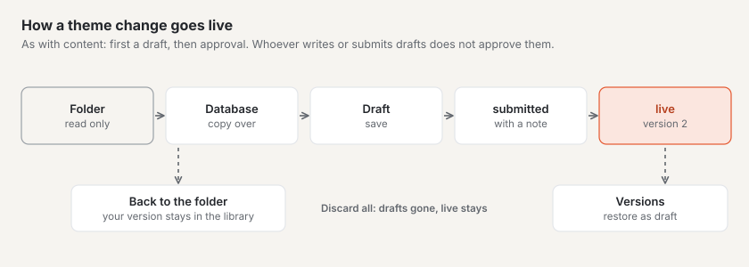
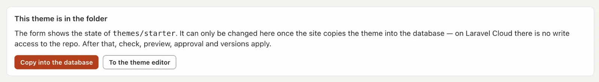
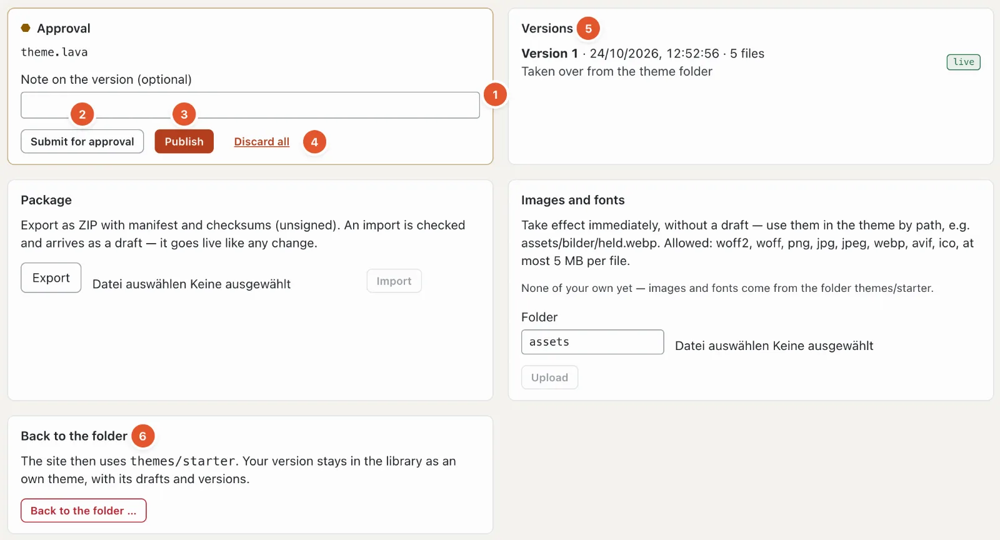

# Drafts and approval in setup

Changes to layouts, parts, templates, image variants and the theme’s code do not go live at once. They are made as a **draft**, checked, and only become the theme’s new **version** with **“Publish”** — like content in “Content” mode.

Exceptions that apply at once: the values in [Design](aussehen.md#design) (colours, fonts, logo), the [site’s](site.md) settings, [menus](menues.md), [building blocks](bausteine.md) and the theme’s images and fonts.

## Theme in the folder or in the database

A bundled theme lies in the installation’s `themes/` folder. Basalto never changes this folder — on hosted installations there is no write access to it either. That is why layouts, image variants and the theme editor initially say “This theme is in the folder” and can only be viewed.

**“Take into database”** creates this site’s own version of the theme in the database (version 1, “Taken over from the theme folder”). From then on checking, preview, drafts, approval and versions apply. The check report then says “Database” instead of “Files”.

## Drafts

Every change — in the layouts, the image variants or the theme editor — saves itself to a draft after a short pause. Basalto checks the whole theme: if it has an error, **nothing is saved** (“a theme with an error never goes live”), and the code shows the spot.

What the drafts do is shown by the **preview with drafts** — in the layouts and the theme editor, for a path of your choice. **“Review the whole site with the drafts”** switches the preview to the whole website for your session; visitors keep seeing the live version.

## Approval

At the bottom of the theme editor (“Setup” mode › “Code”) is the **Approval** card:

At the top it names the files with drafts (here `theme.lava`).

1. **Note on the version** — optional, for example “wider thumb image variant”. It later appears in the list of versions.
2. **“Submit”** — the drafts go to review.
3. **“Publish”** — the drafts become the new version and go live. If image variants change, Basalto cuts all of the site’s images again in the background.
4. **“Discard all”** — all drafts gone; the live version stays.
5. **Versions** — every published version with time, number of files and note; “live” marks the current one. **“Restore as draft”** turns an old version into a draft again — that is how you undo a change.
6. **“Back to the folder …”** — the site uses the bundled theme from the folder again. Your version stays, with drafts and versions, as an own theme in the [library](aussehen.md#themes).

If the site requires the **four-eyes principle** (“Administration › Settings”, group “Approval”, “Four-eyes principle” — off by default), drafts must be submitted first, and whoever wrote or submitted them does not approve them. Without this setting you may publish directly.

Next to it are the cards **Package** (export the theme as a ZIP or import a package — an import arrives as a draft) and **Images and fonts** (upload the theme’s files; they apply at once, without a draft).

## Frequently asked questions

**I saved, but the website does not show the change.**
You saved a draft. Publish it in the “Approval” card of the theme editor — or have it approved if the four-eyes principle applies.

**“Nothing saved” — what now?**
The theme would have an error with your change. The finding names the spot; correct it and save again.

## Next

- [Going live](live-gehen.md)
- [Setup: designing and building the site](README.md)
