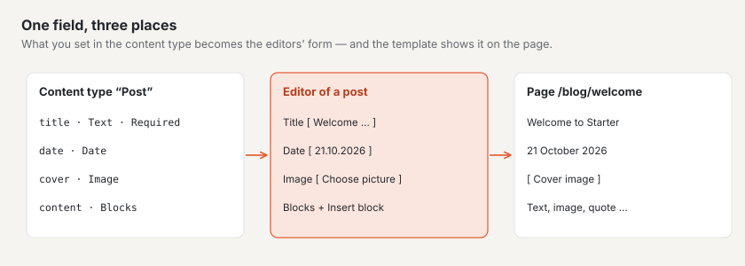
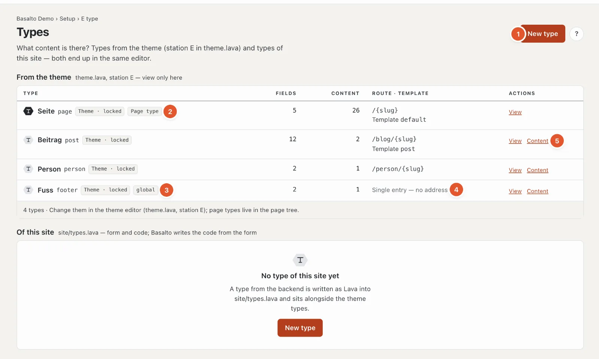
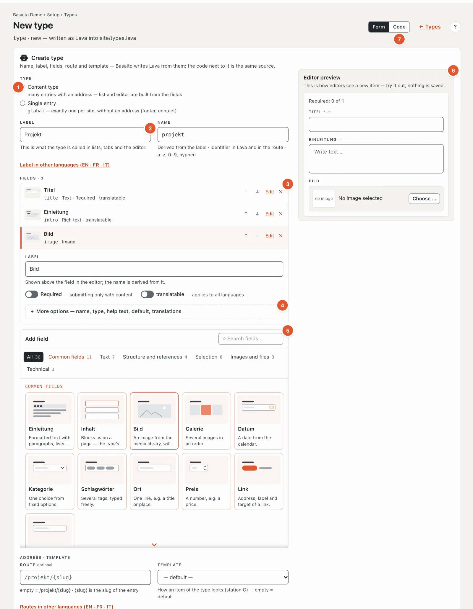
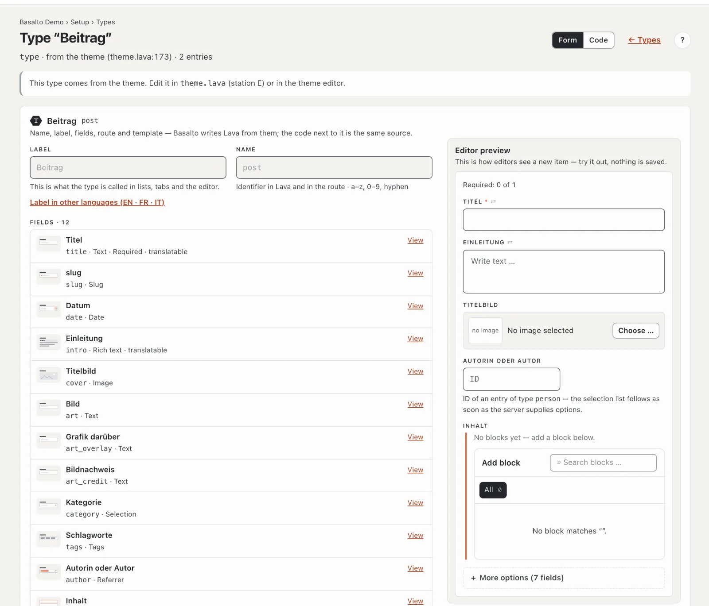

# Content types

The station **“What can be maintained?”** determines which kinds of content the site knows — pages, posts, people, events — and which **fields** each kind has. The fields become the form that editors fill in in the editor.

## Where

“Setup” mode › “What can be maintained?” › **“Open content types”**.

The page has two lists:

- **From the theme** — the types the theme brings. View only here; they are changed in the theme editor (station E).
- **This site** — types you create in the backend. Basalto writes them as Lava to `site/types.lava`; they stand on an equal footing next to the theme’s types.

Per type: name and identifier, labels such as “Theme · locked”, the number of fields and items, address (route) and template, and the operations.

1. **“New type”** creates a type for this site.
2. **Page type** — the type “Page” lives in the [page tree](../redaktion/seiten.md); its content has its place there.
3. **global** — a **single item**: exactly one per site, without an address, for example the footer.
4. Instead of a route, single items say “Single item — no address”.
5. **“Content”** opens the list of all items of this type (for single items, the one item); **“View”** or **“Edit”** the type.

If the theme no longer knows a type that still has content, it appears with “no longer defined — the content stays”. If the theme does not compile, the page shows the findings at the top.

## Creating a type

1. **Kind**:
   - **Content type** — many items with an address; list and editor are built from the fields (for example posts, projects).
   - **Single item** — exactly one per site, without address and template; the theme reads it through a “global” part (for example footer, contact details).
2. **Label** — what the type is called in lists, tabs and the editor, for example “Project”. The **Name** is derived from it (“projekt”): the identifier in Lava and in the address, made of lowercase letters, digits and hyphens; once you change it, it stays as you write it. Labels in other languages are behind “Label in other languages”.
3. **Fields** — one row per field with a drawing, label, name and type. A content type needs the field **title**; it carries the title in lists and in the editor and is already there. ↑ and ↓ change the order, ✕ removes a field, **“Edit”** opens its settings — essentials first: **Label** (the field’s name follows it until you change the name yourself), **Required**, **translatable** and what the field type needs (options of a selection, allowed blocks, target type of a reference).
4. **More options** of a field — name, field type, **help text** (shown below the field in the editor), **default** and the label in other languages. If there is an error in there, the area is already open.
5. **Add field** — a palette as for blocks: a drawing and a sentence per field type, by group, with search. The **common fields** come with a label per language and a name: Introduction, Content (blocks — all theme blocks allowed), Image, Gallery, Date, Category, Tags, Location, Price, Link, Client.
6. **Editor preview** — on the right you see what editors fill in for a new item of this type, redrawn with every change; you can try it out, nothing is saved.
7. **Form · Code** — top right switches to the code view. Form and code are two views of the same source; the code appears after saving.

Below, **Address and template**: the **route** of the items, for example `/projects/{slug}` — `{slug}` is the item’s slug, if empty `/‹name›/{slug}` applies — and the **template** from station G (if empty, “default”). Routes in other languages are behind “Routes in other languages”; if a label is entered there, Basalto suggests the route from it (“From the label: use /projects/{slug}”).

**“Save”** creates the type; after that changes save themselves, names when you leave the field. **“Save and close”** returns to the list.

### Field types

| Field type | For |
| --- | --- |
| Text · Multi-line text | short or longer texts without formatting |
| Rich text · Markdown | formatted text |
| Blocks | the block editor; **Allowed blocks** determines which blocks may be inserted — without a selection the editor has no content area |
| Number · Yes/No · Date · Date and time | values |
| Selection | one choice from **options** (separated by commas) |
| Tags | freely assigned keywords, for example for the blog |
| Image · Gallery · File | from the media library |
| Link · URL · Email | addresses |
| Reference | to another item; **target type** says to which type (for example a post to its author of type “Person”) |
| Repeater | a group of fields that can be added several times |
| Slug · SEO · Colour · Code · JSON | special cases |

**Translatable** means: the field has its own value per language and appears when translating. Otherwise it applies to all languages (“shared”, see [Translating](../redaktion/uebersetzen.md)).

## Viewing a type from the theme

Types from the theme show the same form, locked, with the note “This type comes from the theme”. This shows which fields editors fill in — here for example title, date, introduction, cover image, category (selection), tags, author (reference to “Person”) and blocks with the allowed blocks.

## Deleting a type

At the bottom of the type: **“Delete”**, then “Yes, delete”. The content of this type stays in the database; without a type it no longer appears until a type with the same name knows it again.

## Frequently asked questions

**Where do I maintain a single item, for example the footer?**
In “Content” mode › **Content**: it has its own tab there with its label (“Footer”). Because it exists exactly once, “New item” is missing there.

**I don’t see my new type in “Content”.**
Save the type and reload the “Content” list. Page types are in the page tree, not there.

**Can I change a type from the theme?**
Not here. Change it in the theme editor — or create your own type for this site.

## Next

- [Building blocks](bausteine.md)
- [Pages and page tree](../redaktion/seiten.md)
